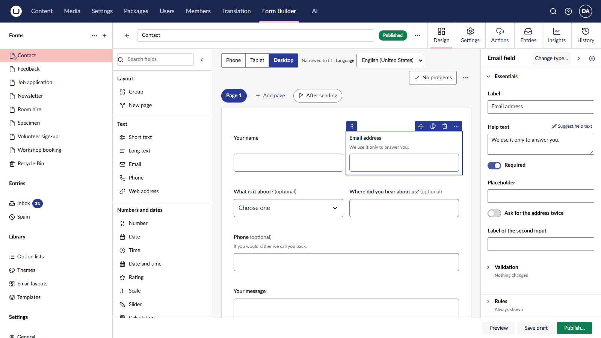
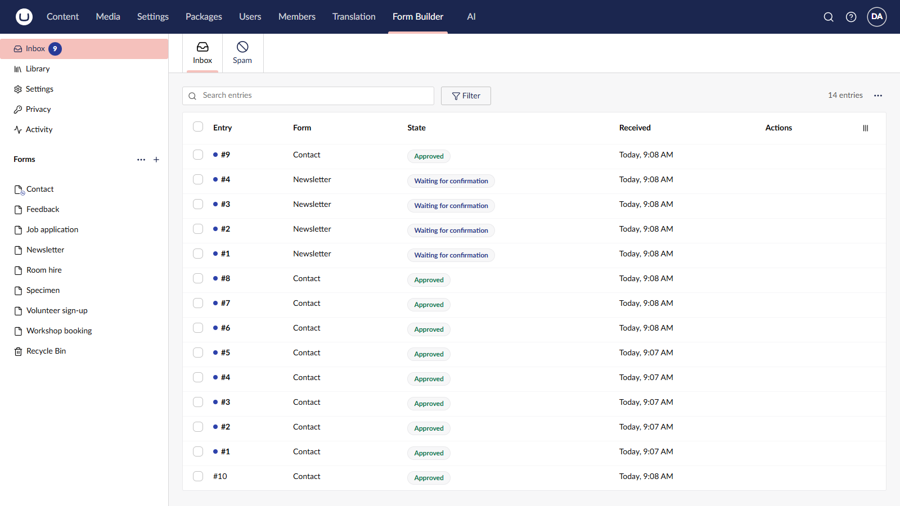
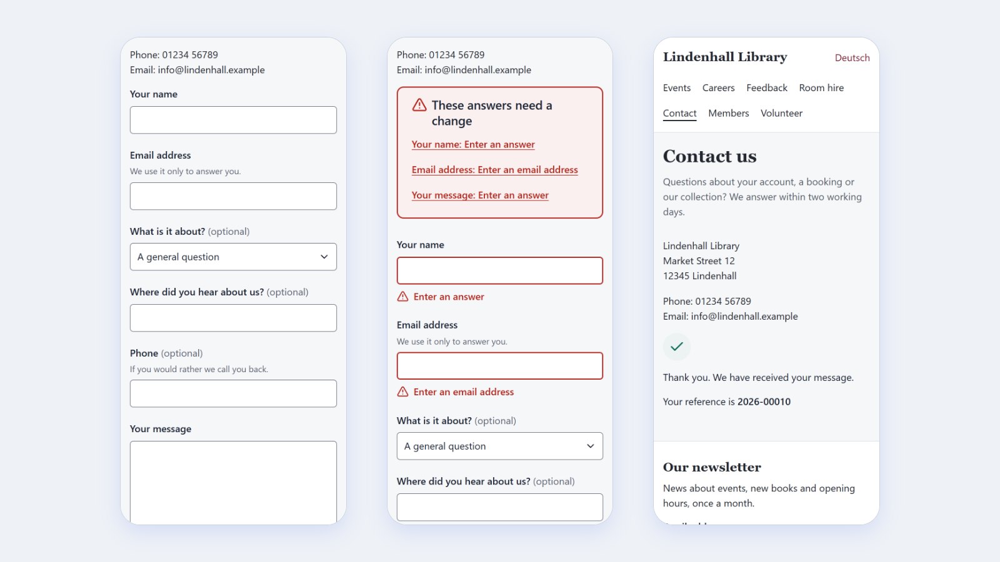

<p align="center">
  
</p>

<h1 align="center">Jiron Form Builder</h1>

<p align="center">
  Forms for Umbraco 17: designed in the backoffice, filled in on any page, and kept in one calm place afterwards.
</p>

Editors build forms in a **Form Builder** section of the backoffice, with pages, rules and actions. Visitors fill them
in on the website, in Razor or headless. The site's team reviews the entries, approves and exports them, and keeps
personal data in check with the privacy tools.

> **Status:** beta. The packages are on [NuGet](https://www.nuget.org/packages/Jiron.Umbraco.FormBuilder) as
> prereleases.

New here? [Getting started](docs/getting-started.md) takes about ten minutes.



## Features

**For editors**

- **A calm drag-and-drop designer:** pages, groups of up to four columns, a field picker with search, a full keyboard
  alternative, undo and redo, and a live preview at phone, tablet and desktop widths.
- **33 field types,** from text, email and dates to grids, rankings, signatures, addresses, calculations, repeatable
  groups and file uploads.
- **Rules** that show, hide, skip and require, choose the outcome and decide which actions run. The server always
  checks the answers; the browser repeats each check at once.
- **Multi-page forms** with progress, a check per page, a summary page, save and continue later, and prefilled
  answers.
- **Drafts, publishing and history:** edits stay a draft until published, a form check finds problems before visitors
  do, and every version is kept, compared in words and can be restored.
- **Nine templates** to start from, folders, search, and forms as JSON to import and export.
- **A library** of shared option lists, saved groups, themes edited visually with contrast checks, and email layouts.
- **The backoffice in English and German,** in Umbraco's own look.

**After a form is sent**

- **Actions:** emails to the team and to the visitor, signed and retried webhooks, Slack and Microsoft Teams, Umbraco
  content and a change of the entry's state, each with its own rule, a delivery log and a test run. Email verification
  is a setting of the form.
- **Entries:** an Inbox across forms with Spam, filters, search, bulk actions, and an entry panel with its timeline,
  notes, approval and audited edits.
- **Exports** to CSV, Excel, JSON, a printable view and a ZIP of the uploaded files.
- **Insights and answer summaries,** without cookies or personal data.

**For visitors**

- **Accessible, fast forms** (WCAG 2.2 AA) that work without JavaScript and get better with it, with their texts in
  seven languages and a layout that turns for right-to-left languages.
- **Spam protection without third parties:** a honeypot, a minimum fill time, a signed challenge, content checks and an
  optional proof of work. reCAPTCHA or hCaptcha only when an editor chooses one.

**For site owners**

- **Privacy built in:** retention with a preview, sensitive fields, no IP addresses by default, finding, exporting and
  erasing one person's data, legal holds, recorded consent wording and an audit log.
- **Permissions** per user group, with folders and forms that can be limited further.
- **Languages, members and several sites:** texts per language, forms for members, and a sender, base URL and defaults
  per site.
- **Built for real hosting:** SQLite or SQL Server, load-balanced servers, private or blob storage for files, forms as
  files for source control, and health checks on Umbraco's dashboard.

**For developers**

- **A form anywhere:** a form picker and a ready-made block, a tag helper or view component, overridable views, CSS
  custom properties and three themes (Default, Bootstrap 5 and Unstyled).
- **Headless:** the form as JSON, a submission API, the picker in the Content Delivery API, TypeScript types, a JSON
  schema and a `<jfb-form>` web component.
- **Extensible:** your own field types, actions, option sources, export formats, captcha providers, spam checks, merge
  tag sources, file scanners and file stores, with compiled samples.
- **An optional AI add-on** on Umbraco.AI that drafts and translates forms for editors. Visitors' answers never reach
  an AI.

## Screenshots





More in [docs/screenshots](docs/screenshots/), and on the documentation's pages.

## Getting started

You need Umbraco 17.6 or later (within 17) on .NET 10, with SQLite or SQL Server. In the site's project folder:

```
dotnet add package Jiron.Umbraco.FormBuilder --prerelease
```

Start the site and choose **Form Builder** in the backoffice's top bar: its setup checklist leads you to a first form.
Publish it, then show it on a page with one line in a template:

```cshtml
@await Component.InvokeAsync("FormBuilderForm", new { form = "contact" })
```

[Getting started](docs/getting-started.md) goes from installing to the first entry in about ten minutes, and
[the documentation](docs/README.md) covers the rest, for editors, site owners and developers.

## Licence

Jiron Form Builder is **free to use and change, including commercially; no selling, no published versions of your own
(free or paid, open source or not), no competing products; source-available.**

That means you may use it on your own sites and on the sites you build or host for clients, and change it for your own
projects. You may not sell it, or publish your own version of it or any product or service that competes with it.
The [licence FAQ](docs/license-faq.md) answers the usual questions in plain words. It is not legal advice: the
[PolyForm Perimeter License 1.0.1](LICENSE.md) governs.

## Contributing

Bug reports and ideas are welcome as issues ([SUPPORT.md](SUPPORT.md)), and security problems are reported privately
([SECURITY.md](SECURITY.md)). Pull requests are welcome too, with no agreement to sign:
[CONTRIBUTING.md](CONTRIBUTING.md) says how work is done here, and the [code of conduct](CODE_OF_CONDUCT.md) applies
to everyone.

The components the package ships with are listed with their licences in
[THIRD-PARTY-NOTICES.md](THIRD-PARTY-NOTICES.md).

## Credits

Made by [Manassés Zähnler](https://jiron.dev) · [Ligata](https://ligata.ch)

Umbraco is a trademark of Umbraco A/S. Jiron Form Builder is an independent community project and is not affiliated
with or endorsed by Umbraco A/S.
