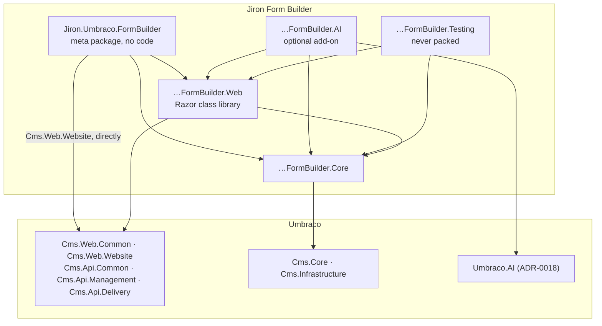
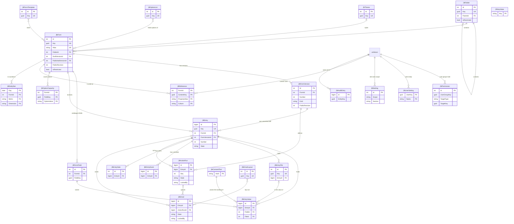
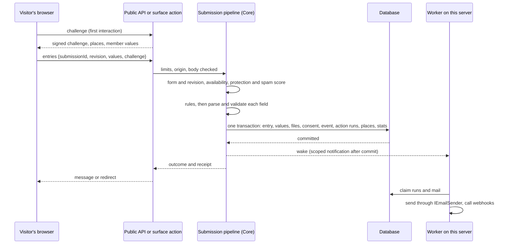

# Architecture

The contract for every phase after Phase 1: what Jiron Form Builder is made of, how the parts depend on each other,
what they store and expose, where it can be extended, what can go wrong and how it is prevented, and what it must
achieve. The decisions themselves are in the ADRs under [`decisions/`](decisions/); this document puts them together
and links to them instead of repeating them. [ROADMAP §4](../ROADMAP.md#4-target-design) is the target design they
refine.

When this document and an ADR disagree, the ADR decides and this document is fixed in the same commit.

## Contents

1. [Modules](#1-modules)
2. [The definition model](#2-the-definition-model)
3. [The data model](#3-the-data-model)
4. [How a submission flows](#4-how-a-submission-flows)
5. [The public API](#5-the-public-api)
6. [The management API](#6-the-management-api)
7. [Settings](#7-settings)
8. [Extension points](#8-extension-points)
9. [Background work](#9-background-work)
10. [Threat model](#10-threat-model)
11. [Quality budgets](#11-quality-budgets)
12. [Glossary](#12-glossary)

## 1. Modules

Four packages, one Testing project that is never packed, the samples, the tests and the demo
([ADR-0001](decisions/0001-solution-structure-and-packages.md)).



All Umbraco references are `[17.5.0, 18.0.0)`; references between our packages are exact versions
([ADR-0010](decisions/0010-versioning-branching-and-upgrade-policy.md)).

**Core** holds every rule of the product and knows nothing about HTTP; an architecture test keeps ASP.NET Core's HTTP,
MVC, routing and Razor assemblies and Umbraco's web and API packages out of it, and another fails when it constructs a
database connection of its own. Its areas:

| Area | Holds | Decided in |
| --- | --- | --- |
| Definitions | the model, its JSON, upgraders, structural validation, the public projection, versions, the field catalogue | ADR-0002 |
| Fields and options | the field type registry, the built-in types, option sources and lists, places on options | ADR-0002, §4.3.2 |
| Logic | rules, validation, the pattern matcher, merge tags, calculations, text cleaning and folding | ADR-0005, ADR-0014 |
| Entries | the submission pipeline, states, values, files, events, notes, the entries query builder | ADR-0003, §4.4 |
| Actions and email | action types, action runs, the email outbox, the worker | ADR-0007 |
| Protection | the spam score, content rules, captcha provider contract, mail caps | ADR-0012 |
| Files | the file store contract and the physical store, scanning | ADR-0006 |
| Privacy | retention, holds, data subject tools, masking, IP handling | ADR-0009 |
| Permissions | grants, restrictions, evaluation | ADR-0013 |
| Settings | sections, host options, locks, the cache | ADR-0008 |
| Persistence | NPoco DTOs, repositories, the migration plan, the database gate | ADR-0003, ADR-0007, D7 |
| Platform | jobs, notifications, the audit log, daily statistics, the HTML and CSS sanitiser | ADR-0007, §4.10 |

**Web** hosts the HTTP surfaces and rendering:

| Area | Holds | Decided in |
| --- | --- | --- |
| Public API | `/jfb/api/v1`, CORS, body and time limits, the rate-limit middleware, the no-form middleware | ADR-0012, ADR-0006 |
| Management API | `/umbraco/jfb/management/api/v1`, authorization policies, the OpenAPI document `jfb` | ADR-0013, §4.7 |
| Rendering | the view component, `<jfb-render>`, `<jfb-assets>`, the surface controller, output cache rules, asset serving | ADR-0004, ADR-0015 |
| Themes | the built-in themes, their views and stylesheets | ADR-0015 |
| Content integration | the form picker property editor, value converters, the Delivery API converter, "used on" | ADR-0017 |
| Operations | health checks, Umbraco webhook events | §3.4 |

**The client packages** (`src/Jiron.Umbraco.FormBuilder.Web/Client`, an npm workspace):

- `logic`: rules, validation, merge tags and calculations in TypeScript; no DOM and no dependencies; run against the
  shared vectors ([ADR-0005](decisions/0005-shared-logic-and-test-vectors.md));
- `runtime`: enhances Razor-rendered forms through the markup contract;
- `element`: `<jfb-form>`, the headless renderer, with the same markup and runtime;
- `backoffice`: the Forms section in Lit and TypeScript with UUI, through the generated client.

## 2. The definition model

A form definition is one JSON document per version; [ADR-0002](decisions/0002-form-definition-model-versions-and-public-projection.md)
has every property, its default and each built-in type's settings, and `schemas/jfb-form.v1.schema.json` (4.2) is its
machine-readable form. The outline:

```text
FormDefinition
├─ schemaVersion            1
├─ key                      the form's key (name, alias and folder live on the form row)
├─ settings
│  ├─ submission            labels, summary page, progress, storage, approval, verification, resume, entry title and reference
│  ├─ availability          opening and closing, entry limit, closed message, members, one per member
│  ├─ protection            level, captcha provider, content-rule strictness          (ADR-0012)
│  ├─ privacy               retention per state, IP handling, insights                (ADR-0009)
│  ├─ appearance            theme, required marker, validation summary, layout, class (ADR-0015)
│  └─ developer             headless access, allowed query values, stored context values
├─ pages[]                  key, title, description, rules
│  └─ groups[]              key, title, description, columns 1–4, style, rules
│     └─ fields[]           key, type, alias, label, help, placeholder, required, messages, default value,
│                           prefill, sensitive, include in emails, keep, autocomplete, class, validation checks,
│                           rules, options (choice types), rows (grid), fields (repeater), settings (the type's)
├─ validationRules[]        key, enabled, target field, message, match, conditions
├─ actions[]                key, type, name, enabled, trigger, stop on failure, rules, settings (the type's)
└─ outcomes[]               key, kind, message, show answers, redirect, rules

Rule        key, effect (show | hide | require | run | use), enabled, match (all | any), conditions[]
Condition   { field, op, value } | { context, op, value } | { match, conditions[] }
Text        LocalizedText: culture → text, "" is the default; "#key" reads the dictionary
```

- **Versions:** every save appends a version row; publishing appends a published one, updates the field catalogue and
  raises the public revision when the projection changed. Drafts keep what publishing refuses; the form check lists it.
- **The public projection** is built from an allowlist and carries no actions, outcomes, recipients, option-source
  configuration or privacy settings. Its TypeScript types and schema ship in `schemas/` (6.6).
- **Upgrades:** stored versions are never rewritten; upgraders run when they are read; v1 is fixed at the first
  prerelease.

## 3. The data model

Twenty-four tables with the prefix `jfb`, all times in UTC, created by the migration plan `Jiron.Umbraco.FormBuilder`
([§4.5](../ROADMAP.md#45-database-schema-v1-table-prefix-jfb-all-times-utc-guid-keys-for-anything-exposed) has the
columns, [ADR-0003](decisions/0003-entry-storage.md) the entry storage). The diagram shows keys and links only;
Umbraco's own tables (users, user groups, members, content) appear as one entity, `umbraco`.



Links to option lists, layouts and templates are by key, and to themes by alias, inside definitions and settings, not
foreign keys. The rules every table follows (no NULL in keys, times on each database, atomic counters, the entry query
shapes) are in §4.5 and [ADR-0003](decisions/0003-entry-storage.md); `docs/database.md` (4.1) gets the full diagram
with every column, kept in sync with the DTOs by a test.

## 4. How a submission flows



- The pipeline is the one of §4.4, the same for JavaScript posts, no-JS posts (ADR-0004) and the API; the
  idempotency of the `submissionId` comes before the single use of the challenge (ADR-0012).
- Suspicious submissions take the same path into `Spam`, with no action runs (ADR-0012).
- After the commit the worker sends within milliseconds; the distributed job only wakes it (ADR-0007).

## 5. The public API

`/jfb/api/v1` (the base path is `JironFormBuilder:PublicApi:BasePath`), anonymous, JSON, ProblemDetails with stable
codes, `no-store` except the definition, the OpenAPI document `jfb-public`
([ADR-0012](decisions/0012-anonymous-endpoints-spam-protection-and-challenges.md)).

| Route | Purpose | Rate-limit policy | Needs |
| --- | --- | --- | --- |
| `GET forms/{keyOrAlias}` | the public projection, when the form allows headless access; `ETag` from the response | `read` | – |
| `GET forms/{key}/render` | the published form as HTML for `form_changed` (ADR-0004) | `read` | a local `page` path |
| `POST forms/{key}/challenge` | a signed challenge, places left, member values | `challenge` | – |
| `POST forms/{key}/uploads` | one file before submitting (ADR-0006) | `upload` | the challenge as the first part |
| `POST forms/{key}/validate` | one page's server validation, without `uniquePerForm` | `submit` | the challenge |
| `POST forms/{key}/entries` | submit | `submit` | the challenge, or a server key |
| `POST forms/{key}/receipt` | the receipt and outcome of an uncertain submission | `submit` | its challenge or server key |
| `POST forms/{key}/drafts` | save and resume: the link is emailed, never returned | `submit` | the challenge |
| `POST drafts/resume` | values and page for a resume token from the URL fragment | `submit` | the token |
| `GET verify` | the page with the confirm button for double opt-in | `verify` | the verification token |
| `POST verify` | confirms the address once | `verify` | the verification token |
| `GET forms/{key}/options/{fieldKey}` | options for cascading and list-backed fields | `read` | – |
| `POST forms/{key}/events` | the insights beacon, no identifiers | `events` | – |

- **Origins:** the same origin always; others only from `AllowedOrigins`; the preview's opaque origin only with a
  preview ticket.
- **Members-only forms** bind the challenge to the signed-in member (`member_required` without one), with no cookie.
- **Error codes:** `form_not_found`, `form_closed`, `form_changed`, `validation_failed`, `invalid_request`,
  `challenge_required`, `captcha_failed`, `rate_limited`, `payload_too_large`, `unsupported_media_type`,
  `member_required`, `duplicate_submission`, `entry_limit_reached`, `already_submitted`, `origin_denied`, `timeout`,
  `not_found`, `server_error` (§4.6).
- **The no-JS path** posts to the page through Umbraco's surface routing, not to this API (ADR-0004).

## 6. The management API

`/umbraco/jfb/management/api/v1`, behind the backoffice's token and the Forms section, with one authorization policy
per permission ([ADR-0013](decisions/0013-permissions.md)), the OpenAPI document `jfb` and a generated TypeScript
client committed from its snapshot. Areas (§4.7) and the permission each needs:

| Area | Permission |
| --- | --- |
| Forms and folders: tree, search, create, save draft, publish, unpublish, duplicate, move, trash, restore, delete, references | `design` on the form or folder |
| Versions: list, get, diff, restore, pin, comment | `design` |
| Designer support: registries, the form check, preview render, preview tickets | `design` |
| Actions: edit, test against a sample entry | `manageActions` |
| Entries: list, get, mark seen, notes, timeline, files, counts, the inbox and Spam | `viewEntries` |
| Entries: change state, edit, forward | `editEntries` |
| Entries: delete, empty Spam | `deleteEntries` |
| Exports | `export` |
| Sensitive values unmasked | `viewSensitive` |
| Deliveries: retry action runs and mail | `manageActions` |
| Library: option lists, themes, email layouts, templates | `manageLibrary` |
| Settings, the audit log, the deliveries log | `manageSettings` |
| Permissions | `managePermissions` |
| Privacy: find, export, erase, retention dry run | `privacyTools` |
| Insights and answer summaries | `viewEntries` |
| Setup and health, user settings | any user of the section |
| The form picker in content | any user who may edit content; names and keys only |

What a user may not see answers `404`; what they may see but not do answers `403` with the permission's name. The
permission matrix checks every endpoint: `403` for a missing permission, `404` on routes for a form, folder or entry
the user holds nothing on, and `403` without the Forms section for what any user of the section may call; only the
form picker is exempt, because content access authorises it (4.7, ADR-0011, ADR-0013). The management API is part of
the backoffice, not of the public surface (ADR-0010).

## 7. Settings

Two layers ([ADR-0008](decisions/0008-settings-model.md)):

- **Host configuration** (`JironFormBuilder` in `appsettings.json`): base paths, origins, server keys, file roots and
  caps, privacy permissions, captcha keys, webhook hosts, the pause switch, secrets, the mirror, limits, designer locks,
  host grants and locked sections. Validated at start-up with messages that name the key; an IntelliSense schema ships
  with the package.
- **Backoffice sections** in `jfbSetting`: `general` and `email` (both per site, field by field), `protection`,
  `files`, `privacy` and `integrations` (global); Access is stored in `jfbPermission`.

Effective value = code default, then the global row, then the site row, then the host rules (switch off only, clamp,
lock). A form's `inherit` takes the effective site value. The site of a request is the root of its content, else the
root whose domain matches its host, else global. Changes reach every server through a cache refresher.

## 8. Extension points

All registered through `builder.JironFormBuilder()`, documented in `docs/extending.md` (15.1), with samples (15.2).
Registries are collections, so a site can add, replace or remove entries.

| Extension | For | Decided in |
| --- | --- | --- |
| `IFormBuilderFieldType` (`FormBuilderFieldTypeBase<TSettings>`) | a field with settings, parsing, validation, storage kind, view and client behaviour | §4.3.2, ADR-0002 |
| `IFormBuilderActionType` (`FormBuilderActionTypeBase<TSettings>`) | an action with settings, a test run and retries | ADR-0007 |
| `IFormBuilderOptionSource` | options from code, with parent filtering | ADR-0002 |
| `IFormBuilderExportFormat` | an export | §4.9 |
| `IFormBuilderCaptchaProvider` | a captcha | ADR-0012 |
| `IFormBuilderSpamCheck` | a spam signal with a score and a reason | ADR-0012 |
| `IFormBuilderMergeTagSource`, `IFormBuilderMergeTagFilter` | merge-tag sources and filters | ADR-0014 |
| `IFormBuilderFileScanner` | scanning and quarantine | ADR-0006 |
| `IFormBuilderFileStore` | other file storage, asynchronous | ADR-0006 |
| `IFormBuilderTheme` | a theme: stylesheet, class map, tokens, view folder | ADR-0015 |
| `IFormBuilderCspNonceProvider` | the request's CSP nonce | ADR-0004 |
| `[FormBuilderSetting]` and the `jfbSettingEditor` manifest | settings editors for custom types without JavaScript, or with a custom element | §4.9 |
| `jfbFieldPreview` manifest and workspace views | the designer preview of a custom field, extra form views | 15.1 |

**Notifications:** `FormSaving`/`Saved`, `FormPublishing`/`Published`, `FormTrashing`/`Deleted`; `EntrySubmitting`
(cancelable, can add field errors), `EntrySubmitted`, `EntryStateChanged`, `EntryDeleting`;
`ActionRunning`/`ActionRunCompleted`/`ActionRunFailed`; `ExportCompleted`; `SettingsSaved`. Umbraco's webhook system
receives entry events too.

**Services:** `IFormBuilderFormService`, `IFormBuilderEntryService`, `IFormBuilderEntryReader`,
`IFormBuilderRenderer`, `IFormBuilderMergeTagService`.

**The website:** the tag helpers and view component, the theme views and the markup contract (ADR-0015),
`window.JironFormBuilder` (`init`, `get`, `consent`), the DOM events `jfb:ready`, `jfb:page`, `jfb:invalid`,
`jfb:submitting`, `jfb:submitted`, `jfb:error`, and the `--jfb-*` custom properties.

**Headless:** the projection's TypeScript types and JSON schema, and `<jfb-form api form culture>`.

## 9. Background work

([ADR-0007](decisions/0007-background-work-outbox-and-email.md))

- **One worker per server** claims due action runs and mail by token, woken after each commit and by the outbox job;
  passes never overlap on a server, and servers share the work through their claims.
- **Distributed jobs**, each returning within 10 seconds and working in bounded batches, a minute apart or more:
  `Jiron.FormBuilder.Outbox` (wakes the worker), retention (ADR-0009), statistics roll-ups, abandoned uploads, draft
  version cleanup (ADR-0002) and the file mirror (D25).
- **Mail** goes through `IEmailSender` with the email type `JironFormBuilder`, gated by `CanSendRequiredEmail()`, one
  body per mail, capped for addresses visitors typed (ADR-0012).
- **The pause switch** `JironFormBuilder:Actions:Paused` stops all claims and loses nothing.

## 10. Threat model

**Assets:** entries, their files and the copies around them (personal data); form definitions; settings and secret
references; backoffice sessions; the site's mail reputation; the server's time and memory; the audit trail.

**Trust boundaries:** the visitor's browser and the public API or no-JS post; a headless server and the public API;
a backoffice user and the management API; the preview frame and the backoffice; the server and outside services
(SMTP, webhooks, captcha providers, URL option lists); the server and its database and file store; one server and the
others in a cluster.

| STRIDE | Threat | Mitigation | Decided in | Tested in |
| --- | --- | --- | --- | --- |
| Spoofing | A bot posts as a visitor | signed challenge, honeypot, minimum fill time, rate limits, optional proof of work or captcha; suspicious entries go to Spam | ADR-0012 | 7.1, 7.2 |
| Spoofing | A forged server key or token (resume, verification, upload, preview) | keys stored as SHA-256 and compared in fixed time; Data Protection tokens bound to form and time; resume tokens stored as hashes | ADR-0012 | 6.6, 7.1, 8.5, 8.6 |
| Spoofing | A faked client address through `X-Forwarded-For` | the connection address only; forwarded headers only through ASP.NET Core with known proxies | ADR-0012 | 7.1 |
| Spoofing | Someone posts as a member | a challenge bound to the signed-in member, readable only from the same origin, on members-only forms | ADR-0004, ADR-0012 | 14.3 |
| Spoofing | A forged Host header steers links in mail | links only from the site's base URL | ADR-0008 | 8.2 |
| Tampering | Posted values for hidden fields, member-prefilled hidden fields or calculations | hidden fields stripped, hide-mode prefill ignored, calculations recomputed on the server | §4.3.3, ADR-0005 | 6.1, 6.5 |
| Tampering | A submission against an older definition | the compatibility rule: `form_changed` when an error falls on a field the visitor never saw, an answered field is gone, or a consent wording changed (by its posted hash) | ADR-0002 | 6.1, 6.4 |
| Tampering | Two editors overwrite each other | concurrency versions on forms and settings | ADR-0002, ADR-0008 | 4.3, 4.5 |
| Tampering | A disguised upload (renamed executable, polyglot, zip slip) | allowlist and blocklist, magic numbers, random names, safe ZIP paths | ADR-0006 | 7.3 |
| Tampering | Hostile theme CSS or rich text | the sanitiser and its CSS parser on every output | §4.10, ADR-0015 | 6.3, 12.2 |
| Repudiation | An editor denies a change, export, deletion or reveal | the audit log with user, entity and changed fields, never values | §4.10, ADR-0013 | 4.3, 12.4b |
| Repudiation | A visitor disputes a consent | the exact consent text's hash and culture with the entry | ADR-0009 | 6.1 |
| Repudiation | Nobody knows whether a mail went out | runs and mail with states, `Uncertain` and the deliveries log | ADR-0007 | 8.1, 8.2 |
| Information disclosure | The projection leaks recipients, secrets or option sources | an allowlisted projection and a property-style test | ADR-0002 | 4.2 |
| Information disclosure | XSS through names or values in the backoffice, Razor, mail or exports | escaping contexts, one confirm helper, the formula guard | ADR-0014, §4.10 | 5.3, 9.1, 11.4 |
| Information disclosure | Personal data in logs or job errors | no values, email or IP addresses, tokens or file names in logs; exception types only | §4.10, ADR-0009 | every step with captured logs |
| Information disclosure | Users see forms or entries they should not | permissions, restricted folders and forms, `404` for what they cannot see, database-side filters | ADR-0013 | 4.6, 4.7 |
| Information disclosure | Sensitive values shown to the wrong people | masking and `viewSensitive`, audited reveals | ADR-0009, ADR-0013 | 13.3 |
| Information disclosure | Cached pages hand one visitor's data to another | markup holds nothing per visitor; per-visitor renders are `no-store` | ADR-0004 | 6.2 |
| Information disclosure | Probing submissions or registrations | `404` for every receipt miss; `validate` skips `uniquePerForm` | ADR-0012 | 6.1 |
| Information disclosure | The preview frame reaches the backoffice session | a sandbox without `allow-same-origin`, preview tickets | §4.10, ADR-0012 | 10.3 |
| Information disclosure | SSRF through webhooks or URL option lists | host allowlist from configuration, private addresses blocked after DNS, no redirects, test transport only in tests | §4.10 | 5.5, 8.4 |
| Information disclosure | A third-party captcha sees visitors without consent | consent modes, nothing loaded before consent, no visitor address in verification | §4.10, ADR-0012 | 7.2 |
| Denial of service | Request floods and floods of addresses | limiters per address, form and site, bounded partitions failing closed | ADR-0012 | 7.1 |
| Denial of service | Large bodies and uploads | limits checked before reading, streamed uploads, no buffering in routing | ADR-0006 | 1.4b, 6.2, 7.3 |
| Denial of service | Patterns, templates or formulas that never finish | the linear-time matcher, grammar and output limits, the fuzz test | ADR-0005, ADR-0014 | 5.2, 5.3 |
| Denial of service | Slow jobs hold Umbraco's scheduled publishing | every job returns within 10 s | ADR-0007 | 8.1 |
| Denial of service | Locked SQLite under parallel writes | the database gate, writes first, no connections of our own | D7, ADR-0007 | 4.3, 16.2 |
| Denial of service | The site's mail used against strangers | per-recipient and per-site caps for visitor-typed addresses | ADR-0012 | 8.3, 8.6 |
| Denial of service | Expensive entry queries | the ADR-0003 query shapes and a per-statement time budget | ADR-0003 | 4.3 |
| Elevation of privilege | Management endpoints without the permission | one policy per permission, resource checks, the permission matrix (`403` and `404`) | ADR-0013 | 4.7 |
| Elevation of privilege | Test-only endpoints or loopback access in production | guarded to test hosts; a test proves a normal host has none | ADR-0011, §4.10 | 3.4 |
| Elevation of privilege | Merge tags or calculations running code | a grammar of paths and filters, no evaluation, no reflection | ADR-0014, ADR-0005 | 5.3 |
| Elevation of privilege | An editor bypasses a host lock | locks enforced on the server and where values are used | ADR-0008 | 4.4 |
| Elevation of privilege | An open redirect through an outcome | the editor fixes scheme and host; merge tags only after the host | ADR-0002 | 6.1, 16.1 |
| Elevation of privilege | A move widens access to a restricted form | moves that widen access need `managePermissions` | ADR-0013 | 4.6 |

Phase reviews 6.8 and 7.4 and the security review 16.1 repeat this pass on the code as it is.

## 11. Quality budgets

The budgets are §4.12's; the measured starting points come from the spikes.

| Budget | Target | Measured so far |
| --- | --- | --- |
| Website runtime | ≤ 16 KB gzip core, ≤ 40 KB with everything; theme CSS ≤ 10 KB | – (6.4, 6.3) |
| Rendering a 50-field form | ≤ 20 ms from the cached definition | median 0.12 to 0.15 ms (ADR-0004) |
| A submission | ≤ 150 ms at p95 with 10 at the same moment on SQLite | p95 59 to 115 ms with 10 at once (ADR-0003) |
| The first page of 100,000 entries; a 10,000-entry CSV | ≤ 300 ms; ≤ 5 s | 7.9 to 16.7 ms by date; 0.77 to 1.09 s (ADR-0003) |
| The first email after a submission | ≤ 10 s | median 7.8 ms, highest 22.7 ms after the commit (ADR-0007) |
| The designer with 300 fields; the tree with 1,000 forms | < 100 ms per interaction; < 1 s | – (9.3c, 16.2) |
| Accessibility | WCAG 2.2 AA for every theme and screen | – (6.8, 16.3) |
| Coverage | ≥ 85% of Core's lines; every endpoint; every vector in both runtimes | – (ADR-0011) |
| Builds | zero warnings, formatters and analyzers clean | – (3.1) |

## 12. Glossary

The product's words are CLAUDE.md's vocabulary; the technical words are used the same way everywhere.

| Word | Meaning |
| --- | --- |
| **form** | what editors design and visitors fill in; one row in `jfbForm` with a draft and published versions |
| **page** | one step of a form |
| **group** | a section of a page with one to four columns |
| **field** | one question or one piece of content on a page |
| **option list** | a reusable set of options, or a source of them, in the library |
| **rule** | a condition with an effect: show, hide, require, run or use |
| **action** | what runs after a submission (email, webhook, Slack or Teams, content, state) |
| **entry** | one submission, with its values, files, timeline and notes |
| **theme** | how forms look on the website: a stylesheet, a class map and tokens over the shared views |
| **merge tag** | `{{ source.path \| filter }}` in a text, filled in when it is shown or sent |
| **template** | a form or group to start from |
| action run | one action for one entry, with its attempts and state |
| challenge | the signed token a visitor's browser fetches before submitting |
| context (merge tags) | the place a template is rendered, which decides its escaping |
| definition | the JSON document of one version of a form |
| draft | the latest saved version that is not published |
| envelope | the JSON wrapper of an exported form, a template or a mirror file |
| field catalogue | every field a form ever published, for entry columns, exports and search |
| form check | the list of problems in a draft, with fixes; errors block publishing |
| instance | one rendering of a form on a page (`jfb-1`), so two forms never collide |
| lock | a host setting that fixes, restricts or clamps a backoffice value |
| markup contract | the hooks every theme's markup keeps for the runtime, the element and site CSS |
| outbox | the action runs and mail stored with the entry and sent afterwards |
| persona | a test user with a fixed set of grants |
| public projection | the part of a definition that visitors and headless clients get |
| public revision | the number that changes only when the public projection changes |
| restricted | a folder or form where only grants made on it count |
| scope | `global` or a site, for settings |
| section | a group of settings saved together |
| site | a root content node with its domains, which can have its own settings |
| spam score | the sum of a submission's signals; 100 or more goes to Spam |
| vector | one shared test case that both runtimes must pass |
| wire form | the invariant text form of a value (numbers, dates, choices) between the runtimes |
