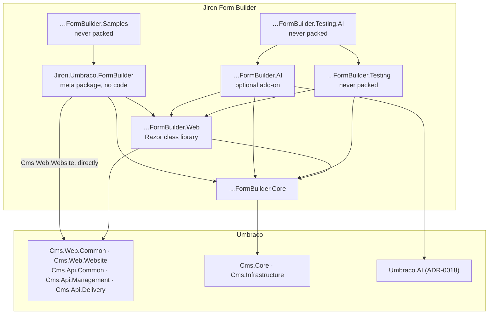
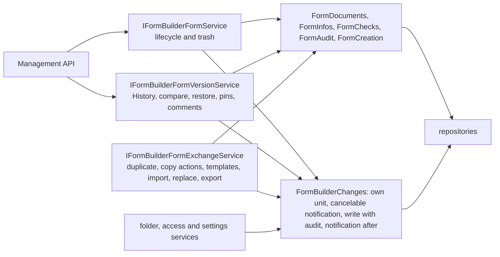
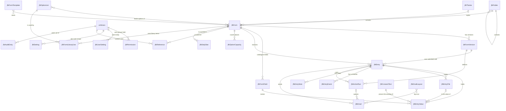
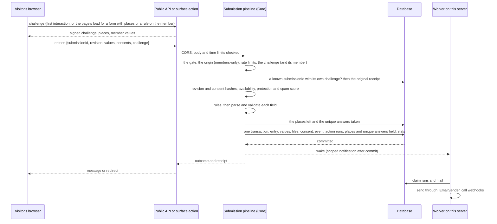

# Architecture

The contract for every phase after Phase 1: what Jiron Form Builder is made of, how the parts depend on each other,
what they store and expose, where it can be extended, what can go wrong and how it is prevented, and what it must
achieve. The decisions themselves are in the ADRs under [`decisions/`](decisions/); this document puts them together
and links to them instead of repeating them. [ROADMAP §4](../ROADMAP.md#4-target-design) is the target design they
refine.

When this document and an ADR disagree, the ADR decides and this document is fixed in the same commit.

## Contents

1. [Modules](#1-modules)
2. [The definition model](#2-the-definition-model)
3. [The data model](#3-the-data-model)
4. [How a submission flows](#4-how-a-submission-flows)
5. [The public API](#5-the-public-api)
6. [The management API](#6-the-management-api)
7. [Settings](#7-settings)
8. [Extension points](#8-extension-points)
9. [Background work](#9-background-work)
10. [Threat model](#10-threat-model)
11. [Quality budgets](#11-quality-budgets)
12. [Glossary](#12-glossary)

## 1. Modules

Four packages, two Testing projects that are never packed, the samples, the tests and the demo
([ADR-0001](decisions/0001-solution-structure-and-packages.md)). The demo references the meta package and the Testing
project, everything in it off, so the browser tests run the demo as their host
([ADR-0029](decisions/0029-testing-project.md), [ADR-0031](decisions/0031-browser-harness.md)), the samples, each off
unless the setting `Demo:Samples` names it ([ADR-0234](decisions/0234-the-samples.md)), and the AI add-on as a site
installs it, with Testing.AI, whose fake provider is left out unless `JironFormBuilderTesting:FakeAI` offers it
([ADR-0018](decisions/0018-the-ai-add-on.md)).



All Umbraco references are `[17.6.0, 18.0.0)`, and the AI add-on's of Umbraco.AI `[17.5.2, 18.0.0)`; references
between our packages are exact versions ([ADR-0010](decisions/0010-versioning-branching-and-upgrade-policy.md)).

**Core** holds every rule of the product and knows nothing about HTTP; an architecture test keeps ASP.NET Core's HTTP,
MVC, routing and Razor assemblies and Umbraco's web and API packages out of it, and another fails when it constructs a
database connection of its own. Its areas:

| Area | Holds | Decided in |
| --- | --- | --- |
| Definitions | the model, its JSON, upgraders, structural validation, the public projection and the visitor's form made from it (one string per text) with its visitor texts and their owners, the one HTML sanitiser (`EditorHtml`), versions and their comparison, and the exchange of forms (`Exchange`: element keys and their remap, copied actions, the export envelope) | ADR-0002, ADR-0045, ADR-0046, ADR-0084, ADR-0085 |
| Forms | the form service in three parts (below): the lifecycle with the trash (create from blank, save, publish, unpublish, rename, move, trash, restore, delete for good, and the published form as the site runs it), the versions (the History with what changed, one version, two compared, restore, pins and comments) and the exchange (create from a template, import and export, replace a draft with a file, duplicate, copy actions to another form); the folder service (create, rename, move, trash, restore, delete, delete an empty folder outside the trash at once, empty the trash and what emptying would take); the library's lists beyond the tree (`LibraryLists`: a folder's rows with their entries of the last 30 days, the fields the header search finds in the catalogue, what a form holds that its delete takes) and the template gallery (`FormTemplateGallery`: built-in, then saved); the import's check, which writes nothing; each change a unit of work of its own; the built-in templates, aliases from names, the publish checks, the field catalogue, the form and folder notifications, the one trash check and the one mapping from a refusal to its code; the published forms each server keeps with their cache refresher, and a published form in a visitor's culture (the dictionary's items read once, rich text sanitised, each consent's wording with its hash, and what the browser renders the visitor texts that render with); forms as files (`FormMirror`: each publish writes the form's file, and a pass on the server that schedules takes a file changed in source control in as a new published version, ADR-0220) | ADR-0002, ADR-0044, ADR-0045, ADR-0046, ADR-0047, ADR-0053, ADR-0060, ADR-0078, ADR-0084, ADR-0085, ADR-0166, ADR-0220 |
| Fields and options | the field type registry, the built-in types, places on options: read while the answers are, and counted again inside the submission's transaction, each entry write keeping the counts under the form's row; unique answers, held against the entries that hold theirs in the same two places | ADR-0002, ADR-0090, ADR-0091, §4.3.2 |
| Option lists | the kinds with their configuration and its checks, content and data type lists with what they read from Umbraco and the handler that drops what they keep when the site changes, URL lists with what they fetch and keep, the reader of uploaded CSV and TXT files, the standard lists and a site's own sources with their start-up check, the library's lists with their cache refresher, the library's screens' service (`OptionListLibrary`: the rows with the forms that use each list, a duplicate under a free alias, the preview of contents not saved yet, a file read into options, and Fetch now, which every server forgets its copy for), the option service with what holds a request's answers up a chain of parents, and the publish check of a field's source | ADR-0002, ADR-0073, ADR-0075, ADR-0076, ADR-0081, ADR-0086, ADR-0214 |
| Outbound | calls to other hosts (`OutboundHttp`): the host configuration's hosts and schemes, redirects to the same host only, one time limit and a cap; the transport that resolves names itself and connects only to globally reachable addresses, which only the Testing assembly replaces | ADR-0076, §4.10 |
| Logic | rules, validation, the pattern matcher, merge tags, calculations, text cleaning and folding; the visitor messages in seven languages and the package's visitor texts by key (`VisitorTextKeys`), with a site's and a form's own wording of them per culture (`VisitorWording`: the form's before the site's before the package's) | ADR-0005, ADR-0014, ADR-0030, ADR-0064, ADR-0068, ADR-0230 |
| Merge tags | the merge-tag service over the engine: the places and what each takes, the built-in sources (`field`, `entry` with `entry.answers`, `entry.table` and `entry.url`, `form`, `query`, `context`, `date`, and `page`, `site`, `member` and `dictionary` over Umbraco's content, members, domains, languages and dictionary), the answers as each field type shows them with what each place masks or leaves out and the dictionary's texts for labels that name an item and the labels lists and other sources resolve for options, answer recall in visitor texts (only the fields before the text's page, group or field, by their current aliases, a site's type by its rule kind), a site's sources and filters with their start-up check, the culture formats written from .NET's data, and for a browser a template's values but recall's, the recall form cut down to what its texts need and the culture's formats as JSON | ADR-0014, ADR-0064, ADR-0065, ADR-0066, ADR-0067, ADR-0068, ADR-0077, ADR-0083, ADR-0085 |
| Entries | the submission pipeline (`Submissions`: from a request by aliases to a stored entry with its receipt and outcome, below), states, values, files, events, notes, the entries query builder, and a consent's wording as shown, sanitised and hashed | ADR-0003, ADR-0070, ADR-0085, ADR-0088, §4.4 |
| Actions and email | action types, action runs, the worker; the mail queue with its renderer, layouts, limits and test mail (`Email`, [ADR-0159](decisions/0159-mail-the-queue-the-layouts-and-the-limits.md)); the email action (`EmailActionType`, [ADR-0160](decisions/0160-the-email-action.md)); the library screens' service of the layouts (`EmailLayoutLibrary`: the rows with how many email actions name each, the checks, a logo from the media library read on save, a duplicate under a free alias, the preview of a sample entry per language, and the test mail of a saved layout to the user who asks) | ADR-0007, ADR-0215 |
| Protection | the spam score, content rules, captcha provider contract, mail caps | ADR-0012 |
| Files | the file store contract and the physical store, whose root is checked against the web root at start-up; the host's limits for files (`Files:MaxFileBytes`, `Files:MaxWaitingBytes`, `Files:MaxWaitingBytesPerAddress`, `Files:BlockedExtensions`); the uploads before a submission: the name cleaned, the first bytes checked against the kinds of file (`FileKinds`), the bytes counted, hashed and stored, a row without an entry; the bytes that may wait for an entry (`WaitingUploads`, ADR-0148); scanning in the background, what an entry holds first, and the quarantine (`FileScans`, ADR-0144, ADR-0148); an entry's files for a user, one or a form's in a ZIP under names that stay in their folder (`EntryFileDownloads`, `FileArchiveNames`, ADR-0145); a typed signature drawn as its PNG in the package's own hand (`TypedSignature`, `SignatureHand`, `PenCanvas`, `Png`), the name kept in an `iTXt` chunk; the site's files settings (`FilesSettings`: the groups of types it takes and its largest file, capped by `Files:MaxFileBytes`), which the upload holds each file to and the form check compares each file field with (ADR-0218) | ADR-0006, ADR-0041, ADR-0087, ADR-0103, ADR-0148, ADR-0218 |
| Exports | the export of a form's entries over the entries list's own query or the ticked entries (`EntryExports`: keyset pages of 250 entries, each its own gated read; the entry's own columns (its number, reference, state, received time and the language its answers are written in, ADR-0228), then the columns from the field catalogue, a grid by row, a ranking by position, a repeatable group as a table; sensitive fields only when asked for and allowed; audited as `entries.exported` and announced with `ExportCompletedNotification`), the built-in formats through `ExportFormats()` (CSV with the formula guard, Excel from a small own writer, JSON, a printable view, a ZIP of the files), and the exports too large to stream, and every ZIP of files (`EntryExportJobs`: a record in `jfbKeyValue` per export, this server's worker, a lease renewed after each page and every minute, three attempts, three exports under way per user, the file kept 24 hours for its owner only and downloaded through a link with a one-minute ticket, `ExportDownloadTickets`) | ADR-0003, ADR-0210 |
| Insights | what a form counts of its visitors (`FormInsights`: whether the site's switch and the form's are both on, a beacon read from its four members and held to the published version, the fields a post without JavaScript was refused at), this server's sums of beacons (`InsightCounts`, at most 100,000 waiting) written to `jfbDailyStat` every 10 seconds and when the host stops (`InsightWriter`, `InsightFlusher`), what a stored entry adds to its unit (`InsightMetrics`: its page, hour and time to complete), a form's report and the site's table of forms (`InsightReports`), the boxes a user shows as tables (`InsightUserSettings`), and what a form's entries answered (`AnswerSummaries`: each field the entries list offers but a sensitive one or one kept only until the actions run, summarised by what its type says its answers are, from grouped statements over the entries list's own query in one read within the query budget (`EntryQuerySql.Summaries`), labelled as the type shows its values with an older version's options marked, and the free texts a page at a time behind a cursor; the entries of a range and the list's filter, never a test entry or one in Spam) | ADR-0041, ADR-0088, ADR-0211, ADR-0212 |
| Privacy | retention, holds, data subject tools, masking, IP handling; the site's privacy section (`PrivacySettings`): the days per state (at most ten years; kept for good only where the host's `AllowRetentionOff` allows it, `RetentionOffRule`, ADR-0226), on Privacy › Retention's own screen, and the insights switch, on Privacy › Data collection's settings screen (ADR-0218, ADR-0222); the data subject tools of Privacy › People: finding a person's entries by address or member, holding and releasing them, erasing them (`PersonData`, which never stores the person), anonymising an entry in place (`EntryAnonymiser`) and the ZIP of everything about the person (`PersonExports`, a background export of its own kind), with the reads across tables in `PersonDataRepository` (ADR-0223); what entries keep of visitors' IP addresses (`VisitorAddresses`: the form's mode or the site's, a full address only where `AllowFullIp` allows it, `FullIPRule`, and the form check's `FullIPFormCheck`, ADR-0224); the Privacy health check (`PrivacyHealth`: a full address kept, a state kept for good, a captcha loaded unasked); what a member's deletion in Umbraco does to their entries (`MemberDeletionHandler`: the erase of `PersonData` for that member, anonymised or deleted as Privacy › Members says, ADR-0231); the anonymous form's check (`AnonymousFormCheck`, ADR-0231); and what a log may hold of an exception (`LoggedException`, in Core's root namespace as every part logs through it: its type, a database's codes and its stack, never its message, the only exception a log message takes, ADR-0226, ADR-0236) | ADR-0009, ADR-0211, ADR-0218, ADR-0222, ADR-0223, ADR-0224, ADR-0226, ADR-0231 |
| Retention | the rules of each entry's time (`RetentionTerms`, `EntryRetention`), legal holds (`EntryHolds`), the dry run (`RetentionDryRun`), and the hourly retention job with its parts: the draft-version cleanup, the purge of entries whose time has come (`EntryPurge`), the walk that gives entries their times when the rules change (`RetentionRecompute`), the sweep of the file store's leftovers (`FileStoreSweep`, through the default store's `IFileStoreLeftovers`), the audit log (`AuditLogPurge`) and the daily statistics (`DailyStatPurge`); the cleanup of uploads no entry took, on a timer of its own (`OrphanFileCleanup`, `OrphanFileJob`) | ADR-0007, ADR-0045, ADR-0148, ADR-0222 |
| Access | the permission model (the flags, what each needs and where it may be granted), the evaluation from one cached snapshot per server with its refresher, the lists' filter, grants and restrictions with their audit entries, host grants and the access lock, and the grants of a user group Umbraco deletes | ADR-0013, ADR-0048 |
| Themes | the registry of themes, a collection a site's composers change through `Themes()`, with its start-up check of every alias, label, stylesheet, class map, token and view folder; the built-in themes `default` (its stylesheet and its token defaults), `unstyled` and `bootstrap5` with their class maps; a form's theme, the first named of the placement's, the form's and the site's General setting, else `default`, which also stands in for a theme the site lacks; a theme's dark colours (`DarkTokens`); the library's themes, each a layer over a theme in code (`LibraryThemes`: its tokens per scheme, `ThemeTokens`, and its custom CSS sanitised and scoped, `ThemeCss`, written into one stylesheet kept per alias and dropped on every server by `FormBuilderThemeCacheRefresher`), which `FormThemes` resolves as its base theme with both classes, and the library screens' service (`ThemeLibrary`: the rows with a swatch and the forms that use each theme, the editor's base themes with their tokens and defaults, a theme created under its alias's key, a duplicate under a free alias, export and import, and the preview's layer) | ADR-0015, ADR-0105, ADR-0106, ADR-0215 |
| Settings | host options and their start-up checks; the backoffice sections with their validators, migrations and host rules, the cached reader, the save and the cache refresher; each section's schema for its screen, read from its record's `[SettingsField]` and `[HostOnly]` (`SettingsSchema`, ADR-0218); a site's base URL (the setting, the site's `https` domains, Umbraco's application URL); a site's time zone, UTC with a warning for one this server cannot resolve | ADR-0008, ADR-0042, ADR-0043, ADR-0067, ADR-0084, ADR-0218 |
| Persistence | NPoco DTOs, repositories, the entries query builder, the outbox, the audit log and daily statistics, the migration plan with schema v1 frozen, the database gate and units of work ([database.md](database.md#access)) | ADR-0003, ADR-0007, ADR-0033, ADR-0036, ADR-0037, ADR-0038, ADR-0039, ADR-0040, ADR-0041, ADR-0054, D7 |
| Platform | jobs, notifications, the one change pipeline of the services, the audit log's details (keys, numbers, flags, enum values, times and identifiers only), the CSS sanitiser | ADR-0007, ADR-0041, ADR-0053, §4.10 |

**The form services** ([ADR-0053](decisions/0053-form-service-in-parts.md)) are three, each with its own interface and
registration, over internal parts they share. Every change of Core's services takes the same steps through
`FormBuilderChanges<TService>`, one per service: refused inside a caller's unit of work or an Umbraco scope, the
cancelable notification, one unit with the write and its audit entries, then the notification that it happened.



**Web** hosts the HTTP surfaces and rendering:

| Area | Holds | Decided in |
| --- | --- | --- |
| Public API | `/jfb/api/v1` below the host's base path: the base controller with each action's declarations and their filter, the middleware in front of it (no form content, origins, what ends a request early), the catch-all, the OpenAPI document `jfb-public`, the form endpoint, the options endpoint, the upload endpoint with its multipart reading and its tokens, the entries, validate and receipt endpoints with their strict reading of a JSON body; the events endpoint, which reads a page's beacon of at most 1 KB in any content type, and from the address a page rendered for a post was given (`continued`, `reached`) that its visit was counted as it began (`InsightRequests`, ADR-0211); the element endpoint, which answers the view model of a form's first render as JSON for the headless element (`ElementJson`: the view models in camel case, a control named by its `kind`, the classes once, without the view paths and what only a post without JavaScript uses), its schema and the element's types made from the models' metadata; the rate-limit middleware | ADR-0006, ADR-0012, ADR-0084, ADR-0086, ADR-0087, ADR-0088, ADR-0089, ADR-0128 |
| Management API | `/umbraco/jfb/management/api/v1`: the base controller, the access declarations and their filter, the refusals with stable codes, the authorization policies with their resources and denials, the OpenAPI document `jfb`; the library tree, folders, the trash, forms and their versions, a definition carried as its document; the library's screens (`library/items`, `library/trash`, what a delete takes), the template gallery with the site's saved groups, and the templates users save (`FormTemplateLibrary`: a form's stored draft, or a group as the canvas holds it with the validation rules on its fields, without the rules and validation rules that name an element outside it, renamed and deleted, each audited, ADR-0217), and a form's duplicate, copied actions, import with its check, replace with its check and export (`FormExchangeController`), where a new form with actions needs `manageActions` where it lands and a replace that changes the draft's actions needs it on the form; the field types for the designer; setup's "create a form block type for me" (`FormBlockTypes`: the element type `jfbFormBlock` and the picker's data type where missing, never a change to one that is there), whose declaration names Umbraco's Settings section besides `manageSettings`; the form picker's endpoints (`PickerController` over `IFormBuilderPickerService`: a level of folders and forms, search, forms by key, folders by key for the settings, the themes), declared `FormBuilderContentAccess` (Umbraco's Content, Media, Members or Settings section instead of the Form Builder section) and answering names and keys of the published forms ADR-0013 lets an editor pick, within a data type's limits | ADR-0013, ADR-0049, ADR-0050, ADR-0051, ADR-0052, ADR-0057, ADR-0130, ADR-0166, §4.7 |
| Rendering | the website assets served from the Web assembly by a middleware before Umbraco's routing (`/jfb/assets/`, the copy the request accepts, a year's caching under the fingerprint) and `<jfb-assets>`, which writes their tags once per request with the nonce; the view component `FormBuilderForm` and `<jfb-render>` (a form by key, alias or `FormBuilderFormReference`, the assets included once unless the placement or the host's `Rendering:IncludeAssetsAutomatically` turns them off, the `context-…` values the form lists), which build public view models from the form endpoint's answer in the page's culture with the state the rules give the defaults, the visitor texts with tags rendered for the page's answers, the site's required-marker style and button labels, and the package's texts in the form's or the site's own wording where they reword them (ADR-0230), and the views of the default folder with their contract headers and a form's own overrides; the choice types' controls, with options from a list or a source, and below an answered parent, resolved as the `options` endpoint resolves them; the controls with parts, dates and outputs, with a date's window for the site's today and a calculation's value worked out for the page's answers as the pipeline reads them, the captcha's place and a site's own type's control from its own view, under a legend for a type that groups its controls (ADR-0234); a repeatable group's rows with their Add and Remove buttons; the notices of a members-only form for a visitor it does not admit, and while the migrations are pending nothing for a visitor and a note for a signed-in backoffice user; the surface controller, which reads a post without JavaScript (every page's answers, the rows the page showed, a switch left off as no, line breaks as LF) into the pipeline's request, refuses another origin's post to a form for members, and to any form while a member is signed in, and shows a form that takes no entry now its notice before anything of the post is stored, moves through the pages with Back and Next, adds and removes a repeatable group's rows and moves a ranking's options in the order the page showed, takes the files of a form that stores them (a middleware before Umbraco's routing reads its post part by part within the form's limit, each file held to its field's checks and stored as an upload is, a file already taken kept across a re-render as a ticked box, and a post past the limit refused with a notice), draws a signature's typed name as its PNG on a page button and stores it the same way (the name kept in its input, never handed to the pipeline), shows errors and notices with the answers kept, and redirects a sent form to its page with a signed token whose outcome the page shows; the output cache rules: a render that is per visitor (a post, a request with `jfb-sent`, a members-only form for anyone, any form while the migrations are pending) and every answer of the surface action marked `no-store` and kept out of Umbraco's output cache by its own switch, also once the response has started, and the cache's vary rule for `jfb-sent`, never a request filter; the markup of a form at a page's place for the `render` endpoint, through the same view component in the page's culture and the theme it names; a form's theme on the page: each view found in its theme's folder, after the form's own override there and before the default folder, the theme's classes beside ours on every slot through `Model.Classes`, and the functional base rules and each theme's stylesheet written once per page, decided when the page is written, with the start-up check that a stylesheet below `/jfb/assets/` is one the assembly holds; a library theme's layer after its base theme's stylesheet, `/jfb/assets/themes/library/<alias>.css?v=<version>`, which the assets middleware serves from `LibraryThemes` (a year's caching under the current version, `no-cache` under another, an ETag); the theme editor's sample page (`ThemePreviewDocuments`: a sample form with an error on its second page, rendered by the same view models and views in a base theme under the preview's alias, with the place of the layer and no script) | ADR-0004, ADR-0015, ADR-0092, ADR-0093, ADR-0095, ADR-0096, ADR-0097, ADR-0098, ADR-0100, ADR-0101, ADR-0102, ADR-0103, ADR-0104, ADR-0105 |
| Themes | the stylesheets of the themes package (`packages/themes`), built into `WebsiteAssets/themes/`: the functional base rules every form gets, which make the markup read without a theme (ADR-0107), and the default theme, every rule nested under `.jfb-form:where(.jfb-theme-default)` so it styles only its forms, with its dark scheme and Lucide's icons, and `bootstrap5`'s for what Bootstrap lacks, nested under `.jfb-form:where(.jfb-theme-bootstrap5)` and drawn from Bootstrap's own variables; the size check lints each as it is served (its scope, nothing physical) | ADR-0015, ADR-0105, ADR-0106, ADR-0107, ADR-0108 |
| Content integration | the form picker's property editor `Jiron.FormBuilder.FormPicker`, which stores the picked forms' keys as text, with its settings (`FormPickerConfiguration`: one form or several, the allowed folders and forms, a theme and a page after a send), the check of a page's value against them on save through a synchronous read of the library's places (`LibraryPlaces`), and its value converter, which gives Razor a `FormBuilderFormReference` (or a list of them) with the settings' theme and page, which `<jfb-render picked="...">` keeps and the route token carries to the post, and the Content Delivery API a marker of the key, the property's expansion and the settings' theme and page; a middleware in front of `/umbraco/delivery/api` replaces each marker once the answer is made with the form's `{ key, alias, name }`, and when expanded its `form` as the definition endpoint answers it in the request's culture for the page the marker is on, or with `null` for a form that is gone, unpublished or not headless, every other byte as Umbraco wrote it; "used on": the picker reports each picked form to Umbraco's reference walk under the UDI type `jfb-form` (`FormPickerReferences`), which reaches into blocks, and `FormReferenceIndex` writes an item's rows in `jfbReference` from each property's edited and published value per culture, on content saved, published, unpublished, moved to the recycle bin, moved, copied and deleted (`FormReferenceHandler`, a failed write logged, never the editor's save failed); `FormReferenceRebuild` walks the documents by node id in batches from where its `jfbKeyValue` request says, which plan step 4 and the health check ask for, then drops the rows of content that has gone, run by the distributed job `Jiron.FormBuilder.References` within 8 seconds a minute; `GET form/{key}/referenced-by` answers the pages the user may see in the shape of Umbraco's document reference, and counts the others (`notShown`); the output cache's tags of a page that uses forms (`FormCacheTags`: `jfb-form` and `jfb-form-<key>` per form, read synchronously by `PageForms`), evicted on every server after each change visitors see by a handler on the form cache refresher's notification (`FormCacheEviction`); the client half in the backoffice package (the schema of the same alias, its default UI, the sidebar and the block label, section 1) | ADR-0004, ADR-0017, ADR-0127, ADR-0129, ADR-0131, ADR-0132, ADR-0134, ADR-0135 |
| Operations | health checks (one probe per subject, which the Overview and Umbraco's dashboard both read, ADR-0165; "Forms as files" with its action that writes the files of the forms in conflict, ADR-0220; "Privacy", which warns while the host allows full IP addresses, retention kept for good or a captcha that loads unasked and a setting uses it, ADR-0224), Umbraco webhook events, the site's content root and web root for the file store | §3.4, ADR-0041 |

**The client packages** (`src/Jiron.Umbraco.FormBuilder.Web/Client`, an npm workspace):

- `logic`: rules, validation, merge tags and calculations in TypeScript; no DOM and no dependencies; run against the
  shared vectors ([ADR-0005](decisions/0005-shared-logic-and-test-vectors.md),
  [ADR-0030](decisions/0030-porting-the-shared-logic.md)). Its form engine (`form.ts`) and Core's (`Logic/FormRules.cs`)
  decide a whole form at once: what is hidden and required, the validation rules' messages, the calculations'
  results, the actions that run and the outcome, from one model of the form that Core builds from a definition with
  `DefinitionLogic.From` ([ADR-0061](decisions/0061-the-form-rules-engine.md)); its calculation language (`calc.ts`,
  Core's `Logic/Calculations.cs`) reads a formula into a tree, checks it against the form and works it out over exact
  decimals ([ADR-0063](decisions/0063-the-calculation-language.md)); its merge-tag engine (`template.ts` with the culture
  formats of `culture.ts`, Core's `Logic/MergeTags*.cs` and `Logic/CultureFormats.cs`) reads a template once for its
  context, refusing a tag where a value could become code, and renders it over the values with every value encoded
  for its place ([ADR-0064](decisions/0064-the-merge-tag-engine.md)); its answer recall (`recall.ts`, with the answers'
  texts of `display.ts`; Core's `MergeTags/MergeTagRecall.cs` and the `field` source in visitor texts) fills a visitor
  text's `field.*` tags from the answers so far, of the fields before the text only, and reads a value with parts as
  Core's `FieldPartsJson` does ([ADR-0068](decisions/0068-answer-recall.md),
  [ADR-0083](decisions/0083-merge-tags-and-the-two-runtimes-after-the-phase-5-review.md)); its `checkField`
  (`checks.ts`) runs the built-in types'
  checks of a field's answers as each type's `Validate` in Core does, and then the field's own `pattern` and
  `matchesField` checks as Core's `FieldValues` does, with the other fields' values
  ([ADR-0062](decisions/0062-the-built-in-types-checks.md)), a choice's answers held to its own options or those its
  list or another source resolved, a cascading field's to those of its parent's answers
  ([ADR-0077](decisions/0077-answers-and-labels-from-resolved-options.md)); its reading stage (`reading.ts`, Core's
  `SubmissionReader.Clean` and `FieldTypes/FieldValues.cs`) cleans a field's answer, holds it to the longest answer
  its built-in type takes and reads it into the wire form as the type's `Read` does, a site's own type left to the
  server ([ADR-0109](decisions/0109-reading-answers-in-the-browser.md));
- `runtime`: enhances Razor-rendered forms through the markup contract. Its entry is the frame (`frame.ts`): it
  finds the forms of the contract, reads each one's model data, enhances it once with `jfb:ready` and
  `JironFormBuilder.init(root)` for later ones, and loads the chunk with the logic (`form.ts`) on a form's first
  interaction; the chunk reads the page (`page.ts`) through `FormData` and the shared logic's `readPost`
  (`posts.ts`, the twin of Web's `FormPostReader`), then each field through the reading stage, into the answers
  the server would take ([ADR-0110](decisions/0110-the-runtimes-frame-its-chunk-and-the-reading-of-the-page.md)),
  and applies the rules (`rules.ts`): the form engine over the model the shared logic's `logicFormOf` makes of the
  model data, as Core's `DefinitionLogic` makes it of the definition, in the render's context, shown through the
  hooks the views write on a form with rules ([ADR-0111](decisions/0111-rules-on-the-page.md)), and checks the
  answers (`validation.ts`): each shown field's errors in the pipeline's order (`checks.ts`), the shared logic's
  `checkField` over the answers and the rules' state, what only the server can decide left to it, and each field's
  first error worded as Web's render words it (`messages.ts`), in the words of the page's language, a file of its
  own loaded the first time a message is needed ([ADR-0112](decisions/0112-checks-and-messages-on-the-page.md)),
  and shows the errors (`errors.ts`, `display.ts`) in the theme's markup from the form's templates, each marked on its
  control or on a group's own choices: as the visitor
  leaves a field, gone once fixed, and after a refused send with the summary, which takes the focus, and
  `jfb:invalid`; a passing send goes on as without JavaScript ([ADR-0113](decisions/0113-errors-on-the-page.md));
  and works the calculations out with the rules (`engine.ts`, `outputs.ts`): the calculation language is the shared
  logic's `@jfb/logic/calc`, a chunk of its own loaded before a form with a calculation is enhanced and never for one
  without, each result shown in its field's format as the server writes it, none for an answer its type cannot read
  in either runtime, said once the visitor pauses, in one line in the form's live region, its own `<output>` quiet,
  and a slider's value kept with its thumb ([ADR-0114](decisions/0114-calculations-on-the-page.md)); and renders the visitor texts that recall answers
  again as the visitor types (`recall.ts`, `texts.ts`): the merge tags are the shared logic's `@jfb/logic/template`
  and `@jfb/logic/recall`, a chunk of their own loaded before a form whose recall form names a field is enhanced,
  each text written on the element the views mark `data-jfb-text`, hidden while empty, a rich text by its texts
  and attribute values only (and the line breaks a recalled answer brings, made anew), a tag its place refuses as it stands, and the error summary naming a label as it reads
  now ([ADR-0115](decisions/0115-answer-recall-on-the-page.md)); and fills in the default values that hold merge tags
  (`defaults.ts`, in the merge tags' chunk) on the fields the server marks `data-jfb-default`, loaded as the form
  shows, before the rules first decide, with the address's query values the form allows, into the controls named as
  the field only and never over a control the visitor changed ([ADR-0118](decisions/0118-defaults-with-merge-tags-on-the-page.md)), a field prefilled from the
  query taking the address's value first ([ADR-0124](decisions/0124-prefill.md)); sends on the page (`send.ts`), its
  outcome in the form's place ([ADR-0120](decisions/0120-sending-waits-for-the-runtimes-budget.md)), and a form
  published again in the old one's place (`changed.ts`); fits a form to its page and offers `get(form)` (`fit.ts`,
  [ADR-0151](decisions/0151-fitting-the-page-and-the-js-api.md)); takes files on the page (`uploads-chunk.ts`, a chunk
  only a form with file fields loads, unless the step onto its summary page posts), each checked first by `@jfb/logic/files`, the port the shared
  vectors hold to the server's, then sent with its progress, its token a hidden input of its row
  ([ADR-0152](decisions/0152-uploads-on-the-page.md)); signs on a pad or types a name (`signature-chunk.ts`, with
  `@jfb/logic/signature`, held to `TypedSignature` by shared vectors), the image going at a send
  ([ADR-0153](decisions/0153-the-signature-pad.md)); works rows, rankings, counters, "Other", growing text areas and
  cascading options in place (`fields-chunk.ts`, [ADR-0154](decisions/0154-the-field-behaviours.md)); its budget of every feature
  counts the largest language's words, as a page loads one
  ([ADR-0116](decisions/0116-the-runtimes-budget-counts-one-language.md)), and its build takes a terser pass besides
  the bundler's minifier ([ADR-0119](decisions/0119-a-terser-pass-for-the-website-runtime.md));
- `element`: `<jfb-form>`, the headless renderer, with the same markup and runtime: it writes the built-in views from
  the element endpoint's answer (`src/views.ts` with `src/dom.ts`, view for view as the Razor views), whose types
  (`src/answer.d.ts`) `scripts/generate-public-types.mjs` makes from the schema the unit tests write
  (`src/answer.schema.json`); the element (`src/jfb-element.ts`) keeps its instance id, adds the theme's
  stylesheets and the runtime once per document, shows the form once its stylesheets loaded, and never posts it as a
  page would (ADR-0128); a site's own field type's control is written by the function the site registers with the
  element's `defineControl`, and the forms shown before it are shown again with it (ADR-0233);
- `backoffice`: the Form Builder section in Lit and TypeScript with UUI, through the generated client. Its build takes the
  comments and line breaks out of its Lit templates first (`scripts/templates.mjs`), and puts the start's modules in
  one chunk and each folder's on-demand modules in chunks of the folder, every module run in its source order
  ([ADR-0216](decisions/0216-smaller-template-text-in-the-backoffice.md)). From 6.7f it holds the
  content editor's form picker (`src/picker`, ADR-0134): the property editor UI `jfb-form-picker` (the picked forms as
  Umbraco's reference rows with Remove, and Choose), its sidebar `jfb-form-picker-modal` (the library's levels, opened
  in place, and the search, within the data type's limits) and the block label's UFM component `jfbFormName`, each
  reading through `picker-data.ts` over the generated client. From 6.7g the schema declares the data type's settings
  (ADR-0135): Umbraco's toggle for one form or several, `jfb-form-picker-allowed` for the allowed folders and forms
  (the same rows, and the sidebar, for folders in its folder mode), `jfb-form-picker-theme` for the theme, and
  Umbraco's document picker for the page after a send; the property and the allowed folders and forms share their rows
  through `picked-rows.ts`. The backoffice's own tokens are in `src/styles/tokens.ts`. From 9.3a it holds the form
  workspace (`src/designer`, ADR-0167): Umbraco's named detail workspace over the draft endpoint (`FormDetailRepository`
  with its store), whose views and footer actions show by the user's permissions on the open form, and the editor model,
  pure functions over the definition and the selection with an undo history (`editor-model.ts`, `history.ts`), whose
  moves the form engine's own `hasCycle` from `@jfb/logic` checks. From 9.3b the Design view (`form-design.view.ts`,
  ADR-0168) holds the palette (`palette/`, with the Paste questions dialog) and the canvas (`canvas/`): each field a
  `jfb-canvas-field` that is the field's wrapper, written by the element's own views (`@jfb/element/views`) from the
  view models `preview/field-models.ts` builds from the draft, with the words, classes and stylesheets of the
  management API's `canvas` endpoint; the template gallery shows a template with the same drawing
  (`preview/form-preview.element.ts`). From 9.3c the moves (ADR-0016, ADR-0169): the backoffice's one pointer drag
  (`drag/pointer-drag.ts`) and its drop arithmetic (`drag/drop-place.ts`), put on the canvas by `canvas/canvas-drag.ts`
  for fields, groups, pages by their steps and the palette's types, each place's refusal asked of the editor model (a
  group a view away from sight is not drawn until it comes near, `canvas/canvas-far.ts`, ADR-0176); and
  in `moves/` the pure helpers the Design view moves with (a drop's edit, where an element is, Move to…'s places), the
  Move to… and Keyboard shortcuts dialogs, and the keys' names. From 9.4a the inspector (`inspector/`, ADR-0170):
  `jfb-designer-inspector` beside the canvas, folded to a rail, or over it in a narrow view, whose sections
  `inspector-model.ts` makes from a type's features and settings schema, whose plain setting editors are
  `setting-editor.ts` and whose values `setting-values.ts` reads, checks as the server does and writes back; it sends
  each change to the Design view as an edit of the editor model, typing in one box one step of the undo history. The
  canvas endpoint serves the site's languages, which the toolbar switches between, and the draft endpoint whether the
  form has entries, which an alias change asks about first. From 14.1 (ADR-0228): `translations.ts` finds the texts the
  language shown lacks, which the canvas marks on a field, group or page and the Settings and Actions views on a box, an
  outcome's row, an action's card and a closed group's line; `dictionary-texts.ts` finds the dictionary items a draft's
  texts name (`#key`), reads their texts from the management API's `dictionary-text` endpoint once per language and
  key, and maps the draft the canvas draws to them, the inspector and the sidebars saying under a `#key` box what
  visitors see; `inspector/dictionary-pick.element.ts` opens Umbraco's dictionary picker for a user with the
  Translation section. From 9.4b the option editor (ADR-0172):
  `inspector/option-editor.element.ts` in Essentials, with "Options from", a field's own options and a grid's rows, over
  the pure helpers of `inspector/option-values.ts`; `inspector/option-data.ts` reads the management API's
  `option-source` (the kinds a field may name with their settings schemas, and the standard lists) and `option-list`
  (the library's lists with a count), and asks `form/{key}/options` for a draft field's options in the language shown,
  which the Design view hands the canvas for a field whose options come from elsewhere. The canvas's images (an image
  field's, an option card's) come from Umbraco's imaging, which a user of the Content section may ask, as Umbraco's
  media picker does for its thumbnails. From 9.4c (ADR-0173): `inspector/rich-text.element.ts` (`jfb-rich-text`, on
  the Tiptap Umbraco's bundle exports, with only the marks and nodes the server's sanitiser keeps) for `localizedHtml`
  settings, and one line of it for `inlineHtml` (a text in a label); Umbraco's own inputs for content and media
  (`umb-input-document`, `umb-input-media`), and ticks or a select for document types and data types, which the option
  sources endpoint serves as the settings' choices (`OptionKind.SiteChoicesAsync`); `inspector/merge-tag-picker.element.ts`
  under the texts made for tags, over the helpers of `inspector/merge-tags.ts`, which asks the management API's
  `form/{key}/merge-tag-paths` for the paths of a place in the draft the designer holds, for the element whose text it
  is (`DraftMergeTagPaths` in Core: a field's path labelled in the language asked, a visitor text's answers only those
  before it); and "Must match a pattern" in Validation, whose "Try it" runs `@jfb/logic`'s `compilePattern`,
  the browser's twin of the server's matcher. From 9.4d (ADR-0174): `change-type/` holds Change type, which the canvas
  element's "..." and the inspector's header offer: `type-change.ts` works out a change's preview on the draft (what
  goes, what a lock sets instead, what the field needs, the conditions naming it whose operator goes) and the field once
  changed, pure; `change-type-words.ts` says the preview; the dialog chooses among the types the workspace reads from
  `field-type/{alias}/changes` once while the form is open (`readOnce`), ahead for a field selected. From 9.5a
  (ADR-0175): `rules/` holds the rules builder, which the inspector's Rules section opens: `rule-draft.ts` is the rule
  as the builder edits it (ids on its conditions and groups, what a condition may look at with its kind as the server
  reads it, the operators of `@jfb/logic`'s own table narrowed to what a sentence means, why a row can't be kept by the
  engine's own check), pure; `rule-words.ts` says a rule ("Shown when Country is Other"), for the inspector and the
  builder alike; `rule-try.ts` is Try it's one adapter to `evaluateRule`, which the shared vectors hold; and
  `rule-edits.ts` lands a rule through the editor model's `change` as one step to undo, a rule moved to another
  element in that same step. From 9.5c (ADR-0178): a form-level validation rule is a rule whose effect is `message`
  in the builder, which `rule-edits.ts` keeps in the definition's `validationRules` with its field, moving a rule to
  or from there in one step; `rule-list.ts` lists the form's rules element by element (a field's own, then the
  validation rules on it or, for a grid, on its rows) for the inspector, the canvas's chips and the rules overview, the
  sidebar the canvas's "..." opens; and the rule search of `@jfb/logic` (`search.ts`, ADR-0179) finds a field that one
  rule hides and another requires for the same answers by trying answers a visitor can give through `evaluateRule`, the
  fields the form hides for them counting as none as the form engine decides (`formSight` over the editor model's
  `logicOf`), so the overview says a conflict only where the engine finds one; Core's `RuleSearch` is the same in C#,
  held to the shared vectors of `tests/vectors/search.json`. The editor model's delete takes the validation rules that show their message on what it
  deletes along, and the structure check refuses a validation rule on a field the visitor's page has no comparable
  answer of, which both runtimes would refuse the whole form for. From 10.1a (ADR-0184): `settings/` holds the form's
  Settings view, the groups of section 4.3.4 on one page: `settings-model.ts` reads each group with the model's
  defaults, writes a setting back where it was as the server writes its canonical form, says where a path of the
  settings is in the view (`anchorOf`) and the line a closed group says, pure; `time-zone.ts` turns a time on the
  site's clock into the UTC instant the definition stores and back, with the browser's own time zone data; and
  `form-settings.view.ts` draws the groups with the boxes' look the inspector has (`inspector/control.styles.ts`) and
  its editors for a captcha provider's own settings. The site's choices come from the management API:
  `form/{key}/setting-choices` for who may design the form (the defaults "Site default" names, the site's button
  labels, the time zone, the themes, the member groups and the save checks' bounds) and `captcha-provider` (each
  provider's label, whether it has its keys, never a key, and its settings). The workspace keeps the language either
  view's switch chose, and hands each Fix it to the view that makes it (`FIXING_VIEWS`, `followFix`); a view that
  opens a sidebar for one handed on waits until the router stays still (`routerSettled`), as Umbraco closes such
  sidebars when a navigation ends (ADR-0227). From 10.1b
  (ADR-0185): After sending lists the outcomes (`outcome-list.element.ts`), each edited in a sidebar of its own
  (`outcome.modal.element.ts`), `outcome-model.ts` holding, pure, what an outcome gives visitors and whether one can get
  it at all, the outcome as its sidebar edits it and as Update writes it back, and where a new one goes. The sidebar asks
  the form check (`checkOf`) about the draft as Update would make it and says its problems under their setting; the
  rules builder edits an outcome's `use` rule when its data says it is an outcome's. A view Fix it carries the outcome's
  key, as the canvas's Change and the rules overview's outcome rows do. From 10.1c (ADR-0187): the sidebar, Umbraco's
  large one, shows the outcome's live preview beside the settings (`outcome-preview.element.ts`), asked for once the
  changes pause (`OutcomePreviewer` in `outcome-preview.ts`, as the form checker) from
  `form/{key}/outcome-preview`, which needs `design`: the server renders the outcome of the draft for Core's sample
  entry (`SampleEntries`: number 42, the form with the site's setting locks applied, every field answered with what it
  takes, which the action test runs share), as `SubmissionOutcomes` renders a real entry's, and writes it with the
  site's own `Outcome` view in the default theme (`OutcomePreviews`, `FormModels.PreviewAsync`, `RazorViewText`). The
  backoffice draws that markup in the canvas's look without anything that runs or sends, its countdown from the
  runtime's own least seconds (`@jfb/runtime/countdown`). From 10.2a (ADR-0188): the Actions view lives in
  `designer/actions/`: `action-model.ts` holds, pure, the form's
  actions as one list in the order they run, shown by trigger (a move within a trigger keeps the others' places), what
  a trigger needs on the form, an action's one line, the choices of what a new one does (every preset of every type, a
  type without presets as itself, from `GET action-type`), and an action as its sidebar edits it and as Add or Update
  writes it back. `action-list.element.ts` draws one trigger's cards (the handle with the pointer and Alt and the
  arrows, the switch, "…"), `form-actions.view.ts` the triggers, Add action and the toasts with Undo, and
  `action.modal.element.ts` the sidebar: the type's settings drawn by the inspector's editors (`settingEditor`), the
  form check asked about the draft as Add or Update would make it, the rule a `run` rule in the rules builder. The
  view's words load with it (`action-words.ts` registers `lang/actions.<xx>.ts` with Umbraco's localization manager),
  so the backoffice's start does not carry them. Fix it of an action carries its key; `?action=` on a form's address
  hands the view a Fix it at that action once the name box has held the focus Umbraco gives it past its second look
  (`name-focus.ts`). From 10.2c (ADR-0190): Test on a card and in the sidebar runs `action-test.ts`'s `runTest`,
  which asks first where the type tests after a confirmation and says the answer in a toast, through the workspace's
  `testActionOf` and the test endpoint with the draft the designer holds; `ActionTestResult.Code` carries what the
  backoffice words. `ActionTestRuns` refuses a test that would reach anything while actions are paused (`OutboxWake`),
  before it asks for a confirmation. From 10.2b (ADR-0189): the action types' own editors are `action-editors.ts`, which the sidebar
  hands the inspector's `settingEditor` through its `editors`: a field picker of the draft's fields of the setting's
  `picks`, addresses as chips, the email's To box (`recipients`), which draws the settings `within` it, the recipient
  map, and the layout from the setting choices' `emailLayouts`. An email's sidebar is Umbraco's large one, with its
  mail's preview (`email-preview.element.ts`) asked as an outcome's is: both previewers are
  `preview/draft-previewer.ts`. `form/{key}/email-preview`, which needs `design`, answers the mail of the draft's email
  action for the sample entry: `EmailPreviews` (Core) finds the action, applies its locks and asks
  `EmailActionType.PreviewAsync`, which finds the recipients as a run does and has the outbox compose the mail without
  queueing it (`EmailOutbox.ComposeAsync`, which `PrepareAsync` shares); the frame reads the layout's colours for the
  scheme chosen (`mailDocument`). From 10.2d (ADR-0191): the webhook's editors are `webhook-editors.ts`, on the
  values and rules of `webhook-model.ts` (the server's `WebhookMaps` and `FormBuilderSecrets` rules, written again so a
  credential typed as itself never reaches the draft, as `ActionGrantChecks.LiteralSecrets` refuses it on the server's
  save, restore, replace and import from 16.1): `webhookAddress` and `webhookBody` draw the settings `within`
  them, which `FieldSettingsReader.Boxes` allows them by the webhook's own names, `webhookUrl` the address (alone where
  a host locks the target), `headerMap` the headers' rows and `secretReference` the signing secret. The sidebar reads a
  locked setting's value as the inspector does (`valueOf`). The sidebar's `kept` holds another choice's values and rows being typed while it is open. A chat's message is
  written by `WebhookChat` (Core); a test's `args` carry a host's status or the key of a secret the site lacks.
  From 10.2e (ADR-0192): the content action's editors are `content-editors.ts`, on `content-model.ts`:
  `contentParent` draws where it goes with the item picked `within` it (`FieldSettingsReader.Boxes`), named for the
  choice, and `contentMapping` the table of properties, each row's boxes under the ids of the check's paths
  (`mapping[2].field`, which `settingAtPath` keeps as the row and the sidebar's `ROW_EDITORS` lead to). An action type
  may serve the site's items as a setting's choices (`IFormBuilderActionType.SiteChoicesAsync`, which `GET action-type`
  applies): the content type its document types. `GET action-type/content/document-type/{alias}` answers a document
  type's properties a form can set (`ContentItemTypes`, by `ContentActionType.Fits` and `ValueKindOf`), which the
  sidebar reads once each while it is open (`documentTypeOf`, `readAgain` for Try again), and `contentMediaFolder`
  the media picker where a row takes a file upload's answer. A test's preview is lines (`ActionTestLine`) with codes
  the backoffice words (`lineWords`), a plain sentence for a site's own type. The content and Set state checks give
  their problems codes (`ActionCheckCodes`, `ActionSettingsCheck.Invalid(setting, code, message)`), which the form
  check words as its own (`OWN_WORDS`). `SetStateActionType`'s check refuses two actions that would move an entry
  between Approved and Rejected for ever.
  From 10.2f (ADR-0195): `GET form/{key}/action/last-run` (`ActionLastRuns`, `design` on the form) answers the last run
  of each action of the stored draft without its entry: `IActionRunRepository.LastOfActionsAsync` takes, an action at a
  time by `IX_jfbActionRun_actionKey_id_state_attempts_entryId`, the newest run of an entry of the form that has
  been tried or has settled. A claim writes `lastAttemptUtc` (migration step 10), and a retry from the log clears it
  with `startedUtc`, as it starts the attempts over. The view reads the last runs as it opens and when its page is
  shown again (`lastRunsOf`); `run-words.ts` says a run on its card in the reader's language and times, and a failed
  or uncertain one's Details (`jfb-action-run-modal`, Test for who may change actions).
  From 10.3a (ADR-0196): the History view (`designer/history/`, `jfb-form-history-view`) lists `GET form/{key}/versions`,
  whose items now carry `by`, the maker's name (`UserNames`, as the library's list), and compares versions with
  `versions/compare` and both versions' definitions. `change-words.ts` says a comparison in words: a vocabulary names
  every property of schema v1 (a Vitest test reads `schemas/jfb-form.v1.schema.json`), a type's own settings by the
  labels its type serves, values as the canonical form writes them (a side without a value is a side without its
  object), lists by what was added and removed, and rules as the rules builder says them. Redirect pages are named
  through Umbraco's document items. The view watches the workspace's `draftVersion` and `publishedVersion`, as a save
  moves the one and a publish the other. Its words load with the view (`history-words.ts`).
  From 10.3b (ADR-0198): `VersionActions` (`history/version-actions.ts`) opens a comparison and restores a version as a
  new draft through `POST form/{key}/versions/{number}/restore`. The workspace's `restoreVersion` runs the steps in
  `history/restore-draft.ts`, one restore at a time and held to the form it began in: it saves what is unsaved, takes
  the new draft's number from the server's answer, and reads the form again. The toast names what changed (the
  History's summary, joined by the dictionary's `listOf`), and Undo restores the draft before while the draft is still
  the restored one. The History view, a row's "…" and the form's "Restore an earlier version…" (an entity action shown
  only in the workspace, with its picker sidebar) share it; after Restore and publish… the caller opens the publish
  dialog through `publish-flow.ts`, the flow Publish… uses. Settings › General's History box is one of the
  global settings screen's (12.4a below).
  From 10.3c (ADR-0200): a save (`form-detail.data-source.ts`) reads the stored draft and refuses a draft saved, or a name
  both changed, since the form was read, then saves the draft before the name; a refused save sends its host element
  `jfb:save-conflict`, as Umbraco's workspace passes no save's error on, and the workspace offers to review both
  versions (`designer/conflict/`), one review at a time; the form stays as read, so every save is refused until then.
  The review compares the user's draft with the one saved meanwhile and both with the draft they started from through
  `POST form/{key}/versions/{number}/compare`, merges key by key in `review-model.ts`, and saves the merged draft
  through `takeReview`, a step Undo takes back, and an ordinary save. History's words and the review's share
  `history/words-context.ts`. Umbraco's detail workspace asks before leaving the route and before the tab closes (from
  17.6.0), so the workspace adds no guard of its own. The workspace's own words, the inspector's, the rules', the
  Settings view's and the form check's, load before its editor does (`workspace-words.ts`, ADR-0201), not with the
  backoffice's start.
  From 10.3d (ADR-0202): the publish flow (`publish-flow.ts`) loads History's words and hands the dialog
  `changesSinceLive` (`history/publish-changes.ts`), which compares the workspace's draft as it is now with the version
  visitors get through `POST form/{key}/versions/{number}/compare`, or with the last published one for a form taken
  offline, and says it with `publishWords` (`change-words.ts`), History's parts in a few words; a form never published
  says what its first version holds, counted from the draft.
  From 10.3e (ADR-0203): Preview in the footer (`visitor-preview/preview.action.ts`) saves what is not saved yet, as
  Publish... does, and opens a full-screen sidebar (`preview.modal.element.ts`) that writes the document of
  `GET form/{key}/preview?culture=&dark=` into a frame sandboxed without `allow-same-origin`. The server renders the
  saved draft through the view component's service with a preview target (`FormPreviewDocuments`, `FormRendering`,
  `PreviewForms`): the version as though it were published, for a test member, with no address to post to, titled
  with the form's name, with the base rules, the theme's stylesheet, the preview script
  (`/jfb/assets/preview/jfb-preview.js`) and the runtime. The preview script lends the frame's requests to the public
  API the ticket of its meta element. `frame-host.ts` hands the frame's first loaded document a port of their own
  (`@jfb/runtime/preview-protocol` holds what they say), over which the script asks for a new ticket and the host answers
  from `POST form/{key}/preview/ticket`, only once the last one is about to run out, and turns the page light or dark;
  the port closes as the frame goes on or the preview closes. The widths are the canvas's (`canvas/widths.ts`), and the
  preview opens at the canvas's.
  From 12.1 (ADR-0214): Library › Option lists (`option-lists/option-lists.screen.ts`) lists `GET option-list/library`,
  and Create option list asks the kind in its dialog, then opens the list's routable workspace (`jfb-option-list`) on
  `create/{kind}`, whose scaffold has its key from the start, so the preview and the save name the same list; saved, it
  moves to `edit/{key}`. The workspace is Umbraco's named detail workspace over the list endpoints, as the form's is: the
  header's name-and-alias box and "Used by N forms" (`GET option-list/{key}/used-by`), Save in the footer, and Duplicate
  and Delete… as entity actions; a delete goes through the workspace's repository, so its store lets the open list go,
  and a list that forms use is not deleted (`409 in_use`) but names them in Umbraco's information dialog. The one view
  (`option-list.view.ts`) holds the inspector's option editor with its source fixed (`fixed`), uploads through `POST
  option-list/read-file`, the keep time, and for a saved JSON address `GET option-list/{key}/fetched` with Fetch now;
  its preview asks `POST option-list/preview` 400 ms after the last change, cancelling the one before. The screens'
  words load with them (`option-list-words.ts`), with the form workspace's, as the option editor is the inspector's.
  The list screen, the workspace's context, header and data source, and Duplicate and Delete... are the library's
  own (`library/items/`), over a kind that names its words, addresses and endpoints (`option-list-kind.ts`), so the
  themes and email layouts take the same ones (ADR-0215); a kind that counts uses, as layouts count actions, has the
  header add up its forms' uses and those of the forms the user may not open (`otherUses`).
  From 12.1's part 12.2 (ADR-0215): Library › Themes (`themes/themes.screen.ts`) lists each theme with its swatch and
  "Default" on the site's default; Create theme asks the theme in code it builds on (`create/{base}`), and Import a
  theme... reads an exported file into a new theme. The theme's one view (`theme.view.ts`) holds sections that open and
  close (colours per scheme, type, spacing and corners, buttons and focus, other tokens, custom CSS), each closed one
  saying what it holds, beside the sample form of `GET theme/sample` in a frame without scripts, one per scheme, into
  which each change writes only the layer `POST theme/preview` gives, after a pause. `theme-model.ts` holds what the
  view decides without the DOM: a colour's WCAG check against what it is read on and the nearest colour of its hue
  that passes, the sections' choices as tokens, and a change that drops a value equal to the base theme's default.
  Export in a theme's "..." downloads its document.
  Library › Email layouts (`email-layouts/email-layouts.screen.ts`) lists each layout with its swatch, its look and
  "Default" on the site's default, and the email actions that use it; Create email layout opens a new card layout. The
  layout's one view (`email-layout.view.ts`) sets the look, the logo from Umbraco's media picker or by address, the
  colours of each scheme with the checks of the colours mail reads as text on its surface (`theme-model.ts`'s, at
  4.5:1), and the header, the footer and the logo's text in the language chosen, the site's default language's under
  the empty culture as mail reads them; beside it, the mail of a sample entry from `POST email-layout/preview`, light or
  dark, after a pause. Send test email saves the layout first and mails the saved layout to the user's own address.
  From 12.1's part 12.3 (ADR-0217): Library › Templates (`templates/templates.screen.ts`) shows the built-in templates,
  the saved forms and the saved groups as cards in one radio group beside the chosen one's preview, with Use template
  for a form template, for who may design at the top of the forms (the form lands there, the tree lists it, and it
  opens) and, for a saved one, Rename… and Delete… in its "…". Save as template… in a form's "…"
  (`library/actions/save-as-template.action.ts`) and Save group as template… in a group's "…" on the canvas or in the
  inspector over a narrow one share one dialog of a name and a description
  (`library/modals/template-name.modal.element.ts`). A group goes with the validation rules on its fields. The palette
  lists the saved groups (`designer/saved-groups.ts`), and one inserts as Duplicate copies (`freshCopyWith` in
  `editor-model.ts`): new keys, references inside it pointing at the copy, free aliases, and calculations and merge
  tags repointed, its validation rules on the copy's fields in the same step.
  From 12.4a (ADR-0218): one settings screen (`settings/settings-screen.element.ts`) serves Settings › General, Email,
  Spam protection, Files and Integrations and Privacy › Data collection, each a small module naming its section
  (`settings/*.screen.ts`). It reads `GET settings/{section}?site=` and saves `PUT settings/{section}` (`manageSettings`,
  `SettingsController` over one `SettingsScreen<T>` per section): the values in the scope, the version, the site's own
  fields, the sites (Umbraco's content roots, `SettingsSites`), the host's locks, the section's fields in the shape the
  field types endpoint serves, drawn by the inspector's `settingEditor`, and the section's facts (`ISettingsFacts<T>`:
  the themes and the form block type, the layouts and whether Umbraco can send mail, the captchas' keys, the files'
  caps and storage, the webhooks' hosts and the references found). The screen's own editors (`settings-editors.ts`)
  draw what the inspector draws none of: the time zone from the browser's list, the theme and the layout, the level with
  the captchas, the consent with the mode the host refuses greyed, a new form's consent field, the secret references,
  and the files' types and size. A global save sends the fields changed, a site's save the fields it sets of its own;
  a refusal is said at its field. Its words are the area `jfbGlobalSettings` (`lang/global-settings.*.ts`), loaded with
  the screen, and it loads the workspace's words for the inspector's editors, as the option lists' workspace does.
  Every setting has a screen and a reader outside the settings module (`SettingsWiringTests`), and every key a section
  serves has its words (`SettingsWordsTests`).
  Settings › Access (`access/access.screen.ts`) reads `GET access` (`managePermissions`, `AccessController`): every
  Umbraco user group with its global grant, the administrators first and holding everything, the permissions in three
  parts and what each needs, the host's lock, and the folders and forms with access of their own. Its matrix
  (`access/access-matrix.ts`) ticks what a box needs with it and unticks what needs it (`access-model.ts`), and
  `PUT access` saves the changed groups through `IFormBuilderAccessService.SaveAsync` in one unit of work, each grant
  from what the editor saw, so a grant changed meanwhile refuses all of it. "Permissions…" in a folder's and a form's
  "…" (`access/permissions.action.ts`) and the screen's list open one sidebar
  (`access/permissions.modal.element.ts`) over `GET`/`PUT access/folder/{key}` and `access/form/{key}`, which saves
  the grants and the restriction together, a form's at the version read. Its words are the area `jfbAccess`, loaded
  with it; the permissions keep the library's names.
  Activity › Deliveries (`activity/deliveries.screen.ts`) reads `GET delivery` (`manageSettings`, `DeliveryController`):
  every mail and every run that queued none (`IDeliveryRepository`, one `UNION ALL` of both tables' ids under the read
  budget, then the page's rows), problems first, with each run's action name and a webhook's host from its version
  (`DeliveryLog`, never a reference's address), and whether the host pauses sending. Its sidebar
  (`activity/delivery.modal.element.ts`) says what happened in the Actions view's run words, names a limited mail's limit,
  and retries a failed or uncertain delivery (`POST delivery/email|run/{id}/retry`), an uncertain one only confirmed; a
  retry also needs `manageActions` on the delivery's form, a mail of no entry `manageSettings` alone (ADR-0219). Activity
  › Audit log (`activity/audit.screen.ts`) reads `GET audit` (`AuditController`): the log newest first, filtered by
  the action's first word (`AuditGroups`), its user, a form (on it, or naming it in its details) and time, and searched
  through people (Umbraco's user filter) and items by name; `AuditNames` answers the names of every key a page names.
  Each action has a sentence (`activity/audit-words.ts`, `lang/activity.*.ts`), which `AuditActionsTests` holds to every
  action the product records. `GET audit/export` writes the filtered log as CSV and records the export first.
  From 15.1 (ADR-0233): a site's own extensions of the designer (`extending/`). `extension-registry.ts` follows the
  registry's `jfbSettingEditor` and `jfbFieldPreview` manifests, the highest weight for a name, and says each change on
  the window, which the inspector and the action sidebar hear, so a bundle that registers later still draws. The
  inspector shows a setting whose editor a site's manifest draws (`inspector-model.ts`), drawn by `jfb-setting-extension`,
  which makes the site's element once, hands it the setting, value, label, culture and `invalid` on every update and
  forwards its `change`; a site's own field type's model carries its effective settings (`preview/field-models.ts`), and
  the canvas and the preview write it through `preview-control.ts` as `jfb-field-preview-extension`, which draws the
  site's preview in the culture the form's root names. The declarations extension authors compile against are
  `public/types/jiron-form-builder.d.ts`, shipped as `App_Plugins/JironFormBuilder/types/`; `public-types.check.ts` holds
  the workspace context, the canvas's field and the element's control writer to them.
  From 15.3 (ADR-0018): a `jfbDesignerAction` is an item of the canvas's "…" after the designer's own, whose api the
  Design view makes and runs, and a `jfbFieldTextAction` an element beside a field's label, help or placeholder in the
  inspector (`extending/field-text-actions.element.ts`). Both get the open form's designer (`designer/designer-host.ts`):
  the language shown, the draft, a save, and `changeTexts`, which `designer/text-changes.ts` applies as one step of the
  undo history or refuses whole.
- `ai`: the AI add-on's backoffice (ADR-0018), built into the add-on's project
  (`src/Jiron.Umbraco.FormBuilder.AI/wwwroot/App_Plugins/JironFormBuilderAI/`) with its own `umbraco-package.json`, a
  client generated from the `jfb-ai` document's snapshot, and words in English and German. Its start chunk holds the
  manifests alone; the draft sidebar, the mark, Translate, Suggest and Settings › AI load on demand, each in a chunk of
  its folder. It reaches the core's backoffice only through the public names of `jiron-form-builder.d.ts` and the
  contract strings of `names.ts`.

**The AI add-on** (`Jiron.Umbraco.FormBuilder.AI`, [ADR-0018](decisions/0018-the-ai-add-on.md)) is a package a site
installs beside the meta package. It shares Core's and Web's internals at the exact version and is the only package
that references Umbraco.AI, which an architecture test reads. Its controllers sit in the management API below `ai/`,
behind the same access declarations, in an OpenAPI document of their own, `jfb-ai`, so the core's document is the same
with or without it:

| Area | Holds |
| --- | --- |
| Chat | one question to Umbraco.AI's chat service with the profile Settings › AI names, or else Umbraco.AI's default chat profile (`AIChat`, `AIProfileChoice`); the prompts and their strict JSON schemas (`AIPrompts`); a reply read as untrusted text (`AIReplies`) |
| Drafting | an editor's description or pasted questionnaire to a small draft of the built-in types, read into a definition with the new-form defaults, held to the structural validator, and created through the form creation as `FormSource.Drafted` (`form.drafted`), its version commented and marked until the first save (`DraftMarks`) |
| Translating | the saved draft's texts that lack a language, or all of them, merge tags kept and dictionary items skipped, for the backoffice to preview and apply |
| Suggesting | a help text and up to three improvements of one field's own texts |
| Health | the probe and Umbraco health check "AI add-on": the profile, its connection and a test of it, cached for five minutes |

What reaches the AI is the editor's own text and the form's texts. No entry, answer or visitor detail ever does, which
a test asserts on every prompt. Its tests live in `tests/…Tests.AI`, with the fake provider in `tests/…Testing.AI`,
because Umbraco.AI.Core's migration plan would join every host that loads it.

## 2. The definition model

A form definition is one JSON document per version; [ADR-0002](decisions/0002-form-definition-model-versions-and-public-projection.md)
has every property, its default and each built-in type's settings, and `schemas/jfb-form.v1.schema.json` (4.2a) is its
machine-readable form. The outline:

```text
FormDefinition
├─ schemaVersion            1
├─ key                      the form's key (name, alias and folder live on the form row)
├─ settings
│  ├─ submission            labels, summary page, progress, storage, approval, verification, resume, entry title and reference
│  ├─ availability          opening and closing, entry limit, closed message, members, one per member
│  ├─ protection            level, captcha provider, content-rule strictness          (ADR-0012)
│  ├─ privacy               retention per state, IP handling, insights                (ADR-0009)
│  ├─ appearance            theme, required marker, validation summary, layout, class (ADR-0015)
│  └─ developer             headless access, allowed query values, stored context values
├─ pages[]                  key, title, description, rules
│  └─ groups[]              key, title, description, columns 1–4, style, rules
│     └─ fields[]           key, type, alias, label, help, placeholder, required, messages, default value,
│                           prefill, sensitive, include in emails, keep, autocomplete, class, validation checks,
│                           rules, options (choice types), rows (grid), fields (repeater), settings (the type's)
├─ validationRules[]        key, enabled, target field, message, match, conditions
├─ actions[]                key, type, name, enabled, trigger, stop on failure, rules, settings (the type's)
└─ outcomes[]               key, kind, message, show answers, redirect, rules

Rule        key, effect (show | hide | require | run | use), enabled, match (all | any), conditions[]
Condition   { field, op, value } | { context, op, value } | { match, conditions[] }
Text        LocalizedText: culture → text, "" is the default; "#key" reads the dictionary
```

- **Versions:** every save that changes the definition appends a version row; publishing appends a published one,
  updates the field catalogue and raises the public revision when the projection changed
  ([ADR-0044](decisions/0044-form-service.md)). Drafts keep what publishing refuses; the form check lists it.
- **The form check** ([ADR-0177](decisions/0177-the-form-check-on-the-server.md), from 9.5b): `FormCheck` in Core
  runs every publish check, whose problems are errors, then every `IFormCheck`, which weighs its issues as errors,
  warnings or hints, over the definition as the site runs it, the host's locks applied; each issue names its element and
  setting by its JSON path. Publishing refuses its errors only. The management API's `form/{key}/check` gives the
  issues of the draft the designer holds, unsaved, to a user with `design`. Its checks: a field visitors see without a
  label (`LabelFormCheck`), the merge tags of every text of the form where they render, found by `FormTemplates`, with
  a redirect that recalls answers (`MergeTagFormCheck`), each action's settings by its type, whose warnings come through
  `ActionSettingsCheck.Warn` (`ActionPublishCheck`), a captcha provider without its keys (`CaptchaKeysFormCheck`) and an
  email action without an email field to reply to (`EmailReplyFormCheck`). From 9.5d
  ([ADR-0179](decisions/0179-the-form-checks-of-the-forms-rules.md)), the checks of the form's rules, over the rule
  search (`RuleSearch`) and what it tries on this site (`RuleSearchScopes`: the kinds, each choice's own options, the
  site's languages, today, the fields the form hides for the answers tried, a repeatable group's children as several
  answers): a require rule that holds while a rule hides its field (`RequiredHiddenFormCheck`) and a page no visitor
  reaches going forward (`UnreachablePageFormCheck`); conditions a change of type left stay the structural validation's
  errors. From 9.5e ([ADR-0180](decisions/0180-the-form-checks-of-the-site-and-of-what-a-form-collects.md)), the
  checks of what a form collects: personal data without a consent field, from a type's `PersonalData` or an
  autocomplete token (`ConsentFormCheck`, a hint), a card number or a password asked for (`CardAndPasswordFormCheck`),
  a file field without a size (`FileLimitFormCheck`, a hint), a required choice whose options can all fill up
  (`FullOptionsFormCheck`), limits that count entries the form does not keep (`KeptLimitsFormCheck`) and a last outcome
  with a rule (`LastOutcomeFormCheck`); and of what the site holds: a theme it lacks, in code or in the library
  (`ThemeFormCheck` over `FormThemes`, which the import shares), the content, media and member groups a form names that
  it lacks and a redirect to a page that is not published (`SiteReferencesFormCheck`), and a dictionary item without a
  text in a language whose visitors see it, over every localised text `FormTexts` finds (`DictionaryFormCheck`).
  `FormCheck` itself warns where a host's lock replaces a value the form stores, since it alone holds the definition
  before the locks apply. From 9.5f ([ADR-0181](decisions/0181-the-form-check-in-the-designer.md)), a form without a
  field to fill in is an error (`FieldsMissingFormCheck`). The designer asks for the draft's check once the changes
  pause (`FormChecker` in the workspace, the last ask's answer only), shows it in the canvas's badge, its sidebar and the
  publish dialog, says each problem in the user's language from its code (`check-words.ts`, the server's sentence for the
  six codes whose words only it has), and reads each path against the definition checked for Fix it (`form-check.ts`):
  the element with the inspector on the item, the rules builder on a rule, the palette for a page without fields, or
  the Settings and Actions views with the problem's path, which the Settings view leads to its setting (10.1a,
  ADR-0184) or to the outcome's sidebar on it, by the outcome's key (10.1b, ADR-0185); a captcha provider's own settings are held to what it describes (`CaptchaPublishCheck`).
- **The History** ([ADR-0045](decisions/0045-versions-comparison-and-draft-cleanup.md)) lists the publishes, or every
  version, newest first, each with what changed since the version before it (a publish since the publish before).
  The comparison matches elements by key, settings groups by name, and gives each change its path of properties with
  both values, and the fewest moves that explain a new order. A restore saves an older definition as a new draft; a
  pin or a comment changes only the version, so no editor's open draft becomes stale.
- **Copies** ([ADR-0046](decisions/0046-copies-templates-and-import.md)): a duplicate, a form from a template and an
  import give every element a new key and replace every reference to it, found by a walk over the canonical JSON,
  so type settings that name an element by key follow too. Copied actions map the fields they name by alias and
  report the rest, which publishing refuses. An export is the `jfb-form-export/1` envelope of the draft or a
  version with the library option lists it names; an import reuses the site's lists and theme where it can, creates
  the lists its file carries for a user who may manage the library, through their kinds' checks and in the form's
  unit of work ([ADR-0078](decisions/0078-lists-from-an-import.md)), and says what it could not.
- **Forms as files** ([ADR-0220](decisions/0220-forms-as-files.md)): a replace makes an export file's definition a
  form's draft with the file's keys, as a draft save; the form keeps its name, alias, folder, access, entries and
  History. With `Definitions:Mirror` on, each publish writes the published version to `<alias>.json` (with an
  underscore first for an alias Windows keeps for a device, `_nul.json`, ADR-0236) in `Definitions:Folder` (a temporary file, then a move), unless the file changed since the mirror last saw it, which is
  a conflict that keeps the file. `FormMirrorJob` reads the folder on the server that schedules: a file whose
  definition changed while the form's published version did not is replaced into the draft and published; a change on
  both sides keeps the form and the file and is a conflict; a file of a form the site never had creates it with its
  keys; a file that holds an older published version is a stale copy and is written again. Definitions are compared
  by hash, never bytes, so formatting is no change. What the mirror last saw of each form is a record in
  `jfbKeyValue`, and what it could not keep in step a marker there, which the health check "Forms as files" names;
  its action writes the files of the forms in conflict.
- **The trash** ([ADR-0047](decisions/0047-trash-delete-and-folders.md)): every trash gives the rows it marks one
  new key, so a folder's restore brings back exactly the folders and forms that went with it, and nothing lives
  below a folder in the trash. A permanent delete works only from the trash: the entries go in batches of 100, each
  a short unit that holds the form at the version the editor confirmed, then the waiting uploads, then the form's
  own rows with its grants, references, daily statistics and what users chose for it (its columns, its last export,
  the filter sets that name it); the bytes of the files go after each commit, and its background exports at the next
  clean-up.
- **Publishing** ([ADR-0035](decisions/0035-structural-validation-and-public-projection.md)) runs the save checks and
  then the structural validation: aliases, names and option values, references, what each field type supports (its
  traits, from the field-type registry), each field's settings against its type's schema and the type's own check
  ([ADR-0056](decisions/0056-field-settings-checks.md)), rule effects, cycles of visibility through rules and
  containment, safe patterns and redirects. Every problem has a code and a JSON path.
- **Field types** ([ADR-0055](decisions/0055-field-type-framework.md)): `builder.JironFormBuilder().FieldTypes()` is
  a collection builder that holds the 33 built-in types from its start, so a site's composer adds, replaces or removes
  one whatever order the composers run in. Each type declares its alias, icon, palette group, storage, rule kind,
  common properties and error kinds, and its settings class with `[FormBuilderSetting]` becomes its settings schema
  (kinds, defaults, editors, which settings visitors see, and for an editor that draws several, which settings it
  holds (`Within`) and which fields a picker offers (`Picks`), ADR-0189), with the rules that `[Required]`, `[Range]`,
  `[StringLength]`, `[Length]` and `[AllowedValues]` give it (ADR-0056). `FieldTypeRegistry` builds the traits that the
  validation, the projection and the field catalogue read; start-up refuses an alias taken twice and a declaration
  or settings class that contradicts itself, naming the type. The backoffice reads every type with its settings, rules
  and availability from `GET field-type` ([ADR-0057](decisions/0057-field-types-endpoint-and-availability.md)): a
  type that needs configuration the site lacks says why (`CheckAvailabilityAsync`, each check within 5 seconds), and
  its names, labels and choices are `#` keys of the backoffice's English and German dictionaries. A type also takes,
  reads and checks visitors' answers ([ADR-0058](decisions/0058-field-answers-and-values.md)): `AnswerLimits` caps
  every answer before the rules run, `Read` turns the texts and parts into values in the wire form, and `Validate`
  holds a shown field's values to its settings, with whether it is required, today and its files; `FieldValues` runs
  the three in the pipeline's order, then the field's own checks, and refuses a type that breaks the contract, and `EntryValueColumns` stores each value in the typed column of its storage kind.
  A type that stores files also declares its uploads' limit (`UploadLimit`) and checks a file's name and first bytes
  before it is stored (`CheckUpload`), which `FieldUploads` runs for the upload endpoint (`FileUploads`, after the
  checks of programs and blocked extensions and before the kinds of file, [ADR-0087](decisions/0087-the-upload-endpoint.md))
  under the host's limit, which a type's settings check also sees (`FieldSettingsCheck.Host`): a
  signature is a well-formed PNG header within three times its pad in pixels and at most a mebibyte (`PngHeader`), a
  file field takes its extensions; and a type with child fields holds a submission's number of rows to its settings
  (`ValidateRows`, run by `FieldValues.CheckRows`), a repeatable group failing `rowCount`
  ([ADR-0071](decisions/0071-the-advanced-types-own-checks.md)).
  `EntryAnswerStore` stores an entry's answers as its rows, with the uploads they name and the consent wordings
  (`ConsentWordings`) they agreed to, in one unit of work, and reads them back typed, each value also as its type
  read it ([ADR-0070](decisions/0070-storing-answers-and-reading-them-back.md)).
  `SubmissionReader` puts these together over a whole form for the pipeline: every answer and part name cleaned,
  limited and read (a hidden field's query value that does not fit counts as none, so its default stands in), a
  repeatable group's rows counted against its limits before any is read, the rules over what was read with every
  calculation worked out by the server, each shown hidden field's value checked as it is resolved on submit (a query
  value its type does not take counts as none, a default it does not take is not stored, ADR-0080) and its default
  rendered over one scope that takes each resolved value in turn (then the rules once more, for the actions and the
  outcome), and the other shown fields checked, a child in its row, a choice from a list or
  another source against the options the option service resolves for the submission's culture, page and parent
  answers (only those the parent offers, so no posted text reaches a source; with the parent's options unknown, the
  child's are unknown too: [ADR-0081](decisions/0081-what-visitors-and-failures-cost-the-option-lists.md)), once per
  field and parent answers, and taken as given, logged, when the source cannot give them, and an
  upload token standing for one value only, the first that names it; it hands over what the entry stores, the errors
  by field and row, the rules' state and the answers for merge tags. What the rules hide is neither checked nor stored
  ([ADR-0072](decisions/0072-a-submissions-answers.md),
  [ADR-0077](decisions/0077-answers-and-labels-from-resolved-options.md),
  [ADR-0080](decisions/0080-reading-a-submission-after-the-phase-5-review.md),
  [ADR-0083](decisions/0083-merge-tags-and-the-two-runtimes-after-the-phase-5-review.md)).
  `FormSubmissions` runs a submission end to end for every transport
  ([ADR-0088](decisions/0088-the-submission-pipeline-and-the-entries-endpoint.md)): the published form as the site
  runs it (a trashed form is none), the gate (a form for members admits a member it admits now whom the challenge
  names, never a server key, ADR-0231), a retry of the same answers (by the
  digest `SubmissionDigest`) answered with its entry's receipt and outcome before anything else, the answers mapped
  from the aliases of the revision the page showed (an older one through the newest version published with it) to
  the live version's keys, `form_changed` when they do not fit or a ticked consent's wording changed, the
  availability (`FormAvailability`, which the form endpoint's `open` and the uploads share), the empty submission,
  then the reader; `SubmissionEntries` stores the entry with its `submitted` event, its action runs and its daily
  count in the store's one unit, which counts the entry limit again after the form's counter, and
  `SubmissionOutcomes` renders the outcome, a redirect checked again by the publish rule. A page's check runs the
  same steps but idempotency, the empty submission and the unit, and answers only the errors of the page's fields;
  a receipt answers an entry as a retry of its answers would
  ([ADR-0089](decisions/0089-the-validate-and-receipt-endpoints.md)).
  `Display` writes the texts merge tags show the values as, in the template's culture, with the wire number or date
  behind a text ([ADR-0066](decisions/0066-answers-as-merge-tags.md)); by default by the type's rule kind. An option
  from a list or another source shows the label its source resolves for the parent answers the check holds it to, row
  by row in a repeatable group, read once per scope for each field and parent answers, for a tag that shows the
  field's answers or those of a child of it (ADR-0077, ADR-0081, ADR-0083).
  `FieldTypeChanges` works out which types a field may become and what each change keeps and loses (its settings, by
  name, kind and rules; common properties; messages; the operators of rules; the columns of older answers), from the
  declarations and schemas alone ([ADR-0059](decisions/0059-changing-field-types.md)), and `UnderLocks` takes a
  setting the host locks on the new type out of what a change carries and needs; `GET field-type/{alias}/changes`
  serves a type's changes so, and the list says which types change at all (`mayChangeType`,
  [ADR-0174](decisions/0174-changing-a-fields-type-in-the-designer.md)). `FieldSettingLocks` resolves the host's designer locks of field settings against the registry
  ([ADR-0060](decisions/0060-designer-locks-of-field-settings.md)): start-up refuses a lock on a type or a setting the
  site lacks, or with a value the setting refuses; `GET field-type` marks a locked setting read-only with its value, or
  hidden without it; a draft save refuses another value (`409 setting_locked`) unless the stored draft held it; and
  the published form the site runs (`GetPublishedAsync`) and every publish check use the locked values, while stored
  definitions keep the editors' own.
- **Options** ([ADR-0073](decisions/0073-option-lists-and-sources.md)): a choice field's options are its own, a
  library list's, or a kind's configured on the field (`content`, `dataType`, `url`, `countries`, `code`; `manual`
  and `file` are a library list's only). Each kind's configuration is a settings class read into a schema with the
  field settings' checks and codes, then the kind's own check; publishing runs them on every field
  (`OptionSourcePublishCheck`) and a library list's save runs them on the list (`OptionListService`).
  `IFormBuilderOptionService` resolves a field's or a list's options in one culture (labels by the text's fallback,
  dictionary items in that culture), filters a cascading field's by the parent's answers (of which a source sees only
  those an option could have), cleans what a source gives as entries need it, and marks a source that fails or takes
  longer than 5 seconds unavailable, logging it without values. A library list is kept until it changes and a code
  list's options for its `cacheSeconds`, per parent answer for none or one; every change drops both on every server
  through the option list cache refresher. A stored list of a kind this version does not know reads as unreadable
  ([ADR-0081](decisions/0081-what-visitors-and-failures-cost-the-option-lists.md)). Content and data type lists
  ([ADR-0075](decisions/0075-content-and-data-type-lists.md)) read the published pages below a root, or a dropdown's,
  checkbox list's or radio button list's values, and keep them until Umbraco's own cache refreshers tell each server
  of a change to content, document types, data types, public access or languages (`OptionSiteCacheHandler`); what
  their configuration names on the site is checked when a list is saved and a form is published. A URL list
  ([ADR-0076](decisions/0076-url-and-file-lists.md)) fetches JSON from a host that the host configuration names, maps
  the list and each option's value and label with its paths, and keeps one copy per configuration and server for its
  `cacheSeconds` (60 at least; a field's own source 10 minutes), with the last copy in use for a minute at a time
  while the address fails, and with no copy, none for a minute before the address is called again
  ([ADR-0081](decisions/0081-what-visitors-and-failures-cost-the-option-lists.md)). A file list holds what
  `OptionFileReader` read from an uploaded CSV or TXT file as its
  items, as a manual list does. The designer reads the kinds and standard lists (`GET option-source`) and the
  library's lists (`GET option-list`) for any user of the section, and a draft field's options (`POST
  form/{key}/options`, `DraftOptions`) with Design permission on the form: resolved in the culture asked as the site
  does, its kind's checks first, a cascading field's without its parent, so the canvas shows every option it may offer
  ([ADR-0172](decisions/0172-the-option-editor-and-the-option-sources.md)).
- **The public projection** is built from an allowlist of public types (`Core.Definitions.Projection`) and carries no
  actions, outcomes, recipients, option-source configuration, privacy settings or switched-off rules; its SHA-256 is
  `PublicHash`. The visitor form (each text in the page's culture, as the definition endpoint answers) has its JSON
  schema and TypeScript types in `schemas/` (`jfb-public-form.v1.schema.json`, `jfb-public-form.v1.d.ts`), shipped in
  the main package's `schemas/` folder: a unit test writes the schema from the records, `scripts/generate-public-types.mjs`
  makes the types from it, and the runtime's type check holds its own narrower types to them
  ([ADR-0125](decisions/0125-the-projections-published-types.md)).
- **Reading and writing** ([ADR-0034](decisions/0034-definition-model-reading-and-writing.md)): the records are
  public in `Jiron.Umbraco.FormBuilder.Core.Definitions`, immutable, with lists that no cast changes, and compare by
  value; Core's internal serializer reads strictly, reporting every
  problem with a code and a JSON path, and writes the canonical form, whose SHA-256 is `DefinitionHash`. The limits
  are `DefinitionLimits`, which the site can lower (4.4).
- **Upgrades:** stored versions are never rewritten; upgraders run when they are read, one per schema version; v1 is
  fixed at the first prerelease.

## 3. The data model

Twenty-four tables with the prefix `jfb`, all times in UTC, created by the migration plan `Jiron.Umbraco.FormBuilder`
([§4.5](../ROADMAP.md#45-database-schema-v1-table-prefix-jfb-all-times-utc-guid-keys-for-anything-exposed) has the
columns, [ADR-0003](decisions/0003-entry-storage.md) the entry storage). The diagram shows how the tables relate, by
foreign key or by a key inside a definition; [database.md](database.md) has every column, index and foreign key.
Umbraco's own tables (users, user groups, members, content) appear as one entity, `umbraco`.



Links to option lists, layouts and templates are by key, and to themes by alias, inside definitions and settings, not
foreign keys; `jfbFormLibraryUse` keeps which library items each form's draft and live version name, written with the
version: the option lists its fields read (ADR-0214), its theme under a name-based key of the alias, and the layouts its
email actions name, counted (ADR-0215). A library item's delete guard and its "Used by" read it. The rules every table follows (no NULL in keys, times on each database, atomic counters, the entry query
shapes) are in §4.5, [ADR-0003](decisions/0003-entry-storage.md) and [ADR-0033](decisions/0033-schema-v1.md), and
[database.md](database.md) explains each table.

## 4. How a submission flows



- The pipeline is the one of §4.4, the same for JavaScript posts, no-JS posts (ADR-0004) and the API; the idempotency
  of the `submissionId` comes before the revision, availability and the single use of the challenge, so a retry after
  a lost answer gets its receipt, through `receipt` once its challenge has expired, for up to 24 hours past that
  expiry (ADR-0012).
- Suspicious submissions take the same path into `Spam`, with no action runs (ADR-0012): a filled honeypot, a send
  sooner than the fill time, a blocked address range, the content rules and the site's own checks score it, the score and
  reasons are stored with the entry, and at 100 it goes to `Spam`, answered as any other, holding no place and no unique
  answer and told of neither (ADR-0139, ADR-0140). Marking it as no spam queues the actions the rules chose when it came
  in (`EntrySpamFolder`). A form at the proof-of-work level asks its submissions for the answer to the challenge's puzzle,
  and without JavaScript, which cannot solve one, a post goes to `Spam` with `no_script` (ADR-0141).
- After the commit the worker sends within milliseconds; the distributed job only wakes it (ADR-0007).

## 5. The public API

`/jfb/api/v1` (the base path is `JironFormBuilder:PublicApi:BasePath`), anonymous, JSON, ProblemDetails with stable
codes, `no-store` except the form and the options, the OpenAPI document `jfb-public` with its reviewed snapshot
`docs/api/jfb-public.json` ([ADR-0012](decisions/0012-anonymous-endpoints-spam-protection-and-challenges.md),
[ADR-0084](decisions/0084-the-public-apis-frame-and-the-form-endpoint.md),
[ADR-0086](decisions/0086-the-options-endpoint.md),
[ADR-0087](decisions/0087-the-upload-endpoint.md),
[ADR-0088](decisions/0088-the-submission-pipeline-and-the-entries-endpoint.md),
[ADR-0089](decisions/0089-the-validate-and-receipt-endpoints.md),
[ADR-0138](decisions/0138-the-challenge.md),
[ADR-0156](decisions/0156-what-the-challenge-tells-the-page.md),
[ADR-0157](decisions/0157-protection-on-the-page.md),
[ADR-0139](decisions/0139-the-signals-and-the-score.md),
[ADR-0141](decisions/0141-proof-of-work-on-the-server.md)).

| Route | Purpose | Rate-limit policy | Needs |
| --- | --- | --- | --- |
| `GET forms/{keyOrAlias}` | the published form in one culture with its revision, the site's time zone and whether it is open, when the form allows headless access, with what the browser decides each field by (`fields`: its kinds, whether it can be required, whether its type is built in), the culture's `formats` and `words`, what the browser renders its visitor texts with (`mergeTags`, null for none), each consent's wording hash (`consents`) and the messages the form or the site rewords in the culture (`texts`, each by its name in the language's table such as `minLength.other`, an empty object for none; [ADR-0230](decisions/0230-visitor-texts-in-seven-languages.md)); `no-cache` with an `ETag` from the answer's bytes, `private` too for a form for members, which answers `403 member_required` unless a member it admits or a server key asks (ADR-0150) | `read` | – |
| `GET forms/{key}/render` | the published form's markup as a page shows it at one place, for `form_changed` on a page from a cache: the page's `instance` id and `page` path (the form's no-JS action), its `contentKey` and `culture`, through the view component without the asset tags; every published form not in the trash, by key only; a members-only form for the member signed in; never an outcome (ADR-0004, ADR-0104) | `read` | a local `page` path as `location.pathname` gives it |
| `POST forms/{key}/challenge` | a signed challenge, an earlier one renewed by a body with `previous`, at the proof-of-work level its puzzle, and at the captcha level what a page needs to show it (`captcha`: the provider, its public key and its script's address, and for a site's own provider the global object its script defines, ADR-0234); the site of the page in the body's `contentKey` when that page holds the form, otherwise the strictest of the sites (ADR-0147); the places left of the options known without a visitor's answers; what the form's rules ask of a member; `member_required` on a form for members for anyone it does not admit | `challenge` | – |
| `POST forms/{key}/uploads` | one file to a field before submitting (`?fieldKey=`), streamed as `multipart/form-data`: a `challenge` part, which only a server key leaves out and which is verified before the file is read, then the `file` part; held to the field's limit (its type's or `Files:MaxFileBytes`) before and while it is read, checked on its first bytes (programs and scripts, a blocked extension anywhere in the name, the field's own check, bytes of another kind than the extension names, a page hidden in them) and, for a kind that must not be one, on whether it ends as a ZIP (ADR-0143), stored with a row that waits for its entry; answers a token for 24 hours with the cleaned name, the size and the detected content type; a form that takes no entry now refuses it with the submission's code before a byte is read; past `Files:MaxWaitingBytes` it answers `503 uploads_full` with `Retry-After` and stores nothing (ADR-0148); every refusal closes the connection | `upload` | the challenge as the first part |
| `POST forms/{key}/validate` | one page's check: a submission's body with the page's key, of at most 1 MiB, the answers given so far read and ruled as the submission's; `204` when the page's answers pass, `422 validation_failed` with the errors of its fields only, the submission's refusals before (a closed or full form among them); every check but `uniquePerForm`; nothing stored | `submit` | the challenge |
| `POST forms/{key}/entries` | submit: a JSON object of at most 1 MiB, counted as it is read, with the revision the page showed and the answers by alias (`values`, a file field's upload tokens among them), the consents' wording hashes, the query and context values, a placed form's `placement` (ADR-0120; a token this site did not write for the form is `400 invalid_request`), and at the captcha level the provider's `captchaToken` (`403 captcha_failed` when it does not pass, and the entry in Spam when the provider cannot answer); answers the entry's `receipt` and `outcome`, the same for a retry of the same answers; refusals by code, `422 validation_failed` with each error's code and path and the check or rule whose message shows, or for `custom` the words a site's handler of `EntrySubmittingNotification` gave it as `text` (ADR-0233) | `submit` | the challenge, or a server key |
| `POST forms/{key}/receipt` | the receipt and outcome of an uncertain submission by its `submissionId`, in a body of at most 16 KiB: what a retry of its answers gets, also once the form is full; the same `404 not_found` for every miss (no such entry, another form's, a draft, an entry another server key or none made) | `submit` | its challenge or server key |
| `POST forms/{key}/drafts` | save and resume ([ADR-0163](decisions/0163-save-and-resume.md)): a submission's body with `email` and `pageKey`, whose answers need not be whole, kept but for files, consents, rankings, sensitive answers and what the server fills in; the link is emailed, never returned, and `resume` names a draft this one replaces | `submit` | the challenge |
| `POST drafts/resume` | values by the form as it is served now, and the page, for a token from the URL fragment, until the draft is submitted or replaced; `entries` names the same token as `resume`, and the draft goes in the entry's unit | `verify` | the token |
| `GET verify` | the page with the confirm button for double opt-in | `verify` | the verification token |
| `POST verify` | confirms the address once | `verify` | the verification token |
| `GET forms/{key}/options/{fieldKey}` | a field's options in one culture for the answers up its chain of parents (`parent` for its parent, `parent.{fieldKey}` for any level), each held to the options its parent offers, for every published form (a form for members only to a member it admits and a server key, ADR-0231); `available: false` when a source failed; `no-cache` with an `ETag` from the answer's bytes | `read` | – |
| `POST forms/{key}/events` | the insights beacon, no identifiers | `events` | – |

- **Every request** below the base path, in any letter case, meets a middleware before Umbraco's routing: no form
  content, `no-store`, `Vary: Origin`. An address that names no endpoint answers `404 not_found`, never a page of the
  site.
- **Origins:** the same origin always, and an `https` origin on the host of a request that came over `http` (a proxy
  ended TLS); others only from `AllowedOrigins`. Another origin's requests other than `GET` and `HEAD`, and its
  preflights, answer `403 origin_denied` before anything runs. The preview frame's opaque origin `null` gets
  `Content-Type, Authorization` in a preflight and passes only with `Authorization: Jfb-Preview <ticket>` that holds
  (`PreviewTickets`, `Jiron.FormBuilder.Preview.v1`, the form, the version, ten minutes); one that does not, or one sent
  to an endpoint without `[FormBuilderPreview]` (the challenge, the options and the page check take it) or for another
  form, answers `401 preview_ticket_invalid`. Those endpoints then read the version the ticket names (ADR-0203).
  A headless server signs with `Authorization: Jfb-Key <key>` against `PublicApi:ServerKeys` (names and SHA-256 hashes,
  compared in fixed time); a key that matches none answers `401 server_key_invalid`, a signed request counts in its
  key's partition, its entry records the key's name as `jfbServerKey`, and only that key gets its receipt; the keys
  are read once, so a changed key takes effect at the next start ([ADR-0126](decisions/0126-server-key-submissions.md)).
- **Each action declares** its rate-limit policy, body limit and time limit (`x-jfb-*` in the document). The policy is
  applied after routing by `FormBuilderRateLimitMiddleware`, a form's own limits and the site's in the API's filter once the form is known, so a key that names no form spends neither (ADR-0149) (`429 rate_limited` with `Retry-After`; a post without JavaScript meets the same limiter in its handler and comes back with its answers, ADR-0137); the others are applied before the body is read: a body above the limit, or any for an action that takes none, answers `413`; the time
  limit `504 timeout`, though an answer the action built is written past it (ADR-0193); pending migrations
  `503 migrations_pending` with `Retry-After: 10`. Anything unexpected answers `500 server_error`, logged with the
  endpoint's name.
- **Members-only forms** bind the challenge to the signed-in member (`member_required` without one), with no cookie;
  they take the entries of the members they admit, on both paths, and their options, receipts and outcomes are
  those members' alone (ADR-0231). A form that takes one entry per member answers a member's second
  `409 already_submitted`, and its page shows that member a notice in its place.
- **Error codes:** `form_not_found`, `form_closed`, `form_changed`, `validation_failed`, `invalid_request`,
  `challenge_required`, `captcha_failed`, `rate_limited`, `payload_too_large`, `unsupported_media_type`,
  `member_required`, `duplicate_submission`, `entry_limit_reached`, `already_submitted`, `origin_denied`, `timeout`,
  `migrations_pending`, `not_found`, `server_error` (§4.6).
- **The no-JS path** posts to the page through Umbraco's surface routing, not to this API (ADR-0004).

## 6. The management API

`/umbraco/jfb/management/api/v1`, behind the backoffice's token and the Form Builder section, with one authorization policy
per permission ([ADR-0013](decisions/0013-permissions.md)), the OpenAPI document `jfb` and a generated TypeScript
client committed from its snapshot ([ADR-0050](decisions/0050-management-api-base.md),
[ADR-0051](decisions/0051-form-endpoints.md), [ADR-0052](decisions/0052-version-endpoints.md)). Areas (§4.7) and the
permission each needs:

| Area | Permission |
| --- | --- |
| The library tree, search and the trash | any user of the section; each lists what the user sees, with the user's permissions on each item |
| A folder, a form's name and state | seeing it |
| Forms and folders: the draft, create, save draft, publish, unpublish, duplicate, rename, move, trash, restore, references | `design` on the form or folder (creating: on the folder it goes in; a move, and a restore that lands somewhere else: on the new one too, and `managePermissions` with a confirmation when it widens access; a save that changes the actions: `manageActions` too) |
| Forms and folders: delete for good | `design` and `deleteEntries` on everything it removes |
| A folder's trash and restore | `design` on every folder and form it takes (ADR-0236) |
| Empty the trash | any user of the section; it removes only what the user may delete for good |
| Versions: list, get, diff, restore, pin, comment | `design` (a restore that changes the actions: `manageActions` too; one that makes a sensitive field no longer so: `viewSensitive` too, ADR-0150) |
| Designer support: the registries (the field types, [ADR-0057](decisions/0057-field-types-endpoint-and-availability.md); the action types, [ADR-0158](decisions/0158-the-action-framework.md)) | any user of the section; they describe the site's code, the same for everyone |
| Designer support: the form check, preview render, preview tickets | `design` (test entries that run their actions: `manageActions` too, and the Umbraco rights of every content action the draft holds, ADR-0235) |
| Actions: edit, test against a sample entry | `manageActions`; an action that is new or changed in a save, restore, replace or publish also needs `viewSensitive` when it copies sensitive answers, `manageSettings` when it sends one of the site's secrets (a webhook's header; also to test it unsaved), and a content action the user's own Umbraco rights where it creates, updates or publishes (ADR-0235) |
| Entries: list, get, mark seen, notes, timeline, files, action runs, counts, the inbox and Spam, and a member's entries (`GET members/{key}/entries`, the member editor's Form entries view, ADR-0231) | `viewEntries` |
| Entries: change state, edit, forward | `editEntries` |
| Entries: delete, empty Spam | `deleteEntries` |
| Exports | `export` |
| Sensitive values unmasked, and publishing a sensitive field as no longer so | `viewSensitive` |
| Deliveries: retry action runs and mail; run entries' actions again | `manageActions` |
| Library: option lists, themes, email layouts, templates | `manageLibrary` |
| Settings, the audit log, the deliveries log | `manageSettings` |
| Permissions | `managePermissions` |
| Privacy › People: find, export, hold and release, erase | `privacyTools` |
| Privacy › Retention: read and its dry run | `privacyTools` or `manageSettings` |
| Insights and answer summaries | `viewEntries` |
| Setup checklist, health results, user settings | any user of the section |
| "Create a form block type for me" | `manageSettings` and Umbraco's Settings section |
| The form picker in content | any user who may edit content; names and keys only |

What a user may not see answers `404`; what they may see but not do answers `403` with the permission's name. The
permission matrix checks every endpoint: `403` for a missing permission, `404` on routes for a form, folder or entry
the user holds nothing on, and `403` without the Form Builder section for what any user of the section may call. Two
endpoints are reviewed exceptions: the form picker's, because content access authorises them (4.7, ADR-0011, ADR-0013),
and the download of a background export's file, which a plain link calls with a one-minute ticket in place of the
backoffice's token, issued to the export's owner after the checks a download needs; it is anonymous, declares its
ticket (`FormBuilderTicketAccessAttribute`), and finds nothing without one (ADR-0210). The management API is part of the
backoffice, not of the public surface (ADR-0010).

**The evaluation** ([ADR-0048](decisions/0048-permission-evaluation-and-visibility-filter.md)) works from one snapshot
per server: every grant, the folder tree and the host's global grants by group, cached for an hour and dropped by every
committed change of a grant, a restriction, a folder, a permanent delete or a user group, at once on the server that
made it and through a cache refresher on the others. A user without the Form Builder section holds nothing, and an
administrator holds everything. Globally a user holds what their groups are granted globally; a folder holds its own
grants and, unless it is restricted, its parent's (for a top-level folder the global grants that work in folders); a
form holds its own and, unless it is restricted, its folder's. An unknown folder holds only its own grants, so the
evaluation fails closed. Lists filter in their query, before paging and counting: a form list keeps the forms whose
folder (or the root) the user holds something on and the forms granted to them on their own; a folder list keeps the
folders on the way to those. A move that gives a group more than it held needs `managePermissions` (4.7).

**The policies** ([ADR-0049](decisions/0049-authorization-policies.md)) are ASP.NET Core authorization policies on
the backoffice's token: `Jiron.FormBuilder.Policy.Section` for what any user of the section may call, and
`Jiron.FormBuilder.Policy.<permission>` for each permission. A policy on its own checks globally; an endpoint for a
folder or form passes the resource, the folder's key (none for the root) or the form's folder and grants, and the
handler asks the evaluation. A failure says why: no Form Builder section, not found (the user holds nothing on the form,
or nothing on the folder and nothing below it), or the missing permission by name, which the management API turns
into `403` or `404` as above. A principal that is not a backoffice user gets no decision, so it is refused.

**The base** ([ADR-0050](decisions/0050-management-api-base.md)): every controller derives from one base, internal and
added to MVC by a feature provider, under Umbraco's `BackOfficeAccess` policy (`401` without the token). Every action
declares what it needs, `[FormBuilderPermission(…)]` or `[FormBuilderSection]`, globally or on the folder or form
whose key a route value, a query value or a body property holds. One filter reads the declaration before the
request's body is validated: the section (`403 no_section`), the migration state (`503 migrations_pending` with
`Retry-After`, no table read), the folder or form (`404 folder_not_found` or `form_not_found`, the same for one that
does not exist and one the user does not see), each permission through its policy (`403 forbidden` naming it), and
last the request (`400 invalid_request`). An action without one declaration is refused. One exception filter turns the
services' refusals into answers with the codes of `FormBuilderErrorCodes`: `400` with every problem, `409` for
conflicts, a cancelled change, a locked setting or a stale version, `503 query_timeout`. Every refusal is
`application/problem+json` with a title for editors and the type `about:blank`, without which Umbraco's client drops
the status and the code. The document `jfb` names its operations `<controller><action>`; its snapshot
`docs/api/jfb.json` is the source of the backoffice's client (`packages/backoffice/src/api`, one function per
operation), and tests keep the two in step. The AI add-on's document `jfb-ai` and its client
(`packages/ai/src/api`) are kept the same way.

## 7. Settings

Two layers ([ADR-0008](decisions/0008-settings-model.md)):

- **Host configuration** (`JironFormBuilder` in `appsettings.json`): base paths, origins, server keys, whether a placed
  form writes its assets (`Rendering:IncludeAssetsAutomatically`), file roots and
  caps (`Files:MaxFileBytes`, `Files:MaxWaitingBytes`, `Files:MaxWaitingBytesPerAddress`, `Files:BlockedExtensions`), the rate limits (`Limits:Read`, `Challenge`, `Submit`,
  `Upload`, `Events` and `Verify`, with `Limits:MaxTrackedClients` and `Limits:ServerKeyFactor`; [ADR-0137](decisions/0137-the-rate-limiter.md); the mail limits in `Limits:Mail`, [ADR-0159](decisions/0159-mail-the-queue-the-layouts-and-the-limits.md)),
  privacy permissions, captcha keys (`Captcha:RecaptchaV2`, `Captcha:RecaptchaV3` and `Captcha:Hcaptcha`, each with
  `SiteKey` and `SecretKey`, both or neither, and an optional `VerifyAddress` (https, or http on this machine for a stub), and `Captcha:UseRecaptchaNet`;
  [ADR-0142](decisions/0142-the-captcha-providers.md)), the hosts the site calls (`Webhooks:AllowedHosts`, each on its scheme's
  standard port unless its entry names one as `host:port`, and `Webhooks:AllowHttp`;
  [ADR-0076](decisions/0076-url-and-file-lists.md), [ADR-0082](decisions/0082-ports-of-calls-to-other-hosts.md)), the
  pause switch, secrets, forms as files (`Definitions:Mirror` and `Definitions:Folder`, under the content root or
  absolute and never in the web root, [ADR-0220](decisions/0220-forms-as-files.md)), limits, designer locks,
  host grants and locked sections, each key arriving with the step that builds what it configures. One options tree
  (`FormBuilderOptions`), bound and read once, so a change takes effect at the next start. Start-up checks every key,
  a misspelt one included, with messages that name the key, and refuses a runtime without ICU
  ([ADR-0042](decisions/0042-host-configuration-and-start-up-checks.md)). Every server of a site runs the same .NET
  version over the same ICU version: the months, weekdays and countries that sources of options give, the order of
  labels in a culture and the date and number patterns of the public projection come from the culture data of the
  server that answers ([ADR-0083](decisions/0083-merge-tags-and-the-two-runtimes-after-the-phase-5-review.md)). A
  lowered definition limit refuses saves,
  never what the site stored. An IntelliSense schema generated from the options ships with the Core package.
- **Backoffice sections** in `jfbSetting` ([ADR-0043](decisions/0043-backoffice-settings-sections.md)): one immutable
  record each, whose initializers are the defaults, with a validator, its schema migrations and a host rule, each
  arriving with the step that builds what it configures (so far `general` with the time zone, the new-form defaults (the consent field and notifying the creator)
  and how long draft saves stay in the History, and `email` with the sender, the default layout and the team's addresses). `general`, `email` and `protection` are per site: a site row holds the top-level
  fields the site overrides (`null` meaning the default), and a `[GlobalOnly]` field, such as `general.newForms` or
  `general.history`, is shared by every site. A request that names no page holding the form meets the strictest of the sites'
  protection ([ADR-0147](decisions/0147-the-site-that-protects-a-form.md)). `files`, `privacy` and `integrations` are global;
  access is stored in `jfbPermission`. The host can set the global grants itself (`Access:Grants`, user groups by
  alias): they replace the stored ones and lock them, while folder and form grants stay the editors'. `access` in
  `LockedSections` locks every grant and restriction.

Effective value = code default, then the global row, then the site row, then the host rules (switch off only, clamp,
lock), applied where the value is read, so a lock added later never rewrites a row. A form's `inherit` takes the
effective site value. The site of a request is the root of its content, else the root an Umbraco domain on its host is
assigned to (`SiteHosts`: domains with a host only, a domain's own port, none for a host of two sites or a root in the
Recycle Bin), else global; the host never chooses the protection, and never becomes an address. An entry keeps its site
(`jfbEntry.siteKey`), so its later mail follows that site once its page is gone. A root deleted for good takes its rows
with it, audited as `settings.removed`, while a root in the Recycle Bin keeps them
([ADR-0232](decisions/0232-the-site-of-a-request.md)).

A save is a unit of work of its own, so its effects follow its commit: it refuses a value the host rules change
(`409 setting_locked`) or clamp (`range`), validates (`422`), writes with the version the editor read
(`409 concurrency_conflict`) together with its audit entry, then clears this server's copy, tells the others through
the payload cache refresher and publishes `SettingsSavedNotification`. Each server caches a section per scope for an
hour, behind a loading token that keeps a read racing a save from caching the old value.

## 8. Extension points

All registered through `builder.JironFormBuilder()`, documented in `docs/extending.md` (15.1), with samples (15.2).
Registries are collections, so a site can add, replace or remove entries; merge tags keep their built-in sources and
filters, beside which a site adds its own ([ADR-0065](decisions/0065-the-merge-tag-service-and-its-sources.md)), whose
names and traits are read once, at start-up
([ADR-0083](decisions/0083-merge-tags-and-the-two-runtimes-after-the-phase-5-review.md)).

| Extension | For | Decided in |
| --- | --- | --- |
| `IFormBuilderFieldType` (`FormBuilderFieldTypeBase<TSettings>`) | a field with settings, parsing, validation, storage kind, its answers' display in merge tags, view and client behaviour | §4.3.2, ADR-0002, ADR-0055, ADR-0066 |
| `IFormBuilderActionType` (`FormBuilderActionTypeBase<TSettings>`) | an action with settings, a test run and retries | ADR-0007 |
| `IFormBuilderOptionSource` | options from code, with parent filtering, by a name start-up checks; the standard lists are sources a site may replace or remove | ADR-0002, ADR-0073 |
| `IFormBuilderExportFormat` | an export format, through `ExportFormats()`: it writes the export's columns, tables and entries, read page by page, to a stream, and may open the entries' files; the built-in formats are its implementations, a site's follow them in the dialog, and the last of a name wins | §4.9, ADR-0210 |
| `IFormBuilderCaptchaProvider` | a captcha a form can choose, through `CaptchaProviders()`; the last of a name wins, so a site can replace a built-in one; one that fails or lost its keys sends the entry to Spam; its `Label` names it in the backoffice, and its `SettingsType` describes the settings a form gives it with the attributes a field type's settings use | ADR-0012, ADR-0142, ADR-0184 |
| `IFormBuilderSpamCheck` | a spam signal with a score and a reason, through `SpamChecks()`; one that fails or takes over 5 seconds counts for nothing | ADR-0012, ADR-0140 |
| `IFormBuilderMergeTagSource`, `IFormBuilderMergeTagFilter` | merge-tag sources and filters of a site's own, in the places their traits allow | ADR-0014, ADR-0065 |
| `IFormBuilderFileScanner` | scanning and quarantine, through `FileScanners()`: asked in the background; any scanner's quarantine decides, and one that fails or takes over 5 minutes leaves the file waiting | ADR-0006, ADR-0144 |
| `IFormBuilderFileStore` | other file storage, asynchronous: all of a file or nothing, never replacing one | ADR-0006, ADR-0041 |
| `IFormBuilderTheme` | a theme, added, replaced or removed in a composer through `Themes()`: its alias and label, a local stylesheet, a class map onto the slots of `FormBuilderThemeSlots`, tokens, a dark scheme and a view folder; start-up refuses one with a problem, naming it | ADR-0015, ADR-0105 |
| `IFormBuilderCspNonceProvider` | the request's CSP nonce, for the tags `<jfb-assets>` writes without a `nonce` attribute | ADR-0004, ADR-0092 |
| The form views and their view models | a site's own view at a built-in view's path below `Views/JironFormBuilder/default/` or a theme's own folder, or in `_forms/<alias>/` there for one form, over the public models of `Jiron.Umbraco.FormBuilder.Web.Rendering.Models` with `FormBuilderHtml` for the contract's attributes; a contract header says the version it follows | ADR-0015, ADR-0093 |
| `[FormBuilderSetting]` and the `jfbSettingEditor` manifest | settings editors for custom types without JavaScript, or with a custom element | §4.9, ADR-0055 |
| `jfbFieldPreview` manifest and workspace views | the designer preview of a custom field, extra form views | 15.1 |
| `jfbDesignerAction` and `jfbFieldTextAction` manifests | an item of the designer's "…", an element beside a field's label, help or placeholder, both changing the open draft through `JfbFormDesigner` | ADR-0018 |

**Notifications:** `FormSaving`/`Saved`, `FormPublishing`/`Published`, `FormUnpublishing`/`Unpublished`,
`FormRenaming`/`Renamed`, `FormMoving`/`Moved`, `FormVersionUpdating`/`Updated` for a version's pin or comment (the
first of each pair cancelable, the second once the change committed, [ADR-0044](decisions/0044-form-service.md),
[ADR-0045](decisions/0045-versions-comparison-and-draft-cleanup.md); a restore is a `FormSaving`/`Saved` with
`RestoredFromVersion`, a new form one with `CreatedFrom` and `SourceKey`, copied actions one with `ActionsCopiedFrom`,
[ADR-0046](decisions/0046-copies-templates-and-import.md)), `FormTrashing`/`Trashed`, `FormRestoring`/`Restored`,
`FormDeleting`/`Deleted`, and for folders `FolderCreating`/`Created`, `FolderRenaming`/`Renamed`,
`FolderMoving`/`Moved`, `FolderTrashing`/`Trashed`, `FolderRestoring`/`Restored`, `FolderDeleting`/`Deleted` and
`TrashEmptying`/`Emptied`, which name the folders and forms a change takes with it
([ADR-0047](decisions/0047-trash-delete-and-folders.md)); for entries `EntrySubmitting` (cancelable, with errors in a
handler's own words that every transport shows as the code `custom`), `EntrySubmitted`, `EntryApproved`,
`EntryRejected`, `EntryStateChanged` once a change stands, `EntryDeleting` before a delete and `EntryDeleted`, and
`EntryActionFailed` ([ADR-0233](decisions/0233-the-extension-surface.md)); `ActionRunning`/`ActionRunCompleted`/
`ActionRunFailed`; `ExportCompleted`; `SettingsSaved`. Umbraco's webhook system receives the entry events of 8.4 too.

**Services:** `IFormBuilderFormService` with `IFormBuilderFormVersionService` and `IFormBuilderFormExchangeService`
(ADR-0053), `IFormBuilderFolderService`, `IFormBuilderEntryService` (entries from a site's code, created through the
pipeline under the reserved server key `@code`), `IFormBuilderEntryReader` (approved entries for a site's pages),
`IFormBuilderRenderer`, `IFormBuilderMergeTagService`, `IFormBuilderOptionService` (ADR-0233). The public surface is
listed member by member in `docs/api/<assembly>.api.txt`, which a test holds it to.

**The website:** `<jfb-assets nonce>`, `<jfb-render form picked assets theme context-*>` and the view component, the
theme views and the markup contract (ADR-0015), `window.JironFormBuilder` (`init`, `get` with its `validate`, `submit`, `next`, `back` and `values`, `consent` with `grant('captcha')`, `withdraw()` and `has('captcha')`, ADR-0157), the DOM events
`jfb:ready`, `jfb:page`, `jfb:invalid`, `jfb:submitting`, `jfb:submitted`, `jfb:error`, and the `--jfb-*` custom
properties.

**Headless:** the projection's TypeScript types and JSON schema, and `<jfb-form api form culture content theme
context-*>` with its `render()`, its `fresh()` (the form as it is now, for the runtime to put in the old one's place
when it was published again) and its `jfb:rendered` event.

## 9. Background work

([ADR-0007](decisions/0007-background-work-outbox-and-email.md), [ADR-0158](decisions/0158-the-action-framework.md))

- **One worker per server** claims due action runs and mail by token, woken after each commit and by the outbox job;
  passes never overlap on a server, and servers share the work through their claims.
- **An attempt** runs one action of a claimed run on the thread pool, within the type's time limit of at most a minute, and records
  what came of it through its claim's token: a success; a failure with back-off (1, 3, 9, 27 minutes, then for good); or `Uncertain`
  when it was cut off or its lease ran out, which the attempt's own late result can still replace.
- **What an entry's events leave for later** is a third queue (`EntryChangeQueue`, [ADR-0162](decisions/0162-state-changes-verification-and-content.md)): at the end of a user's undo window the entry events and letting go, and the mail and expiry of email verification and of saved forms. An event's `dueUtc` says when, and clearing it is the claim.
- **A delivery that fails for good** tells the email settings' team recipients, at most once an hour per form, with no answer ([ADR-0164](decisions/0164-team-recipients-hear-of-failed-deliveries.md)).
- **Settling an entry** runs in the unit that makes its last run final: the values kept only until the actions have run, and a whole
  entry of a form that stores none, go once no run is open and no trigger can still fire. A kept value takes its copies with it,
  the entry's mail and its runs' error messages, and is audited as `entry.valuesRemoved`; one no action could use is never stored
  ([ADR-0225](decisions/0225-sensitive-and-kept-answers.md)).
- **Distributed jobs**, each returning within 10 seconds and working in bounded batches, a minute apart or more:
  `Jiron.FormBuilder.Outbox` (wakes the worker), `Jiron.FormBuilder.Retention` (hourly, its parts in order within
  8 seconds: the draft-version cleanup, ADR-0045, the entries whose time has come, the times of entries whose rules
  changed, the file store's leftovers, the audit log after a year and the daily statistics after three, ADR-0222, besides
  the mail, the used challenges and the entries of forms that store none), `Jiron.FormBuilder.Digest`
  (hourly, the users' summary emails once the site's 07:00 has passed, each period once, ADR-0209),
  `Jiron.FormBuilder.Exports` (every minute: removes the exports whose day is up, file and record, and wakes its server's
  export worker, which restarts an export whose lease ran out, ADR-0210) and statistics roll-ups.
- **The export worker** (`EntryExportWorker`), one per server, writes the background exports one after the other; queueing
  one wakes it at once. It renews an export's lease after each page and every minute meanwhile, counts any failure as an
  attempt, a cancellation it did not ask for among them, and deletes what it stored when the host stops (ADR-0210).
- **The insights flusher** (`InsightFlusher`), one per server, writes the beacons this server added up every 10 seconds
  and once more when the host stops; a write that fails leaves its sums for the next (ADR-0211).
- **Jobs on timers of their own,** on the server that schedules, because they can take longer than a distributed job may:
  `FileScanJob` every half minute, up to two minutes (ADR-0144), `OrphanFileJob` for uploads no entry took, every minute,
  up to 30 seconds (ADR-0148), and `FormMirrorJob` for forms as files, every minute from 20 seconds after the start, as
  the folder is that server's own and the backoffice publishes there (ADR-0220).
- **Mail** goes through `IEmailSender` with the email type `JironFormBuilder`, gated by `CanSendRequiredEmail()`, one
  body per mail, capped for addresses visitors typed (ADR-0012).
- **The pause switch** `JironFormBuilder:Actions:Paused` stops all claims and loses nothing. Unlike the other host options it takes
  effect at once, and turning it off wakes the worker.

## 10. Threat model

**Assets:** entries, their files and the copies around them (personal data); form definitions; settings and secret
references; backoffice sessions; the site's mail reputation; the server's time and memory; the audit trail.

**Trust boundaries:** the visitor's browser and the public API or no-JS post; a headless server and the public API;
a backoffice user and the management API; the preview frame and the backoffice; the server and outside services
(SMTP, webhooks, captcha providers, URL option lists); the server and its database and file store; one server and the
others in a cluster.

| STRIDE | Threat | Mitigation | Decided in | Tested in |
| --- | --- | --- | --- | --- |
| Spoofing | A bot posts as a visitor | signed challenge, honeypot, minimum fill time, rate limits, optional proof of work or captcha; suspicious entries go to Spam | ADR-0012 | 7.1, 7.2 |
| Spoofing | A bot names a lax site's page, or none, to escape a stricter site's protection | a page's site counts only when that page holds the form, by the reference index; anything else gets the strictest of the shared values and every site's | ADR-0147 | 7.4a |
| Spoofing | A forged server key or token (resume, verification, upload, preview) | keys stored as SHA-256 and compared in fixed time; Data Protection tokens bound to form and time; resume tokens stored as hashes | ADR-0012 | 6.6, 7.1, 8.5, 8.6 |
| Spoofing | A faked client address through `X-Forwarded-For` | the connection address only; forwarded headers only through ASP.NET Core with known proxies | ADR-0012 | 7.1 |
| Spoofing | Someone posts as a member | a challenge bound to the signed-in member, readable only from the same origin, on members-only forms, and rendered into the member's page for a post without JavaScript; a post without JavaScript from another origin, or with no origin or `null` the browser does not vouch for, refused while a member is signed in; a member's page refuses another origin's frames | ADR-0004, ADR-0012, ADR-0100, ADR-0231 | 14.3 |
| Spoofing | A forged Host header steers links in mail | links only from the site's base URL, never from the request | ADR-0008, ADR-0067 | 5.3e, 8.2 |
| Tampering | Posted values for hidden fields, member-prefilled hidden fields or calculations | hidden fields stripped, hide-mode prefill ignored, calculations recomputed on the server | §4.3.3, ADR-0005 | 6.1, 6.5 |
| Tampering | A submission against an older definition | the compatibility rule: `form_changed` when an error falls on a field the visitor never saw, an answered field is gone, or a consent wording changed (by its posted hash) | ADR-0002 | 6.1, 6.4 |
| Tampering | Two editors overwrite each other | concurrency versions on forms and settings | ADR-0002, ADR-0008 | 4.3, 4.5 |
| Tampering | A disguised upload (renamed executable, polyglot, double extension, zip slip) | allowlist and blocklist over the whole name, magic numbers, a page hidden in the first bytes, a ZIP behind another kind, random names, safe ZIP paths | ADR-0006, ADR-0143 | 7.3 |
| Tampering | Hostile theme CSS or rich text | the sanitiser and its CSS parser on every output; a token's value read as an allowlist; custom CSS kept inside the form, without escapes outside quotes or an address with one | §4.10, ADR-0015, ADR-0236 | 6.3, 12.2, 16.1 |
| Repudiation | An editor denies a change, export, deletion or reveal | the audit log with user, entity and changed fields, never values | §4.10, ADR-0013 | 4.3, 12.4b |
| Repudiation | A visitor disputes a consent | the exact consent text's hash and culture with the entry | ADR-0009 | 6.1 |
| Repudiation | Nobody knows whether a mail went out | runs and mail with states, `Uncertain` and the deliveries log | ADR-0007 | 8.1, 8.2 |
| Information disclosure | The projection leaks recipients, secrets or option sources | an allowlisted projection and a property-style test | ADR-0002, ADR-0035 | 4.2b |
| Information disclosure | XSS through names or values in the backoffice, Razor, mail or exports | escaping contexts, one confirm helper, the formula guard | ADR-0014, §4.10 | 5.3, 9.1, 11.4 |
| Information disclosure | Personal data in logs or job errors | no values, email or IP addresses, tokens or file names in logs; exception types only, every log message taking a `LoggedException` and scalars alone; records of submissions and mail print their name | §4.10, ADR-0009, ADR-0226, ADR-0236 | every step with captured logs, 16.1 |
| Information disclosure | Users see forms or entries they should not | permissions, restricted folders and forms, `404` for what they cannot see, database-side filters | ADR-0013 | 4.6, 4.7 |
| Information disclosure | Sensitive values shown to the wrong people | masking and `viewSensitive`, audited reveals; a forward sends them only to a user who may see them; the deliveries log shows a visitor's address only to who may see the form's sensitive answers | ADR-0009, ADR-0013, ADR-0236 | 13.3, 16.1 |
| Information disclosure | Cached pages hand one visitor's data to another | markup holds nothing per visitor; per-visitor renders are `no-store` and kept out of Umbraco's output cache by its own switch; `jfb-sent` varies the cache and is never stored; a form for members answers `private` | ADR-0004, ADR-0104, ADR-0236 | 6.2l, 16.1 |
| Information disclosure | Probing submissions or registrations | `404` for every receipt miss; `validate` skips `uniquePerForm`, and a submission checks it only once every other answer passes | ADR-0012, ADR-0091 | 6.1 |
| Information disclosure | A file runs in a browser, or goes to someone it should not | every download an attachment with `nosniff`, `no-store` and a sandboxing policy, through the management API only, by `viewEntries` on the form; `viewSensitive` and an audit entry for a sensitive field's; nobody gets a quarantined file | ADR-0006, ADR-0144, ADR-0145 | 7.3 |
| Information disclosure | The preview frame reaches the backoffice session | a sandbox without `allow-same-origin`, preview tickets | §4.10, ADR-0012 | 10.3 |
| Information disclosure | SSRF through webhooks or URL option lists | host allowlist from configuration, private addresses blocked after DNS, no redirects, test transport only in tests | §4.10 | 5.5, 8.4 |
| Information disclosure | A user who manages actions sends one of the site's secrets to an address of theirs | a header that sends a secret is set up, changed and tested unsaved only with `manageSettings`; no save, restore, replace or import keeps a secret as itself; a captcha's secret goes only over https, or to a stub on this machine | ADR-0235, ADR-0236 | 16.1 |
| Information disclosure | A download link outlives what its user may do | the download makes the ticket's checks again for its user; a person's tickets have a purpose of their own; `no-referrer` | ADR-0210, ADR-0236 | 16.1 |
| Information disclosure | A third-party captcha sees visitors without consent | consent modes, nothing loaded before consent, no visitor address in verification | §4.10, ADR-0012 | 7.2 |
| Denial of service | Request floods and floods of addresses | limiters per address, form and site, bounded partitions failing closed; a key that names no form spends only its address's limits and a lookup's; past the bound 64 overflow windows by a hash of the key, and windows of one request forgotten near it | ADR-0012, ADR-0149, ADR-0236 | 7.1, 7.4e, 16.1 |
| Denial of service | Uploads no entry takes fill the disk, or use up what may wait for everybody | a cap on the bytes that wait, each address's share of them, four shares for an IPv6 /48 together, and a cleanup on a timer of its own that moves past what it cannot remove | ADR-0148, ADR-0236 | 7.4d, 7.4h, 16.1 |
| Denial of service | Posts without JavaScript fill the temporary files before any check | only a page's post is read; the share and the room first; each byte counted against what this server's posts hold at once; no file or typed signature of a row past the group's most | ADR-0236 | 16.1 |
| Denial of service | A trash takes a restricted form offline | a folder's trash and restore need `design` on everything they take | ADR-0236 | 16.1 |
| Denial of service | Large bodies and uploads | limits checked before reading, streamed uploads, no buffering in routing | ADR-0006, ADR-0102 | 1.4b, 6.2, 7.3 |
| Denial of service | Names a request makes up fill memory or the log | only the context names a form lists reach the rendering, so no set keeps or logs a name a request chose | ADR-0124, ADR-0128 | 6.8a |
| Denial of service | Patterns, templates or formulas that never finish | the linear-time matcher, grammar and output limits, the fuzz test | ADR-0005, ADR-0014 | 5.2, 5.3 |
| Denial of service | Slow jobs hold Umbraco's scheduled publishing | every job returns within 10 s | ADR-0007 | 8.1 |
| Denial of service | Locked SQLite under parallel writes | the database gate, writes first, no connections of our own | D7, ADR-0007 | 4.3, 16.2 |
| Denial of service | The site's mail used against strangers | per-recipient and per-site caps for visitor-typed addresses, a Gmail mailbox counted once however it is spelled; a held-back link mail keeps no code | ADR-0012, ADR-0236 | 8.3, 8.6, 16.1 |
| Denial of service | A user spends the mail server or a receiver on tests | sixty tests an hour per user, test mails and action tests together | ADR-0236 | 16.1 |
| Denial of service | Expensive entry queries | the ADR-0003 query shapes and a per-statement time budget | ADR-0003 | 4.3 |
| Elevation of privilege | Management endpoints without the permission | one policy per permission, resource checks, the permission matrix (`403` and `404`) | ADR-0013 | 4.7 |
| Elevation of privilege | Test-only endpoints or loopback access in production | guarded to test hosts; a test proves a normal host has none | ADR-0011, §4.10 | 3.4 |
| Elevation of privilege | Merge tags or calculations running code | a grammar of paths and filters, no evaluation, no reflection | ADR-0014, ADR-0005 | 5.3 |
| Elevation of privilege | An editor bypasses a host lock | locks enforced on the server and where values are used | ADR-0008 | 4.4 |
| Elevation of privilege | An open redirect through an outcome | the editor fixes scheme and host; merge tags only after the host; publishing refuses the rest, and a run checks the template and the result again | ADR-0002, ADR-0035, ADR-0236 | 4.2b, 6.1, 16.1 |
| Elevation of privilege | A move widens access to a restricted form | moves that widen access need `managePermissions` | ADR-0013 | 4.6 |
| Elevation of privilege | A form designer writes to Umbraco content they may not touch through a content action | the action is held against the Umbraco rights of whoever saves, publishes or previews it: create, update and publish where it writes, the languages, the media folder | ADR-0235 | 16.1 |
| Information disclosure | A user who manages actions sends themselves sensitive answers through an action | a new or changed action that copies a sensitive field needs `viewSensitive` | ADR-0235 | 16.1 |

Phase reviews 6.8 and 7.4 and the security review 16.1 repeat this pass on the code as it is.

## 11. Quality budgets

The budgets are §4.12's; the measured starting points come from the spikes.

| Budget | Target | Measured so far |
| --- | --- | --- |
| Website runtime | ≤ 16 KB gzip core, ≤ 60 KB with everything (ADR-0146); theme CSS ≤ 10 KB | core 0.99 KB, everything 28.95 KB with both language files (6.4d, ADR-0112); default theme 8.02 KB (6.3b) |
| Rendering a 50-field form | ≤ 20 ms from the cached definition | median 0.12 to 0.15 ms (ADR-0004) |
| A submission | ≤ 150 ms at p95 with 10 at the same moment on SQLite | p95 59 to 115 ms with 10 at once (ADR-0003) |
| The first page of 100,000 entries; a 10,000-entry CSV | ≤ 300 ms; ≤ 5 s | 7.9 to 16.7 ms by date; 0.77 to 1.09 s (ADR-0003) |
| The first email after a submission | ≤ 10 s | median 7.8 ms, highest 22.7 ms after the commit (ADR-0007) |
| The designer with 300 fields; the tree with 1,000 forms | < 100 ms per interaction; < 1 s | 72 to 80 ms at the slowest interaction alone (9.4d, ADR-0176); the tree – (16.2) |
| The backoffice's files | ≤ 64 KB gzip at each start, in any section (the entry, its static imports, English's words and the largest other language's); ≤ 64 KB any one file; ≤ 512 KB the whole (ADR-0183) | at start 54.47 KB, the Design view's chunk 55.14 KB, the whole 246.76 KB (9.6b); at start 42.28 KB, the Design view's 45.20 KB, the whole 378.65 KB once the workspace's words load with it (10.3c, ADR-0201); at start 44.06 KB, the largest file 25.75 KB, the whole 511.69 KB (15.3) |
| The AI add-on's backoffice files | ≤ 8 KB gzip added to each start (its entry, static imports and words); ≤ 64 KB the whole (ADR-0018) | at start 5.42 KB, the whole 19.43 KB (15.3) |
| Accessibility | WCAG 2.2 AA for every theme and screen | – (6.8, 16.3) |
| Coverage | ≥ 85% of Core's lines; every endpoint; every vector in both runtimes | – (ADR-0011) |
| Builds | zero warnings, formatters and analyzers clean | – (3.1) |
| The backoffice's words | every word from its dictionaries in English and German; every key used | each area held to the keys its code uses (`lang/key-use.test.ts`, ADR-0229); no word in a template (`jfb/no-hard-coded-text`) |

## 12. Glossary

The product's words are CLAUDE.md's vocabulary; the technical words are used the same way everywhere.

| Word | Meaning |
| --- | --- |
| **form** | what editors design and visitors fill in; one row in `jfbForm` with a draft and published versions |
| **page** | one step of a form |
| **group** | a section of a page with one to four columns |
| **field** | one question or one piece of content on a page |
| **option list** | a reusable set of options, or a source of them, in the library |
| **rule** | a condition with an effect: show, hide, require, run or use |
| **action** | what runs after a submission (email, webhook, Slack or Teams, content, state) |
| **entry** | one submission, with its values, files, timeline and notes |
| **theme** | how forms look on the website: a stylesheet, a class map and tokens over the shared views |
| **merge tag** | `{{ source.path \| filter }}` in a text, filled in when it is shown or sent |
| **template** | a form or group to start from |
| action run | one action for one entry, with its attempts and state |
| challenge | the signed token a visitor's browser fetches before submitting |
| context (merge tags) | the place a template is rendered, which decides its escaping |
| definition | the JSON document of one version of a form |
| draft | the latest saved version that is not published |
| envelope | the JSON wrapper of an exported form, a template or a mirror file |
| field catalogue | every field a form ever published, for entry columns, exports and search |
| form check | the list of problems in a draft, with fixes; errors block publishing |
| instance | one rendering of a form on a page (`jfb-1`), so two forms never collide |
| lock | a host setting that fixes, restricts or clamps a backoffice value |
| markup contract | the hooks every theme's markup keeps for the runtime, the element and site CSS |
| outbox | the action runs and mail stored with the entry and sent afterwards |
| persona | a test user with a fixed set of grants |
| public projection | the part of a definition that visitors and headless clients get |
| public revision | the number that changes only when the public projection changes |
| restricted | a folder or form where only grants made on it count |
| scope | `global` or a site, for settings |
| section | a group of settings saved together |
| site | a root content node with its domains, which can have its own settings |
| spam score | the sum of a submission's signals; 100 or more goes to Spam |
| vector | one shared test case that both runtimes must pass |
| wire form | the invariant text form of a value (numbers, dates, choices) between the runtimes |
