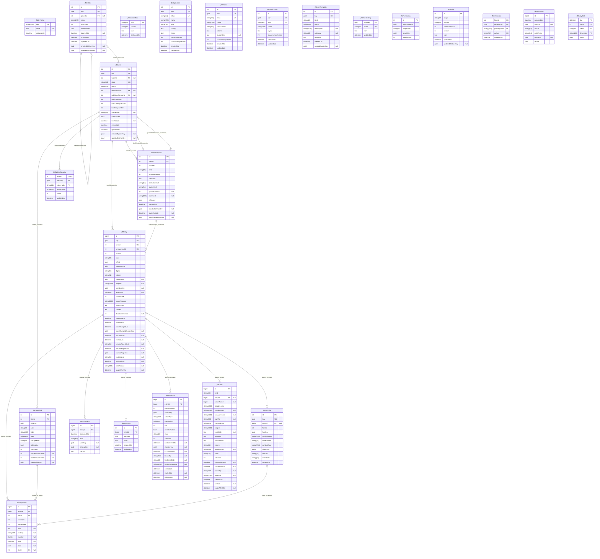

# Database

Jiron Form Builder keeps its data in 24 tables of its own, next to Umbraco's, on SQLite or SQL Server. Form
definitions are versioned JSON documents; entries are rows with one typed value per answer, so they can be filtered,
sorted and exported in SQL ([ADR-0002](decisions/0002-form-definition-model-versions-and-public-projection.md),
[ADR-0003](decisions/0003-entry-storage.md)). This page describes schema v1 table by table. The diagram is generated
from the migration's snapshot classes, and a test (`DatabaseDocsTests`) fails when the two differ.

## Conventions

- **Names.** Tables are `jfb` plus a PascalCase noun, columns are camelCase, as Umbraco's own are. A single-column
  primary key is `id`; indexes are `IX_<table>_<columns>`, primary keys `PK_<table>`, foreign keys
  `FK_<table>_<referenced table>` (plus the column when a table refers to one table twice).
- **Identifiers.** Rows have integer ids for joins, `bigint` where a table grows with every entry. Anything that leaves
  the database (an API, a URL, an export) is named by its GUID `key` or by an alias, never by its id.
- **Times** are UTC. SQL Server stores them as `DATETIME`, rounded to about 3 ms, so lists order by time and then by
  id, and nothing compares stored times for equality. SQLite stores text that sorts correctly only while it is written
  one way, so times are written only as UTC `DateTime` parameters (ADR-0003).
- **Numbers** that visitors enter are doubles (`FLOAT`, `REAL`): exact for the at most 15 significant digits a number
  field accepts, and compared as numbers on both databases. The submitted text is kept beside them.
- **Text.** Every string column has a length, or is unbounded text (`NVARCHAR(MAX)`) that no index uses. Aliases are
  unique without regard to case on both databases: Umbraco creates text columns `COLLATE NOCASE` on SQLite and requires
  a case-insensitive collation on SQL Server. Every other text in a key is written by code in one fixed form (lowercase
  hex hashes, GUIDs, fixed words), so the collation never decides whether two keys collide. Option values are free
  text, so the capacity table keys them by their SHA-256 instead ([ADR-0033](decisions/0033-schema-v1.md)).
- **No NULL in keys.** No nullable column is part of a primary key or a plain unique index, because SQL Server treats
  NULLs there as equal and SQLite as distinct. A sentinel stands in (`Guid.Empty` for "global", `""` for the invariant
  culture or no dimension), or the index is filtered to the rows that have a value.
- **JSON columns** hold camelCase JSON; a missing property means the default.
- **Deletes.** Deleting an entry deletes its values, files, events, notes and action runs; its emails stay until their
  purge, unlinked. A form, a version, a field, a file or a folder that something still points at cannot be deleted:
  the services delete entries before their form, and the cleanup jobs skip what is in use.

## Migrations

The package migration plan `Jiron.Umbraco.FormBuilder` creates and upgrades the tables. Umbraco runs it at start-up
when `Umbraco:CMS:Unattended:PackageMigrationsUnattended` is on (the default); otherwise an administrator runs it from
the backoffice's Packages section. Each step runs in its own transaction with the state it reaches, and each is
idempotent, so a rerun changes nothing.

| State | Step | What it does |
| --- | --- | --- |
| `jfb-001-create-schema` | `CreateSchemaV1` | Creates every table below that is missing, its keys, and the filtered indexes. |
| `jfb-002-default-settings` | `CreateDefaultSettingsV1` | Adds the global row of each settings section (General, Email, Protection, Files, Privacy, Integrations) at version 1, holding no values: the defaults live in code. |
| `jfb-003-grant-forms-section` | `GrantFormsSectionV1` | Gives Umbraco's administrators group the Forms section, once. A flag in `jfbKeyValue` records it, so an administrator who removes the section later is not overruled. |

A step that has shipped is never edited; a change to the schema is a new step with snapshot classes of its own. Until
the stored state is the plan's last one, `IFormBuilderMigrationState` reports the migrations as pending, and the parts
of Jiron Form Builder that use the tables check it first (ADR-0033).

## Access

Every read and write goes through `FormBuilderDatabase` and the repositories in Core's `Persistence` folder
([ADR-0036](decisions/0036-database-gate-units-of-work-and-repositories.md)):

- **Units of work.** Each runs in its own Umbraco scope, behind one async gate that lets one unit at a time through on
  SQLite and every unit on SQL Server. A unit inside another joins its transaction, so a service makes several
  repository calls atomic by running them in one write.
- **One statement per state change.** A write starts with a write. The concurrency version, a free alias, an existing
  folder or the absence of entries are conditions of the write itself, never read first. An insert that must happen
  once is `INSERT … SELECT … WHERE NOT EXISTS`, which locks the checked range on SQL Server.
- **Refusals write nothing.** A stale version throws `FormBuilderConcurrencyException`. A taken alias or key, a
  missing folder, a folder moved below itself or deeper than 32 levels, a folder with contents and a row still in use
  throw `FormBuilderConflictException`, which names the reason.
- **The library and the grants** work the same way ([ADR-0037](decisions/0037-library-and-permission-repositories.md)).
  Option lists, themes and email layouts are changed and deleted against their concurrency version, and a theme stays
  while a form's published version names it. A grant changes only from the permissions the editor saw, and a grant
  of nothing is no row.
- **Entries** ([ADR-0038](decisions/0038-entry-repositories.md)) take their form's next number from
  `jfbForm.lastEntryNumber`, raised as the first write of the unit, and are stored with their values and files in one
  unit or not at all. The insert itself refuses a submission id or a challenge the form has already seen, and a
  refused entry gives its number back. Values carry the text key rules compare by, and an entry's state changes only
  from the state the user saw. Events are only ever added, and a consent wording is stored once under its hash.
- **Entry lists** ([ADR-0039](decisions/0039-entries-query-builder.md)) come from the entries query builder, in the
  shapes ADR-0003 measured and only those: field filters as `IN` subqueries, keyset pages, a sort by a value that
  walks the value index and then lists the entries without a value, and a search that counts up to 1,000. Text
  compares by its key and then again in a binary collation; a key that may be cut compares the whole texts. Each
  list is one read with a time budget of 10 seconds: past it the statement stops (SQLite's progress handler, a
  cancelled command on SQL Server) and the read fails with `query_timeout`.
- **The outbox** ([ADR-0040](decisions/0040-outbox-repositories.md)): action runs and mail change state only through
  one conditional statement each. A claim names the row's state and writes a token of its own, and an attempt's
  outcome names that token, so a row is claimed once and a stale outcome changes nothing (ADR-0007). The runs one
  change queues for an entry are a batch: an earlier run of the batch holds a later one back while it runs, waits for
  its first attempt, or stops the rest and is not final. The processors pass the wait, the lease, the delay before the
  next attempt and how long mail is kept: the repositories decide no policy.
- **The audit log and daily statistics** ([ADR-0041](decisions/0041-file-store-audit-log-and-daily-stats.md)): an
  audit entry is added in the unit of the change it records, with details built only from keys, numbers, flags, enum
  values, times and identifiers; a view is recorded once per user, item and window by one `INSERT … WHERE NOT EXISTS`.
  A count is an update, then an insert where the form exists and the row does not, then an update again, so counters
  stay right when servers count at once and a late count never brings back the statistics of a deleted form.
- **Guards are locking reads.** A check whose answer must hold until the unit ends (a row that must stay, or rows that
  must not appear) reads with `UPDLOCK, HOLDLOCK` on SQL Server, so a writer at the same moment meets the repository's
  refusal, not a foreign key's error, also under read-committed snapshot (ADR-0038).
- **Reruns.** A unit that meets a lock conflict runs again, up to three attempts in all; a read also after a lost
  connection or a command timeout, but never after its own time budget ran out.
- **No connections of its own.** Core never opens a connection or creates a database. A unit test reads Core's IL to
  make sure.

## Diagram

Every column, with `PK`, `FK` and `UK` (a single-column unique index) and `null` for a nullable column. Lines are
foreign keys, labelled with the column and what a delete of the referenced row does. Links that are not foreign keys
(to option lists, themes, layouts and templates inside definitions, and to Umbraco's own rows) are drawn in
[architecture.md](architecture.md#3-the-data-model).

## Tables

### `jfbKeyValue`

One-time flags and small markers, such as the record that the Forms section was granted, or the hashes of mirrored
definition files. No indexes besides the primary key on `key`.

### `jfbFolder`

The folders of the forms tree. A folder in the trash keeps its place, so a restore puts it back under its parent, or
at the root when the parent is gone. `isRestricted` makes only the grants on it, and on what lies below it, count inside it (ADR-0013).

- `IX_jfbFolder_key`: unique.
- `IX_jfbFolder_parentId`: the children of a folder, and the check that refuses to delete a folder that has any.

### `jfbForm`

One row per form. The name, alias and folder live here rather than in the definition, so restoring an older version
never renames or moves a form. `draftVersionId` and `publishedVersionId` point at its current versions;
`publicRevision` rises only when what visitors see changes (ADR-0002). `concurrencyVersion` rises with every save, and
a save based on an older one is refused. `lastEntryNumber` hands out entry numbers with one atomic update. `themeAlias`
copies the published version's theme, for the theme library's "used by" list (ADR-0015).

- `IX_jfbForm_key`, `IX_jfbForm_alias`: unique; the alias without regard to case, trashed forms included.
- `IX_jfbForm_folderId`: the forms of a folder.
- `IX_jfbForm_trashedUtc`: the trash.

### `jfbFormVersion`

Every save of a form adds a version: drafts, and the published versions entries are submitted with. The definition is
stored whole, with the hash of its text and of its public projection. Published versions are never pruned; old draft
saves are, except pinned ones and any an entry points at.

- `IX_jfbFormVersion_formId_number`: unique; the history of a form in order.

### `jfbFormField`

The field catalogue: every field a form has published, plus fields that so far exist only in a draft (for test
entries). Entry columns, exports and search read it, and each value refers to its field by this table's id.
`firstVersionNumber` and `lastVersionNumber` say in which published versions the field appeared.

- `IX_jfbFormField_formId_fieldKey`: unique; a field key once per form.

### `jfbEntry`

One row per entry, numbered per form from `jfbForm.lastEntryNumber` (drafts and test entries too, ADR-0038).
`submissionId` and `digest` make retries safe: the same submission returns the first receipt, a different one with
the same id is refused (§4.4). `state` is the entry's place in the review workflow; `isTest` marks
entries from the preview. The search text holds the answers cleaned and folded the way rules compare text, one per
line, and leaves out sensitive fields (ADR-0039).
Resume tokens and challenges are stored only as hashes and ids.

- `IX_jfbEntry_key`: unique.
- `IX_jfbEntry_formId_number`, `IX_jfbEntry_formId_submissionId`: unique within the form.
- `IX_jfbEntry_formId_challengeId`: unique, over the entries that have a challenge (filtered).
- `IX_jfbEntry_resumeTokenHash`: unique, over the entries that have a resume token (filtered).
- `IX_jfbEntry_formId_submittedUtc`, `IX_jfbEntry_formId_state_submittedUtc`: the entry lists.
- `IX_jfbEntry_formVersionId`: the versions entries point at, so pruning a draft save checks without a scan.
- `IX_jfbEntry_memberKey`: a member's entries, for privacy requests.
- `IX_jfbEntry_purgeAfterUtc`: retention.

### `jfbEntryFile`

Uploaded files. The bytes live in the file store under `storedName`, a random name; the original name is kept for
downloads only. A file is linked to its entry when the entry is stored, and files that stay without one for a day are
cleaned up (ADR-0006).

- `IX_jfbEntryFile_key`: unique.
- `IX_jfbEntryFile_entryId`: the files of an entry.
- `IX_jfbEntryFile_createdUtc`: the cleanup of orphans.

### `jfbEntryValue`

One row per answer, or per item of a multi-value answer (`valueIndex`) and per row of a repeater (`rowIndex`). The
typed columns are filled by the field's storage kind: `text` with `textKey` (for a value that is text only, the text
cleaned and folded as rules compare it, cut to 256 code units; ADR-0005, ADR-0038), `number`, `date`, `bool` or
`fileId`, at most one of them. Values refer to their field without a cascade: a field that has values cannot be
deleted. On SQL Server the column's case-insensitive collation can treat keys as equal that rules keep apart (`ß` and
`ss`), so the entries query builder compares a key again in a binary collation after the seek (ADR-0038, ADR-0039).

- `IX_jfbEntryValue_entryId_fieldId`: the answers of an entry.
- `IX_jfbEntryValue_fieldId_textKey_entryId`, `IX_jfbEntryValue_fieldId_number_entryId`,
  `IX_jfbEntryValue_fieldId_date_entryId`: filters and sorts by a field's value, the query shapes of ADR-0003.
- `IX_jfbEntryValue_fileId`: the values of file fields (filtered), so deleting a file checks without a scan.

### `jfbConsentText`

The exact wording of every consent a visitor gave, stored once and named by the SHA-256 of its culture and text (the
culture's UTF-8 bytes, one zero byte, the text's UTF-8 bytes; ADR-0038); a consent value stores that hash. No
indexes besides the primary key on `hash`.

### `jfbEntryEvent`

The timeline of an entry: submitted, changed, forwarded, and so on. `changeKey` ties together the events of one change
by a user, a bulk change included, so it can be undone (ADR-0023).

- `IX_jfbEntryEvent_entryId_occurredUtc`: an entry's timeline.
- `IX_jfbEntryEvent_changeKey`: the events of one change.

### `jfbEntryNote`

Internal notes on an entry, never sent anywhere.

- `IX_jfbEntryNote_entryId`: the notes of an entry.

### `jfbActionRun`

The outbox: one row per action an entry triggered, with its order (`seq`), state, attempts and the lease of the server
that is running it (`lockedBy`, `lockedUntilUtc`). Errors are stored sanitised, as a code and a message; a skipped run
says why with the code `stopped` (an earlier run stopped the rest) or `undone` (ADR-0023, ADR-0040).

- `IX_jfbActionRun_state_nextAttemptUtc`: what is due.
- `IX_jfbActionRun_entryId_seq`: the runs of an entry in order.
- `IX_jfbActionRun_changeKey`: the runs one change queued, a batch (ADR-0040), and for undo.

### `jfbEmail`

The outgoing mail queue: the message as it will be sent, its state and attempts. Mail outlives the entry that caused
it until its purge (`entryId` is then empty). `recipientKey` is the visitor's address folded, so the per-address limits
count every spelling of one mailbox (ADR-0012). `lastError` holds an error as `code: message`, and `purgeAfterUtc` is
set once the mail is final or uncertain (ADR-0040).

- `IX_jfbEmail_state_nextAttemptUtc`: what is due.
- `IX_jfbEmail_entryId`: the mail of an entry.
- `IX_jfbEmail_recipientKey_createdUtc`: the per-address limits.
- `IX_jfbEmail_purgeAfterUtc`: the purge.

### `jfbOptionCapacity`

Places taken on options with a limit; the limit itself is in the definition. A place is taken with one conditional
update, so two visitors can never take the last place twice. The key is the form, the field and the SHA-256 of the
option's value; the value itself is kept beside it for reading. No indexes besides the primary key.

### `jfbOptionList`

Shared option lists: typed in by editors, or read from content, a data type, a URL, a file or code.

- `IX_jfbOptionList_key`, `IX_jfbOptionList_alias`: unique; the alias without regard to case.

### `jfbTheme`

Themes for the rendered forms: a base theme, design tokens and optional custom CSS. The default theme is a setting.

- `IX_jfbTheme_key`, `IX_jfbTheme_alias`: unique; the alias without regard to case, and fixed once created. A
  theme cannot be deleted while a form's `themeAlias` names it.

### `jfbEmailLayout`

Layouts for outgoing mail: logo, colours, header and footer per culture. The default layout is a setting.

- `IX_jfbEmailLayout_key`, `IX_jfbEmailLayout_alias`: unique; the alias without regard to case.

### `jfbFormTemplate`

Templates users saved: whole forms, and groups of fields the designer inserts as copies. The built-in templates ship
inside the package.

- `IX_jfbFormTemplate_key`: unique.

### `jfbUserSetting`

A backoffice user's own choices, the same on every device: column sets, saved filters, export choices. No indexes
besides the primary key on the user and the setting's name.

### `jfbPermission`

What a user group may do, globally (`targetKey` is `Guid.Empty`), in a folder or on a form, as flags (ADR-0013).

- `IX_jfbPermission_userGroupKey_targetType_targetKey`: unique; one row per group and target. No row holds 0, and
  a change names the permissions the row holds now, which work as its version (ADR-0037).

### `jfbSetting`

The backoffice settings, one row per section and scope: `global`, or the key of a site's root. `schemaVersion` lets
code upgrade old values; `version` makes a save based on older values fail (ADR-0008).

- `IX_jfbSetting_scope_section`: unique.

### `jfbReference`

Where forms are used: one row per form, content item, property and culture, refreshed when content is saved, because
Umbraco's own relations link only its own nodes (ADR-0017). It names the form without a foreign key, so a content save
never fails over a form that is gone. No indexes besides the primary key.

### `jfbAuditEntry`

Who did what to which item and when, never with field values (ADR-0041). The action is `entity.verb`, the user is
null for Jiron Form Builder's own jobs, and the details are a JSON object of keys, numbers, flags, enum values, times
and identifiers; details about an entry name its fields by key. Entries never change and outlive what they name;
retention deletes them oldest first, in batches. SQL Server compares actions and entity types ignoring case, so none
differs from another in case only.

- `IX_jfbAuditEntry_occurredUtc`: the log in order.
- `IX_jfbAuditEntry_entityKey`: the history of one form, entry or setting.

### `jfbDailyStat`

Counters per day, form, metric and dimension (views, starts, submissions, spam, pages reached, invalid fields, and so
on). New metrics need no migration, and the counters hold no personal data: a metric is one camelCase word, and a
dimension a key, an hour, or a field key and an error kind. Like `jfbReference`, it names the form without a foreign key,
so counting never fails over a form that is being deleted; a count for a form that does not exist adds nothing, and
deleting a form deletes its values. Every unit that writes a form's values holds the form's row first, as the form's
delete does, so they take turns and never deadlock; deletes and retention go a form and a day at a time, each a seek
on the key. Days are midnights in UTC. No indexes besides the primary key.
