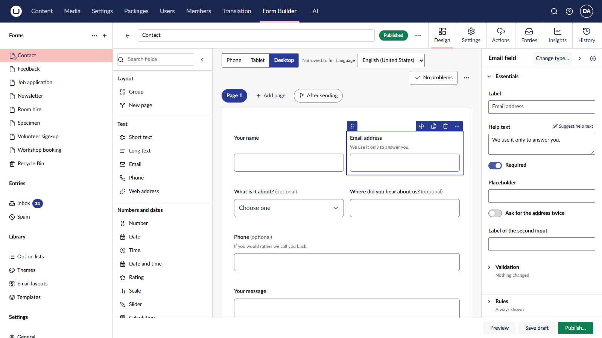
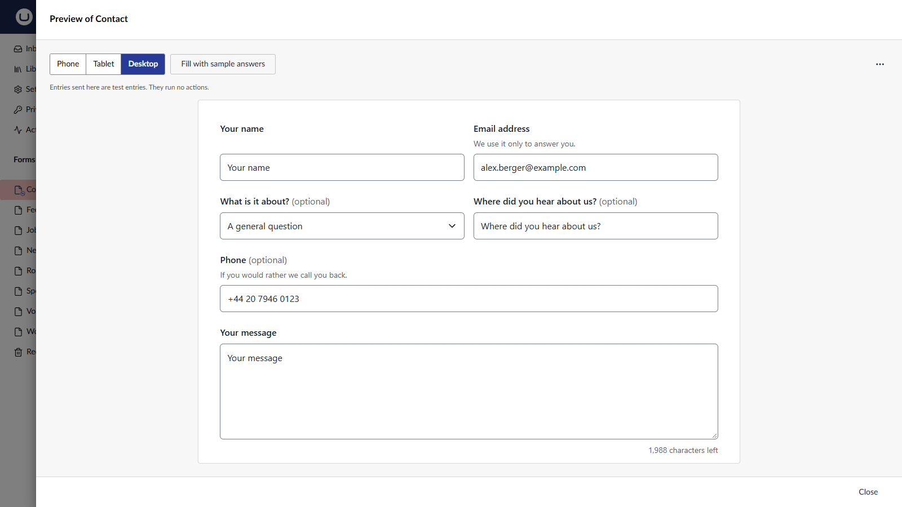
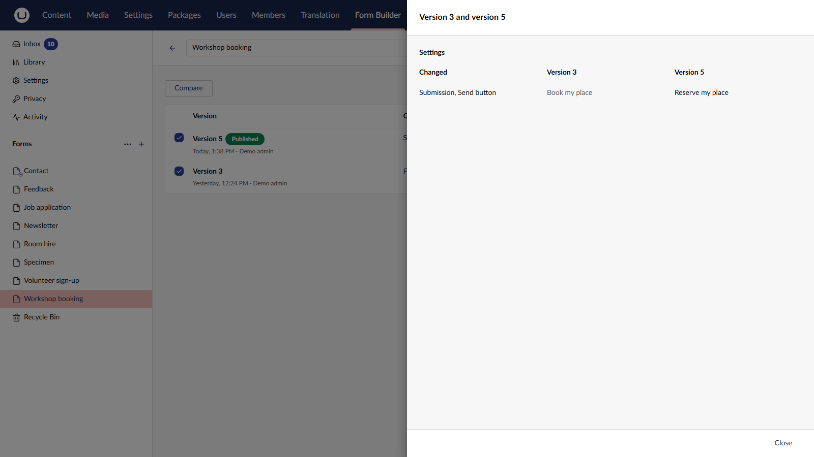

# The editor's guide

How to find your way around the Form Builder section, design a form, publish it and keep track of its versions. The
field types, rules, actions and entries each have a page of their own; this page links to them where they come up.

## Contents

- [The section](#the-section)
- [Creating forms](#creating-forms)
- [A form's workspace](#a-forms-workspace)
- [The Design view](#the-design-view)
- [The Settings view](#the-settings-view)
- [Publishing](#publishing)
- [Preview](#preview)
- [History](#history)
- [Templates](#templates)
- [Languages](#languages)
- [The AI add-on](#the-ai-add-on)

## The section

Choose **Form Builder** in the backoffice's top bar. What you see depends on your user group's permissions
([permissions.md](permissions.md)); a heading in the sidebar appears only when you may open something below it.

- **Overview,** the start page: the setup checklist while a site is new, the health of the installation, the latest
  entries and how each form is doing.
- **Forms:** your folders and forms, with the **Recycle Bin** last. A form that isn't published is shown muted, a
  restricted folder or form shows a lock, and a form with entries you haven't seen shows a dot.
- **Entries:** the **Inbox**, with every form's new entries in one list, and **Spam** ([entries-and-exports.md](entries-and-exports.md)).
- **Library:** option lists, themes, email layouts and templates that every form can use.
- **Settings, Privacy and Activity,** for users whose group may manage settings or use the privacy tools
  ([permissions.md](permissions.md)): the site's defaults, access, retention, the privacy tools, the delivery log and the
  audit log.

Umbraco's search in the header has a **Forms** tab too. It finds forms by name or alias, and fields of every form by
label or alias; choosing a field opens its form with that field selected.

## Creating forms

**+** beside the Forms heading, or on a folder, opens the create menu. The new form lands in that folder.

- **Form** creates an empty form named "Untitled form", with the name ready to type. Its canvas suggests a first
  field, or pasting a list of questions.
- **Form from a template…** opens the template gallery: nine built-in templates (contact, callback, newsletter, event
  registration, job application, feedback, quote request, support request and privacy request), and any your site has
  saved. The chosen template's preview stands beside the list. **Use template** creates the form.
- **Import a form…** takes a JSON file that a site running Jiron Form Builder exported. The form arrives as a new
  draft; the dialog first says what it holds and what this site lacks, such as a theme or a page an outcome leads to.
  An export never holds entries, files or access settings.
- **Folder…** creates a folder. Folders keep forms together and can have access settings of their own.

With the AI add-on, the menu also offers **Draft a form with AI…** ([below](#the-ai-add-on)).

### A form's "…" menu

Each form in the tree, and the open form's header, has a **…** menu:

| Item | What it does |
| --- | --- |
| Restore an earlier version… | Compares an earlier version with the draft and restores it ([History](#history)). In the open form only. |
| Duplicate… | Copies the form under a new name. **Copy its actions too** is on by default. A copy never takes the form's own access settings; it gets those of the folder it lands in. |
| Move to… | Moves it to another folder. If more user groups would see it there, you are asked first. |
| Copy actions to… | Copies its actions to another form, and then lists anything the other form lacks for them. |
| Save as template… | Saves it as a template for new forms ([Templates](#templates)). |
| Export as JSON | Saves its draft as a JSON file that another site can import. |
| Replace from a file… | Makes an exported file this form's draft. Its name, entries and access stay. |
| Permissions… | Limits which user groups may do what with it ([permissions.md](permissions.md)). |
| Trash | Moves it to the Recycle Bin. |

**Trash** asks first only when a page's form picker or form block uses the form, and names those pages: they show
nothing in its place until the form is restored. A form placed in a template by code is not known to it, so check your
views before trashing one placed that way. Otherwise the form moves at once, and the message that follows offers
**Undo** for 10 seconds.

A folder's own page lists its forms with their entries over the last 30 days; its name in the header is where you
rename it. An empty folder can be deleted from its "…" menu.

### The Recycle Bin

Trashed forms wait in the Recycle Bin with their entries. **Restore…** puts a form back where it was, or at the top of
Forms if its folder is gone. **Delete…** deletes it for good, with its entries and uploaded files; a legal hold on any
of its entries prevents that until the hold ends ([privacy.md](privacy.md)). **Empty recycle bin…** deletes everything
in it, and cannot be undone.

## A form's workspace

Opening a form shows its name, its state and its views.

- **The state:** **Draft** (never published), **Published**, **Published (pending changes)** (published, with a newer
  draft) or **Unpublished** (published before, now offline).
- **The views:** **Design**, **Settings**, **Actions**, **Entries**, **Insights** and **History**. You see the ones
  your permissions allow, and the form opens on the first of them.
- **The footer:** **Preview**, **Save draft** and **Publish…**.

Everything you change in Design, Settings and Actions changes the **draft**. **Save draft** keeps it; visitors keep
getting the published version until you publish. If someone else saved the form after you opened it, your save stops
and **Review both versions** shows each difference side by side, so you choose what stays; nothing you changed is
lost.

The other views have pages of their own: [actions.md](actions.md), [entries-and-exports.md](entries-and-exports.md)
and [insights.md](insights.md).

## The Design view

The palette is on the left, the form in the middle and the inspector on the right. On a smaller screen the palette and
inspector fold to the side; below 700 pixels they open over the form, and Esc closes them.

### Adding fields

The **palette** lists, in order: the field types you used most recently, **Layout** (a **Group** and **New page**), the
field types by kind, your site's **Saved groups**, and **Paste questions…**. Its search finds a type by name.

A field you pick lands at the insertion point you opened, else after what is selected, else at the end of the page.
Between any two elements, **Add a field here** appears when you point at the gap or reach it with the keyboard, and
every page ends with **Add field**. You can also drag a type from the palette onto the form.

[field-types.md](field-types.md) describes every field type and its settings.

**Paste questions…** turns a list into fields: one question per line, up to 50. Each line becomes a field whose type is
guessed from its words, such as an email field for "Your email address" or a long text for "Your message". You can
change any type in the list before you add them.

### Pages, groups and After sending

The steps across the top of the form are its pages, then **Add page**, then **After sending**.

- **A page** is shown by choosing its step, and moved by dragging its step. **New page** in the palette, or **Start a
  new page after this** on a field, splits a page at that point.
- **A group** holds fields side by side in one to four columns, plainly or as a card. A **repeatable group** lets
  visitors add the same set of fields more than once.
- **After sending** shows what visitors get once they have sent the form: its first outcome, or the standard thank-you
  message. **Change** opens it in the Settings view ([After sending](#after-sending)).

### Selecting, moving and deleting

Choose an element to select it; Esc clears the selection. The selected element shows its actions: **Move to…**,
**Duplicate**, **Delete** and, under **…**, **Change type…**, **Start a new page after this**, **Copy alias** or, for a
group, **Save group as template…**.

To move an element, drag its handle at the top left. A line shows where it lands; where it can't go, the line changes
colour and says why, for example because a rule would then wait on its own answer, or because a form holds only one
captcha. **Move to…** does the same from a list, and Alt+↑ or Alt+↓ moves it one place at a time.

Deleting or moving shows a message with **Undo**. Every change in the designer can be undone with Ctrl+Z (Cmd+Z on a
Mac) and redone with Ctrl+Y, also from the canvas's **…** menu.

### Keyboard shortcuts

They act on the field, group or page you are on. **?** shows them in the designer.

| Keys | What it does |
| --- | --- |
| Ctrl+Z | Undo the last change |
| Ctrl+Y or Ctrl+Shift+Z | Redo what was undone |
| Ctrl+D | Duplicate it |
| Delete | Delete it; the message that follows offers Undo |
| Alt+↑ / Alt+↓ | Move it one place up or down, at the end into the next group or page |
| ↑ / ↓ | Go up or down the page |
| F2 | Edit a field's label in place (a double click does too) |
| Esc | Clear the selection, close the palette, or stop a drag |
| ? | Show these shortcuts |

Inside a text box, the box keeps its own undo and the shortcuts don't apply.

### The inspector

The inspector shows the selected element's settings in sections, from what most forms need to what few do:

- **Essentials:** the label, help text, whether an answer is required, the placeholder and, for choice fields, the
  options.
- **Validation:** the checks on an answer, such as a length, a pattern or "each answer only once", and the message for
  each ([rules-and-validation.md](rules-and-validation.md)).
- **Rules:** when the element is shown, hidden or required.
- **Appearance:** hiding the label, the width in a group of columns, and the type's own look.
- **Advanced:** the alias, a default value or prefill, autocomplete, whether the answer is sensitive, how long it is
  kept, whether emails list it, and a CSS class.

Essentials is open at first; the other sections stay open or closed as you leave them in this browser. A closed
section sums up what is set in one line, and a long section shows its first seven settings with **More options** for
the rest. A setting the site's configuration fixes is shown read-only, with the key that sets it.

The **alias** names the answer in merge tags, exports and the API. Changing the alias of a field that already has
entries asks first; merge tags written with the old alias keep working ([merge-tags.md](merge-tags.md)).

**Change type…** turns a field into another type, and first lists what the field would lose and what it would then
need. Answers already sent keep their values.

### The form check

The badge in the canvas's toolbar shows how many problems the form check finds, and opens its list. **Errors** block
publishing; **warnings** and **suggestions** don't. Each problem names the element and what is wrong, and **Fix it**
selects the element and opens the setting. Typical ones: a field without a label, personal data asked for without a
consent field, a card number asked for, or outcomes that leave some visitors without one.

## The Settings view

The form's settings, in groups: **Submission**, **After sending**, **Availability**, **Spam protection**,
**Privacy**, **Appearance** and **Developer**. A closed group sums up its settings in one line. A setting offered as
**Site default (…)** follows the site's own setting, also when that changes later.

### Submission

- **Send button:** its label. The labels of the next and back buttons are under **More options**.
- **Store entries:** always, for a number of days, or never. **For a number of days** is a ceiling: an entry goes
  after that many days, however long its state would keep it under Privacy. **Never** still runs the actions, but keeps
  no entry.
- **Manual approval:** entries wait until someone approves or rejects them. Without it, every entry is approved as it
  arrives ([entries-and-exports.md](entries-and-exports.md)).
- **Email verification:** visitors confirm their address through a link before any action runs, as newsletters need.
  It needs an email field outside repeatable groups; the link is valid for 7 days unless you change it
  ([actions.md](actions.md)).
- **Entry title:** names each entry in the lists, with merge tags. Sensitive answers are left out.

Under **More options**:

- **Visitor texts:** your own words for the hints, notices and error messages the form shows, per language. Texts you
  don't reword keep the site's words ([multi-language.md](multi-language.md)).
- **Summary page:** visitors check their answers on one page before they send.
- **Progress:** numbered steps, a bar or nothing, on forms with more than one page.
- **Save and continue later:** visitors can save their answers and get a link by email to finish later, on the page
  the form is on. The link works for 30 days unless you change it (1 to 365). Files, consents and sensitive answers
  are not saved, so the form asks for them again. It needs entries to be stored.
- **Entry reference:** a prefix, the number of digits and whether the year is included. Visitors see the reference
  after they send, and the merge tag `{{ entry.reference }}` writes it.

### After sending

What visitors get once they have sent the form is its **outcomes**: a message in place of the form, a redirect to a page
or address, or a message and then a redirect. **Visitors get the first outcome whose rule matches,** so put the outcomes
with rules first and leave the last without a rule; the list says for each one when it is used. A form placed with a
form picker whose **Page after a send** is set goes to that page instead
([multi-site.md](multi-site.md#the-form-picker)). Without any outcome, visitors get the standard message, "Thank you. We
have received your message."

An outcome's message can **show a copy of the answers** below it, with a print button. A redirect waits a few seconds
first if it follows a message (5 by default). **Preview with a sample entry** shows the outcome with sample answers.

### Availability

- **Opens** and **Closes:** times in the time zone set for all sites (Settings › General). Empty, the form opens at
  once and stays open.
- **Entry limit:** the form closes once it has this many entries.
- **Message while closed:** shown in place of the form before it opens, after it closes and once it is full.
- **Who can fill it in:** anyone, members only, or members of chosen groups, with **One entry per member** if each
  member may send it once ([members.md](members.md)).

### Spam protection

How the form tells people from robots: the site's default, **Standard** (nothing loads from elsewhere), **Standard
with proof of work**, or a captcha provider the site has keys for. **Content checks** set how much links and blocked
words count towards Spam. [spam-protection.md](spam-protection.md) explains each.

### Privacy

How long entries are kept in each state, what each entry keeps of the visitor's IP address, whether the form counts
what visitors do for its Insights view, and whether its entries stay **Anonymous** even when a member is signed in.
Empty days follow the site's retention ([privacy.md](privacy.md)).

### Appearance

The **theme**, which fields get a mark (required ones with an asterisk, or optional ones with "(optional)"), whether a
list of problems appears above the form when a visitor sends with mistakes, how choice fields lay out their options,
and a CSS class for the site's own styles ([themes.md](themes.md)).

### Developer

The form's **alias**, with **Copy alias**: templates and code place the form by it, and renaming the form keeps it.
**Headless access** lets a headless site read the form from the public API. **Query values** and **Context values**
name the values from the page's address or the site's code that the form may read or store
([rendering.md](rendering.md), [headless.md](headless.md)).

## Publishing

**Publish…** saves any unsaved changes, then opens the publish dialog:

1. **The form check's result.** Errors must be fixed first; **Fix it** takes you to each one. Warnings don't block
   publishing.
2. **What changed** since the version visitors get, in fields, settings, actions and rules.
3. **A comment for this version,** optional, which History shows.

**Publish** makes this version the one visitors get. Each entry remembers the version it was sent with.

On a published form, the messages after adding an outcome or an action remind you that visitors get it once you
publish.

## Preview

**Preview** saves any unsaved changes and shows the form as visitors get it, in its own theme, at phone, tablet or
desktop width. **Fill with sample answers** fills it in; its **…** menu switches the colour scheme or the language.

**Entries sent in the preview are test entries.** They run no actions, never appear in the Inbox or the lists of
entries, and are deleted after 7 days. Users who may manage the form's actions can turn on **Run actions for test
entries**, or run them for one test entry after sending; then the emails and messages really go out.

A draft whose rules have errors can't be previewed until the form check's errors are fixed.

## History

The **History** view lists the published versions, newest first: when and by whom, what changed against the version
before, and the comment. The version visitors get is marked **Published**. **Show draft saves** adds the saves in
between.

- **Compare:** tick two versions, then **Compare** shows what was added, removed, moved or changed between them.
- **A version's name** opens it compared with the current draft, with **Restore as a new draft** and **Restore and
  publish…**.
- **A row's …** offers **Restore as a new draft**, **Pin** and a comment. A restore can be undone at once from its
  message.

Published and pinned versions are kept for good; how long draft saves are kept is set in Settings › General.
**Restore an earlier version…** in the form's "…" does the same from any view.

## Templates

A template is a starting point for new forms, or a group of fields that any form can insert.

- **A form as a template:** the form's "…" › **Save as template…**, with a name and a short description for its card.
  The template holds the form as last saved.
- **A group as a template:** a selected group's "…" › **Save group as template…**. It keeps the group's fields and
  their validation; rules that depend on fields outside the group are left out. The group then appears under **Saved
  groups** in every form's palette.

**Library › Templates** shows the built-in templates, saved forms and saved groups, with a preview of each. Saved ones
can be renamed or deleted there; forms already made from a template stay as they are.

## Languages

On a site with more than one language, **Language** in the canvas's toolbar and in the Settings view switches the texts
you see and edit. In another language, an empty box shows the default language's text, which visitors get until it is
translated, and elements with a missing translation say so.

A text written as `#key` takes its words from Umbraco's dictionary item of that key, in each visitor's language. Users
who can open Umbraco's Translation section get **Use a dictionary item** beside labels, help texts, placeholders,
titles, button labels and email subjects; other texts take a `#key` typed in, or `{{ dictionary.key }}` where they are
formatted.
[multi-language.md](multi-language.md) explains both ways.

## The AI add-on

With the optional `Jiron.Umbraco.FormBuilder.AI` package, the designer offers three helpers:

- **Draft a form with AI…** in the create menu writes a form from a description or a pasted questionnaire;
- **Translate with AI…** in the canvas's **…** menu fills in missing translations;
- **Suggest help text** beside a field's help text proposes a help text and better wording.

Everything it writes is a draft for you to review, and it never sees entries or answers. [ai.md](ai.md) says how to set
it up and what it sends.
