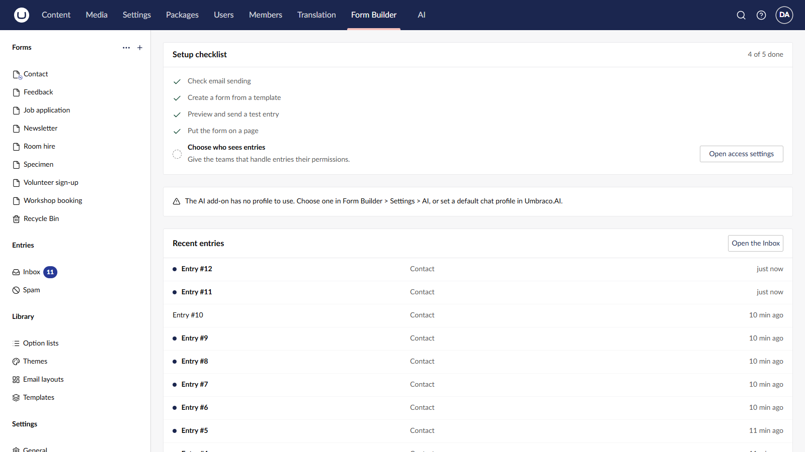
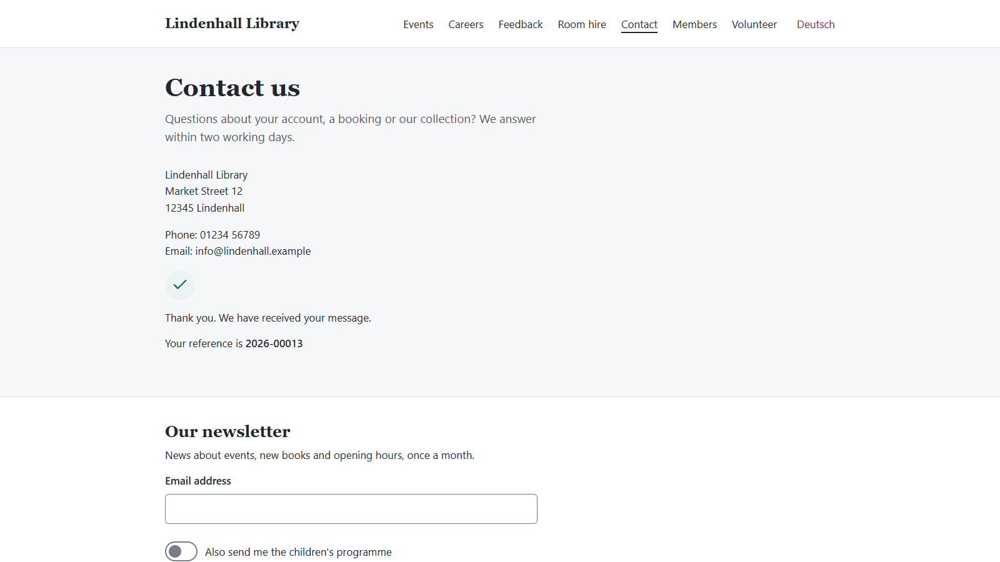

# Getting started

From installing the package to the first entry in your Inbox, in about ten minutes. This page takes the shortest path;
[installation.md](installation.md) explains each part in full.

## Before you start

- An Umbraco 17.6 or later site that runs, on .NET 10, with SQLite or SQL Server. A site made with `dotnet new umbraco`
  is fine.
- A backoffice user in Umbraco's **Administrators** group.
- For step 6, a published page with a template. A new site has none yet: under Settings, create a **Document Type
  with Template** that is allowed at the root, then create and publish a page of that type under Content.

## 1. Install the package

In the site's project folder:

```
dotnet add package Jiron.Umbraco.FormBuilder
```

Then build. No change to `Program.cs` is needed: Umbraco finds the package by itself.

## 2. Open Form Builder

Start the site. Its database tables are created as it starts. Sign in to the backoffice (reload it if it was already
open) and choose **Form Builder** in the top bar.



The section opens on its **Overview**, with a **Setup checklist** of five steps. Each step ticks itself off when it
is done, whoever does it, so you can follow it in any order. This page starts at its second step; the first, email,
comes under [What next](#what-next).

## 3. Create a form from a template

In the checklist, choose **Choose a template…**. The gallery opens with the **Contact** template selected: a name, an
email address and a message, then a thank-you message. Choose **Use template**.

The new form, named "Contact", opens in the designer. It is a draft: visitors see nothing of it until you publish it.

## 4. Preview it

Choose **Preview** at the bottom of the designer. The preview shows the form as visitors see it, at phone, tablet or
desktop width. **Fill with sample answers** fills it in for you; **Send** sends a test entry.

Test entries tick off the checklist step, but they never appear in the Inbox or in any list of entries, and they are
deleted after 7 days. The real entry comes in step 7.

## 5. Publish it

Choose **Publish…**. The dialog shows what the form check found and lets you add a comment for this version. For the
Contact form it suggests a consent field, as the form asks for an email address; a suggestion never stops publishing,
and [privacy.md](privacy.md) explains when you want one. Choose **Publish**. From now on, visitors get this version of
the form.

## 6. Put it on a page

The quickest way is one line in a page's template. Open the template in Umbraco (Settings › Templates) or in your
editor, and add:

```cshtml
@await Component.InvokeAsync("FormBuilderForm", new { form = "contact" })
```

`contact` is the form's alias, made from its name when the form was created; renaming the form keeps it. The form's
**Settings** view shows it under **Developer**, with **Copy alias**. That is all: the script and stylesheet the form
needs are added to the page by themselves.

If editors should place forms themselves, use a block instead. In the checklist, **Create a form block type…** creates a
"Form" block; you then add it to the Block List or Block Grid your pages use and write its view.
[installation.md](installation.md#a-form-block-for-editors) shows how.

## 7. Send an entry

Open the page on the website, fill in the form and choose **Send**. The form makes way for its thank-you message.



The Contact template sends no email. To get one for each entry, open the form's **Actions** view and choose
**Add action** (see [actions.md](actions.md)).

## 8. Find it in the Inbox

In the Form Builder sidebar, open the **Inbox**. The new entry is at the top, in bold as unseen. Select it to see the
answers, its timeline and its notes. The Overview lists it under **Recent entries** too.

## What next

The checklist has up to three more steps:

- **Put the form on a page:** a form placed in a template, as above, leaves it open. It ticks once the form block type
  exists or a page picks a form.

- **Check email sending:** Settings › Email › **Send test email** sends a message to your own address. Without a mail
  server, entries are still kept, and their emails go out once sending works ([email.md](email.md)).
  - **To read the mails on a local site,** let Umbraco write them to a folder instead of sending them. Create the
    folder first, then add this to `appsettings.Development.json`:

    ```json
    {
      "Umbraco": {
        "CMS": {
          "Global": {
            "Smtp": {
              "From": "noreply@example.com",
              "DeliveryMethod": "SpecifiedPickupDirectory",
              "PickupDirectoryLocation": "C:/temp/mail-pickup"
            }
          }
        }
      }
    }
    ```

  - **Links in emails,** such as the one that confirms an address, need the site's address. A local site usually has
    no `https` domain set in Umbraco, so enter the address the site runs on, as your browser shows it, in Settings ›
    General › **Base URL** ([email.md](email.md#links-in-emails)).
- **Choose who sees entries:** only administrators can open Form Builder at first. Another user group needs the
  section, added in Umbraco's Users section, and its permissions, set in Form Builder › Settings › Access, which also
  lists the groups that lack the section. The group's screen in Users › User groups shows its permissions in a
  **Form Builder** view and links there ([permissions.md](permissions.md)).

Then:

- [The editor's guide](editor-guide.md) tours the designer.
- [Rendering forms](rendering.md) covers every way to put a form on a page, and [headless sites](headless.md) the API.
- [The documentation index](README.md) lists every page.
