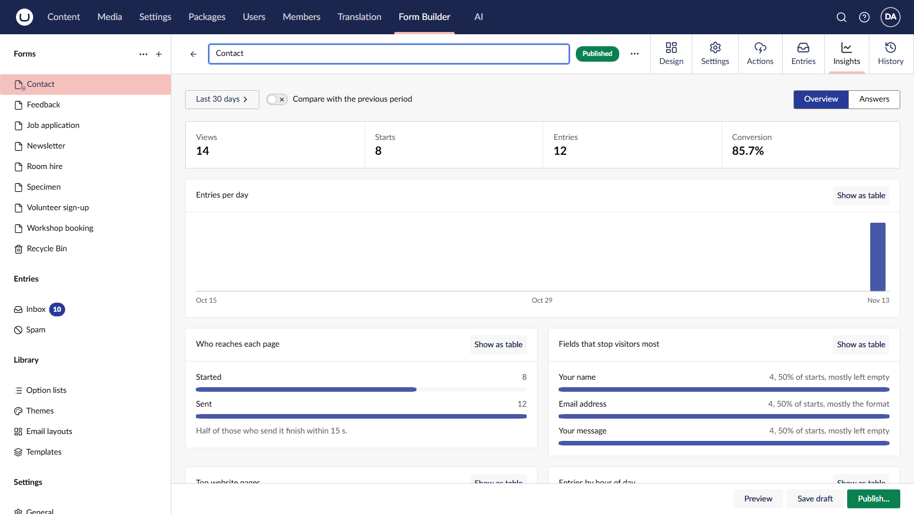

# Insights

How a form is doing: how many visitors see it, start it and send it, where they give up, and what they answer. Each
form has an **Insights** view; the Overview's **Forms at a glance** compares your forms.

Insights set no cookie, store nothing in the visitor's browser and count no person: only that a form was seen,
started or stopped at a field.

## Contents

- [The Overview](#the-overview)
- [Answers](#answers)
- [Forms at a glance](#forms-at-a-glance)
- [What is counted](#what-is-counted)
- [Turning it off](#turning-it-off)

## The Overview

Choose a **Date range** (the last 30 days unless you choose another), how to **Group by** (day, week or month), and
whether to **Compare with the previous period**. The view then shows:

- **Views, Starts, Entries and Conversion,** each with its change from the period before. A start is a visitor's first
  answer; conversion is entries per view. Entries also say how many were caught as spam.
- **Entries per day** (or week, or month), with the period before as a quieter bar.
- **Who reaches each page:** of the visitors who start a form with several pages, the share who reach each page and
  who send it, and how long half of those who send it take.
- **Fields that stop visitors most:** the fields whose problems held visitors up most often, and the most common
  problem, such as left empty, the format, or too long.
- **Top website pages:** the pages entries were sent from.
- **Entries by hour of day,** in the time zone of all sites (Settings › General).
- **Members:** on forms that signed-in members send, how many members sent how many entries.

**Show as tables** beside the range shows every chart as a table instead, on the Overview and the Answers alike, and
the view remembers it for you.

## Answers

**Answers**, beside **Overview**, sums up the answers of the entries in the date range, field by field:

- choices as bars of their share, with "Other" answers listed and options no longer on the form marked;
- a ranking by average place, and a grid row by row;
- numbers with their average, median, lowest and highest;
- a 0 to 10 scale grouped into 0 to 6, 7 and 8, and 9 and 10, with its **recommendation score**: the share who chose 9
  or 10, less the share who chose 0 to 6, from -100 to 100;
- free text as the newest answers, five at a time, each linking to its entry.

The list's **Filter** narrows them, for example to approved entries. Answers leave out test entries, spam, sensitive
fields and answers kept only until the actions ran. They come from the entries, so they work while counting is off.

## Forms at a glance

On the Overview, for users who may see entries: your forms with the most entries, with their views, starts, entries
and conversion, and their change from the period before.

## What is counted

- **From the page:** the form's script reports that a form was seen, started, reached its next page, or stopped a
  visitor at a field, and which kind of problem it was. Nothing else: no answer, no address, no identifier. Forms that
  run without JavaScript count only what the server sees.
- **From the entries:** how many arrived, from which page, at what hour and how long they took to fill in. Spam and test
  entries don't count here.

Counts are added up on each server and saved every 10 seconds. Days in the reports run from midnight to midnight UTC,
while Entries by hour of day follows the time zone set for all sites, so on a site far from UTC an evening's entries can
count for the next day. The counts are kept for three years.

Previews in the backoffice count nothing, and neither does the message of a closed form or what visitors see after
sending.

## Turning it off

- **For the whole site:** Privacy › Data collection › **Count what visitors do with the forms**. On by default.
- **For one form:** its Settings view › Privacy › **Insights**. On by default.

With either off, the form's page reports nothing; what was counted before stays until it is three years old.
[privacy.md](privacy.md) covers what the site collects.
