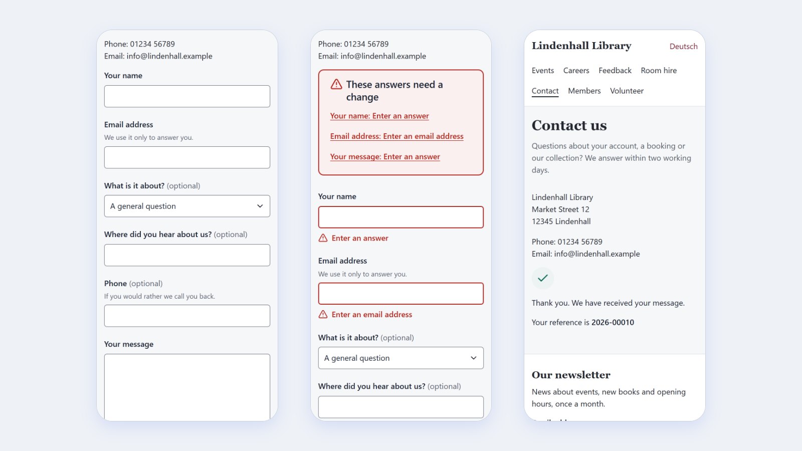
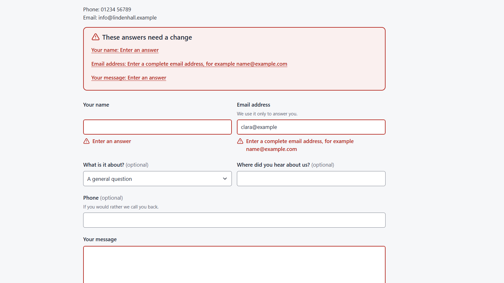

# Rendering forms

How a site puts forms on its pages with Razor, how they are styled and themed, what markup and events they offer to a
site's own code, and how they behave with caches, Content Security Policies and without JavaScript. For sites that
render their pages elsewhere, see [headless.md](headless.md).

## Contents

- [Placing a form](#placing-a-form)
- [Scripts and stylesheets](#scripts-and-stylesheets)
- [Themes](#themes)
- [Overriding views](#overriding-views)
- [The markup](#the-markup)
- [CSS custom properties](#css-custom-properties)
- [JavaScript](#javascript)
- [Save and continue later](#save-and-continue-later)
- [Without JavaScript](#without-javascript)
- [Content Security Policy](#content-security-policy)
- [Caching](#caching)
- [Context values and query values](#context-values-and-query-values)
- [Right-to-left](#right-to-left)

## Placing a form



Nothing needs registering: the package adds rendering, the public API and the middleware that serves its scripts and
stylesheets by itself, ahead of Umbraco's routing. A form must be **published** before it renders.

### The tag helper

Import the tag helpers once, in `Views/_ViewImports.cshtml`:

```cshtml
@addTagHelper *, Jiron.Umbraco.FormBuilder.Web
```

Then place a form by its alias or key:

```cshtml
<jfb-render form="contact" />
```

| Attribute | Takes | What it does |
| --- | --- | --- |
| `form` | text | The form's alias, in any letter case, or its key as a GUID with hyphens. |
| `picked` | `FormBuilderFormReference` | The form picker's value, written as code without `@`: `picked="reference"`. Keeps the picker's theme and page after a send, and wins over `form`. |
| `theme` | text | A theme's alias to render with here, instead of the form's own and the site's default. A theme the site lacks renders as `default`. |
| `assets` | `true` or `false` | Whether this placement writes the tags for the script and stylesheets. By default it does, once per page ([below](#scripts-and-stylesheets)). |
| `context-<name>` | text | A context value stored with the entry, such as `context-topic="@Model.Name"`. Only names the form lists under Settings › Developer › Context values are kept ([below](#context-values-and-query-values)). |

The element itself isn't written; its place gets the form.

### The view component

Without the tag helpers:

```cshtml
@await Component.InvokeAsync("FormBuilderForm", new { form = "contact" })
```

It takes `form` (a key, a key's text, an alias or a `FormBuilderFormReference`), `assets` (`bool?`), `context`
(`IReadOnlyDictionary<string, string?>`) and `theme` (`string`).

### From code

`IFormBuilderRenderer` renders a form as HTML wherever a site needs it, with the same markup and the assets once per
request; it returns null where no published form matches:

```csharp
var html = await renderer.RenderAsync(httpContext, new FormBuilderRenderRequest("contact") { Assets = false });
```

A page that adds such a fragment after it has loaded wakes it with `window.JironFormBuilder.init(holder)`
([JavaScript](#javascript)).

### The form picker

The **Jiron Form Builder form picker** property editor lets editors pick a form on a page. A data type made with it
takes these settings:

| Setting | What it does |
| --- | --- |
| Allow several forms | One form, or a list. |
| Allowed folders, Allowed forms | Which forms can be picked: those in the folders and below them, and those listed. With neither, every form. |
| Theme | Every form placed with this picker renders in this theme. |
| Page after a send | Visitors go to this page once they have sent a form placed here, instead of the form's outcome. |

In Razor, a single picker's value is a `FormBuilderFormReference` (null when empty) and a multiple picker's an
`IReadOnlyList<FormBuilderFormReference>`, which Models Builder types too:

```cshtml
@using Jiron.Umbraco.FormBuilder.Web.Rendering

<jfb-render picked='Model.Value<FormBuilderFormReference>("form")' />

@foreach (var picked in Model.Value<IReadOnlyList<FormBuilderFormReference>>("forms") ?? [])
{
    <jfb-render picked="picked" />
}
```

A reference holds the form's `Key`, the picker's `Theme` and its `Redirect`. The page after a send travels in Umbraco's
encrypted route token, so a visitor can't change it. In the Content Delivery API the picker's value is the form's key,
alias and name, or the form itself when expanded, and `null` for a form without Headless access
([headless.md](headless.md#the-content-delivery-api)).

### The form block

**Create a form block type…** makes a **Form** element type (alias `jfbFormBlock`) with one `form` property of a picker
data type, for editors to add to block lists and grids. The site writes the block's view as for any block;
[installation.md](installation.md#a-form-block-for-editors) shows it.

### What renders in a form's place

- **A published form:** the form.
- **A form not open yet, closed or full,** or one a visitor may not fill in (members only, already sent): its notice.
- **A missing, unpublished or trashed form,** or an empty picker: nothing, and the page renders as usual. The problem is
  logged once.
- **A form that fails while rendering,** for example in a view a site overrode: nothing for visitors, and for signed-in
  backoffice users a short note naming the error. The error is logged, and the page and its other forms are unaffected.
- **While the package's database migrations are pending:** nothing for visitors.

## Scripts and stylesheets

By default, each placement writes the tags its form needs, once per page: the functional base rules
(`/jfb/assets/themes/base.css`), the stylesheet of its theme, and the runtime script (`/jfb/assets/runtime/jfb-runtime.js`,
a module). Without anything else, they appear just before the first form.

**Better: put `<jfb-assets />` in the layout's `<head>`,** so the stylesheets load before anything shows. It writes the
same tags, for every form the page renders, including those in the body below it; the forms then write nothing more.

```cshtml
<head>
    …
    <jfb-assets />
</head>
```

A site that loads them itself turns the automatic tags off, and a placement then writes them only with
`assets="true"`:

```json
{ "JironFormBuilder": { "Rendering": { "IncludeAssetsAutomatically": false } } }
```

**The files** are embedded in the package and served from `/jfb/assets/` with Brotli and gzip copies, so there is nothing
to deploy as static files. Each tag carries the file's fingerprint (`?v=`), under which it is cached for a year as
immutable; the runtime's chunks are named by their content. The runtime loads only the parts a page's forms use, each
when first needed: the core is about 2.5 KB gzipped, and everything together about 60 KB
([performance.md](performance.md)).

## Themes

A form's theme is the first that is set of: the placement (`theme`, or the picker's), the form's own (Settings ›
Appearance), the site's default (Settings › General), and `default`. The built-in themes are `default`, `bootstrap5`
(Bootstrap's classes; the site loads Bootstrap itself, including its RTL build for right-to-left pages) and `unstyled`
(the base rules only). [themes.md](themes.md) covers the theme editor, which makes library themes on top of them.

A theme's stylesheet styles only its own forms, under `.jfb-form:where(.jfb-theme-default)`, so a site's CSS competes
with it as with plain `.jfb-form` rules. The form element carries `jfb-theme-<alias>`, and for a library theme its base
theme's class too.

**A theme of your own** in code implements `IFormBuilderTheme`: its name and label, a stylesheet (a local path or
none), classes for the slots of `FormBuilderThemeSlots` (such as `control`, `button-primary` or `error-summary`, added
to the package's own classes, never replacing them), tokens, whether it has a dark scheme, and its view folder.
Register it with `builder.JironFormBuilder().Themes().Append<AcmeTheme>()`. The site refuses to start with a theme that
breaks the rules, and says why ([extending.md](extending.md#themes-and-views)).

## Overriding views

Forms are drawn by Razor views a site can override one by one: `Form`, `Page`, `Group`, `Field`, `Navigation`,
`Progress`, `ErrorSummary`, `Summary`, `Outcome`, `Notice`, and `fields/<type>` for each field type, such as
`fields/text` or `fields/rating`. Each view is looked for in this order:

1. `Views/JironFormBuilder/<theme>/_forms/<form alias>/<View>.cshtml`, for one form;
2. `Views/JironFormBuilder/<theme>/<View>.cshtml`, for every form in the theme;
3. `Views/JironFormBuilder/default/<View>.cshtml`, where the built-in views ship, so a site file at the same path wins.

`<theme>` is the theme's view folder: its alias for the built-in themes, the base theme's for a library theme. A site's
own field type ships its view as `fields/<type alias>.cshtml` the same way.

**Start from the built-in view,** never from scratch. The package holds its views compiled, so copy the view from the
repository's
[`src/Jiron.Umbraco.FormBuilder.Web/Views/JironFormBuilder/default/`](../src/Jiron.Umbraco.FormBuilder.Web/Views/JironFormBuilder/default/),
at the tag of the version you run (such as `v17.0.0`), and change what you need. The views carry the hooks the runtime
and screen readers rely on, and leaving one out quietly drops a feature to its form without JavaScript.

Each view starts with a header that names its contract version:

```cshtml
@* jfb-view: Field 1 *@
@model Jiron.Umbraco.FormBuilder.Web.Rendering.Models.FieldViewModel
```

Keep it. When a version of the package changes a view's contract, its release notes in [upgrading.md](upgrading.md)
say so, and in Development the site logs a warning for each overridden view whose header names an older version.

The view models in `Jiron.Umbraco.FormBuilder.Web.Rendering.Models` carry everything a view needs, every view path
included. `FormBuilderHtml` has small helpers for overrides, such as `FormBuilderHtml.Attribute(name, value)`, which
writes an attribute only when it has a value. Emails have views of their own, in
`Views/JironFormBuilder/Emails/` ([actions.md](actions.md#email)).

## The markup

The markup is a contract: the class names, ids, `data-jfb-*` attributes and custom properties below stay the same within
a major version.



```html
<form class="jfb-form jfb-theme-default" id="jfb-1" data-jfb-form="…" data-jfb-contract="1" lang="en" dir="ltr"
      method="post" action="/contact#jfb-1" novalidate>
  <section class="jfb-page" data-jfb-page="…">
    <fieldset class="jfb-group jfb-columns-2" data-jfb-group="…">
      <div class="jfb-field jfb-field-email" data-jfb-field="…" data-jfb-alias="email" data-jfb-type="email">
        <label class="jfb-label" for="jfb-1-email">Email address</label>
        <input class="jfb-control" id="jfb-1-email" name="email" type="email" aria-describedby="jfb-1-email-help">
        <p class="jfb-help" id="jfb-1-email-help">…</p>
      </div>
    </fieldset>
  </section>
  <div class="jfb-navigation">…</div>
</form>
```

- **Ids:** forms are `jfb-1`, `jfb-2` and so on in the order a page renders them; a field's control is
  `<form id>-<alias>`, with `-help` and `-error` beside it.
- **Classes:** blocks such as `jfb-field`, `jfb-label`, `jfb-help`, `jfb-error`, `jfb-control`, `jfb-choices` and
  `jfb-button-primary`; modifiers such as `jfb-field-<type>`, `jfb-span-<n>`, `jfb-columns-<n>` and `jfb-group-card`.
  The form's own CSS class (Settings › Appearance) and a field's go on the form and the field.
- **State lives in attributes:** `hidden`, `disabled`, `aria-invalid`, `aria-current="step"`, `data-jfb-hidden` for
  what a rule hides, `data-jfb-busy` while sending, `data-jfb-mark="required"` or `"optional"`.
- **The form's data** travels in a `<script type="application/json" data-jfb-model>` block, which is data and never
  runs.

Every control reads without a theme: a rating's points hold their number, a scale's ends say their whole name, and
lists carry `role="list"`. The base rules every form gets, `unstyled` included, only hide what must be hidden and keep
controls within their field.

## CSS custom properties

The `default` theme reads its look from custom properties. Set any of them on `.jfb-form` or an ancestor:

```css
body {
  --jfb-color-accent: #8a1c3c;
  --jfb-radius: 4px;
}
```

| Property | Default | Used for |
| --- | --- | --- |
| `--jfb-color-text` | `#1d2433` | text and answers |
| `--jfb-color-text-muted` | `#5b6372` | help, marks, counters |
| `--jfb-color-surface` | `#fff` | controls, cards, notices |
| `--jfb-color-border` | `#767c88` | the edges of controls |
| `--jfb-color-rule` | `#d9dde3` | hairlines, the progress track |
| `--jfb-color-accent` | `#0f6e5c` | the primary button, chosen choices, links |
| `--jfb-color-on-accent` | `#fff` | text and ticks on the accent |
| `--jfb-color-button`, `--jfb-color-on-button` | the accent, on-accent | the primary button |
| `--jfb-color-button-hover` | `#125f54` | the primary button under the pointer |
| `--jfb-color-focus` | `#1a5fd1` | the focus ring |
| `--jfb-color-error` | `#b3261e` | errors |
| `--jfb-shade` | a soft shadow | card groups; `none` flattens them |
| `--jfb-radius` | `12px` | corners; panels, cards, controls and ticks scale from it |
| `--jfb-space-1` … `--jfb-space-7` | `4px` to `48px` | spacing on a 4 px grid |
| `--jfb-font-family`, `--jfb-font-size` | `inherit` | the site's font and size |
| `--jfb-line-height` | `1.5` | text |
| `--jfb-font-size-small`, `-large`, `-title` | `.875em`, `1.25em`, `1.5em` | help, group headings, page titles |
| `--jfb-font-weight-strong` | `600` | labels, headings, buttons |
| `--jfb-size-control` | `48px` | the height of controls |
| `--jfb-size-form` | `960px` | the form's widest width |
| `--jfb-focus-ring` | `2px solid` the focus colour | every focus ring |
| `--jfb-motion-fast`, `--jfb-motion-base` | `120ms`, `200ms` | presses, errors, pages |
| `--jfb-scroll-margin` | `6rem` | room above what scrolls into view, for sticky headers; read in every theme |

Only `--jfb-*` names are the contract. The layout follows the form's own width, not the window's, so a form in a narrow
column lays out as on a phone. Typed text is never smaller than 16 px, and with reduced motion nothing moves.

**Dark scheme:** the `default` theme has one, for a class on the form or any ancestor: `jfb-scheme-dark` always, or
`jfb-scheme-auto` when the visitor's system asks for dark, such as `<html class="jfb-scheme-auto">`. A site that sets a
colour sets it for the dark scheme too. Without a class, the runtime switches a form to dark by itself when it stands on
a dark background; on a background image, set the class.

## JavaScript

The runtime installs `window.JironFormBuilder`:

| Member | What it does |
| --- | --- |
| `version` | The runtime's version. |
| `init(root?)` | Enhances forms added to the page later, below `root` (the document by default); each form once. |
| `get(form)` | The API of one form element, or null. |
| `consent.grant('captcha')`, `consent.withdraw()`, `consent.has('captcha')` | For a site's consent manager, where the spam protection waits for it ([spam-protection.md](spam-protection.md#consent)). |

A form's API, from `get(form)`, has `validate()`, `submit()`, `next()`, `back()` and `values()`, each returning a
promise: the checks as a send makes them, the buttons as a visitor presses them, and the answers as they would be sent.

**Events** are dispatched on the form element and bubble, so a site listens on `document`. None carries an answer.

| Event | When | `detail` |
| --- | --- | --- |
| `jfb:ready` | a form is enhanced | `{ key, alias }` |
| `jfb:page` | another page shows | `{ key, alias, page, number, total }` |
| `jfb:invalid` | a send or Next is refused by the checks | `{ key, alias, scope, errors: [{ field, kind }] }` |
| `jfb:submitting` | a send starts | `{ key, alias }` |
| `jfb:submitted` | the entry is stored, before the outcome shows | `{ key, alias }` |
| `jfb:error` | a send fails | `{ key, alias, code }`: `timeout`, `rate_limited`, `server_error` or `form_changed` |
| `jfb:consent` | consent is granted or withdrawn, on `document` | none |

```js
document.addEventListener('jfb:submitted', (event) => {
  analytics.track('form sent', { form: event.detail.alias });
});
```

Jiron Form Builder tracks nothing itself; the events are there for a site's own analytics. To hear `jfb:ready` for the
forms present when the page loads, add the listener before the asset tags.

## Save and continue later

A form with **Save and continue later** on (its Settings view › Submission › More options) offers it with its
buttons, with JavaScript, on a page of the site, which the link a visitor gets by email comes back to. A panel takes
the buttons' place: it says what is not kept and for how many days, and asks for the address; a notice then says
where the link went and until when it works. The link brings the answers back on the page they were saved on, with a
notice to add files, consents and sensitive answers again, which are never saved
([ADR-0163](decisions/0163-save-and-resume.md)). A link that was used, or whose time is over, says so above the
empty form.

- **The link's token** is in the address's fragment, which no browser sends to a server. The runtime takes it out of
  the address at once and keeps it in the tab's `sessionStorage` until the entry is sent, so a refresh finds the
  answers again: the only browser storage the package uses ([the privacy facts](privacy/facts.md#on-the-visitors-device)).
  A link opened in the tab that already shows its page loads the page again, as it would from the mail.
- **The markup:** `Form.cshtml` writes the link and the panel as `template[data-jfb-resume]` right after the form's
  templates, in the theme's classes, and the notices `resume_saved`, `resume_restored` and `resume_expired` with the
  form's other notices. The runtime puts the link last in the `jfb-navigation` row. An overridden `Form` view without
  the template offers no control.
- **Its words** are visitor texts of their own group, "Save and continue later", which a site or a form may reword
  ([multi-language.md](multi-language.md)).
- **Without JavaScript** the form offers no saving; it still sends.

## Without JavaScript

Every form works without JavaScript, and gets better with it. Without it:

- the form posts back to its own page through Umbraco's routing, with no antiforgery token or cookie, so the page stays
  cacheable;
- the server checks the answers and shows the page again with the same messages; after a send, it redirects to the page
  with the outcome shown, or to the outcome's redirect;
- Next and Back post the page, rows are added and removed by posting, and files go with the post; a signature is typed;
- forms protected by proof of work or a captcha can still be sent, and their entries go to Spam to be looked at.

## Content Security Policy

The runtime has no inline script, no inline event handlers, no `eval` and no style attributes, so a strict policy
works. The browser tests run forms under:

```
default-src 'self'; script-src 'self'; style-src 'self'; img-src 'self' data:; object-src 'none'; base-uri 'self'; form-action 'self'; frame-ancestors 'self'
```

- `img-src data:` is needed: the themes draw their icons as `data:` images.
- **Cached pages** need nothing more than `script-src 'self'`; a nonce can't live on a cached page.
- **Pages that are never cached** can use a nonce: `<jfb-assets nonce="@nonce" />`, or register an
  `IFormBuilderCspNonceProvider` that returns the request's nonce, which then goes on every tag the forms write. The
  runtime's later imports inherit it, with or without `'strict-dynamic'`.
- **File fields with thumbnails** show the chosen picture through a `blob:` address: add `blob:` to `img-src`, or the
  thumbnail stays empty while the upload still works.
- **A captcha** loads from its provider; allow the provider's hosts where a form uses one.

Members-only forms also send `frame-ancestors 'self'` and `X-Frame-Options: SAMEORIGIN` unless the site already says how
its page may be framed.

## Caching

An anonymous form's markup holds nothing per visitor, no token, nonce or time, so pages with forms stay cacheable in
Umbraco's output cache and in CDNs. The signed check behind each form is fetched when a visitor starts filling it in.

The package marks a page `no-store` only where it must: a members-only form, a form that fills in values from the
signed-in member while one is signed in, the page after a send without JavaScript, pages while migrations are pending,
and a form that failed to render.

When a form is published, renamed, trashed or deleted, each server evicts the cached pages the "used on" index knows use
it. A form named only in a template isn't in that index; a cached copy of its page lives until it expires, and a
visitor who sends the old version has their form swapped for the new one in place, answers kept, with a notice.

## Context values and query values

- **Context values** are values a site's code passes when it places a form, such as the product a page is about:
  `context-product="@Model.Name"`, the view component's `context`, or `FormBuilderRenderRequest.Context`. Only names the
  form lists under Settings › Developer › **Context values** are kept, up to 2,000 characters each, and they are stored
  with the entry and available as `{{ context.<name> }}`. They are written into the page and posted back, so a visitor
  could change them: never use them for secrets or to decide what a visitor may do.
- **Query values** are read from the page's address, such as `?plan=pro`, for prefill and rules, when the form lists
  their names under Settings › Developer › **Query values**.

## Right-to-left

A form in a right-to-left culture writes `dir="rtl"` and `lang`, and its layout mirrors: the themes use logical CSS
properties only, and turn their directional icons. Write your own CSS for forms with logical properties too
(`margin-inline-start`, not `margin-left`).
