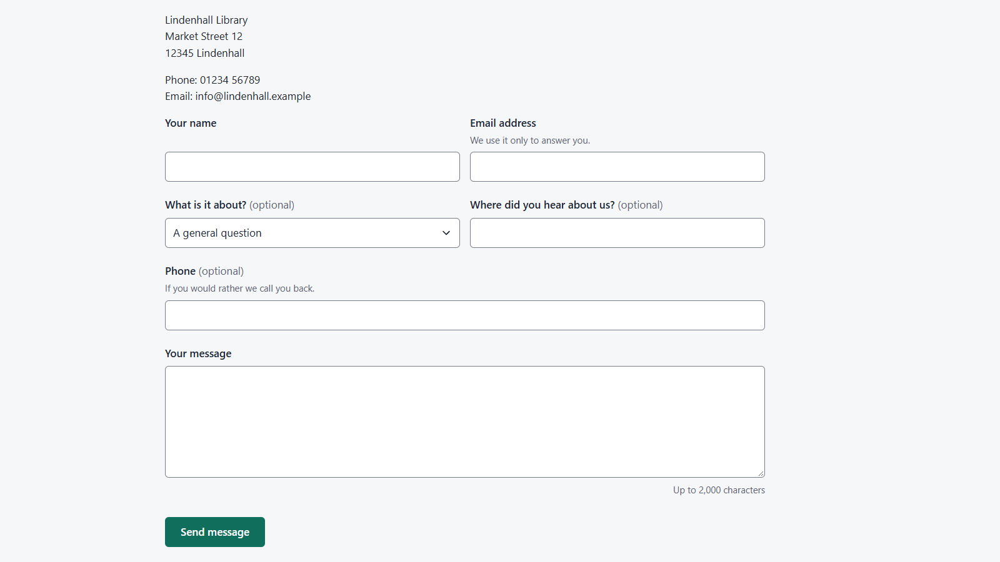
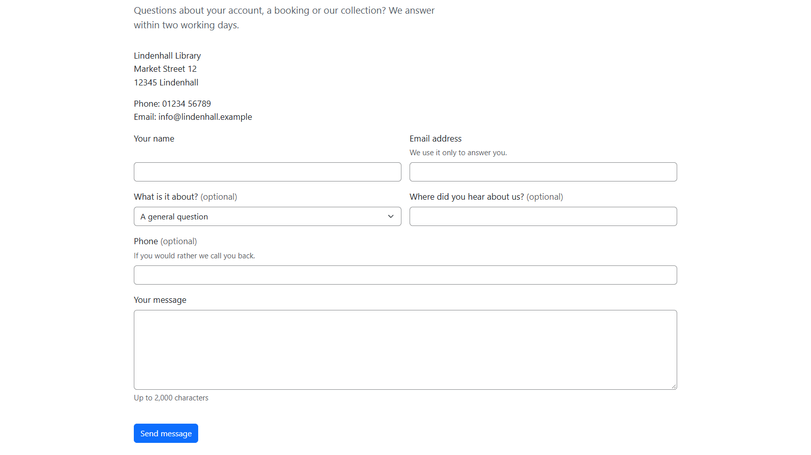
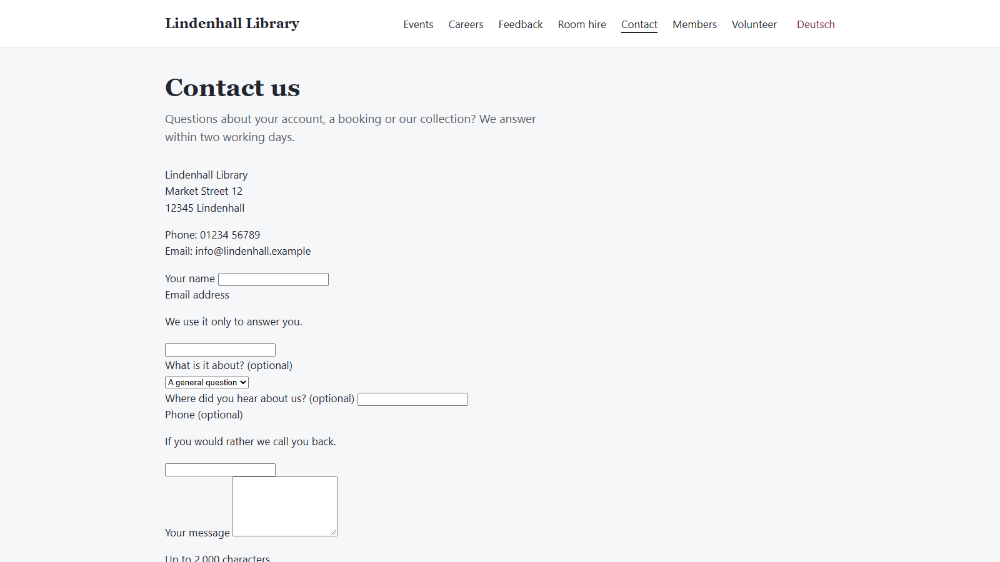
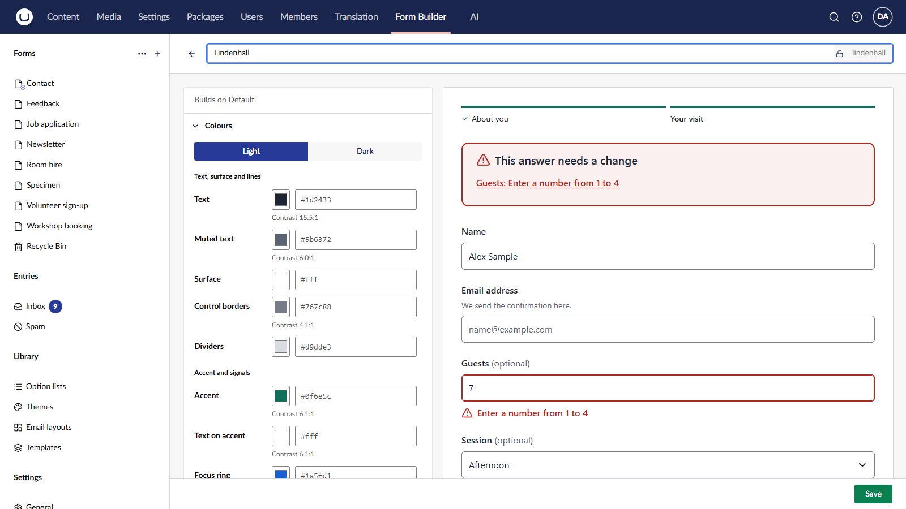

# Themes

How forms look on the website. A theme sets a form's colours, type, spacing and corners; the theme editor in the library
lets you make your own without writing CSS, with every colour checked for contrast as you choose it.

## Contents

- [The built-in themes](#the-built-in-themes)
- [Which theme a form uses](#which-theme-a-form-uses)
- [Making a theme](#making-a-theme)
- [Contrast](#contrast)
- [Custom CSS](#custom-css)
- [Sharing and deleting themes](#sharing-and-deleting-themes)

## The built-in themes

| Theme | Looks |
| --- | --- |
| Default | A calm, complete look, with a dark scheme the site can switch on. It takes the site's own font and size. |
| Bootstrap 5 | Bootstrap's own classes, for sites that load Bootstrap 5 themselves; the package never ships Bootstrap. |
| Unstyled | Only the few rules every form needs to work, such as hiding what should be hidden, for sites that style forms entirely themselves. |

Developers can add themes in code and change a theme's views ([rendering.md](rendering.md)).

## Which theme a form uses

The first of these that is set wins:

1. **Where it is placed:** the form picker's **Theme**, or the theme a developer names in a view;
2. **The form:** its Settings view › Appearance › **Theme**;
3. **The site:** Settings › General › **Default theme**, for all sites or one;
4. **Default.**

## Making a theme

**Library › Themes › Create theme** asks which theme the new one builds on, then opens its editor: the settings beside a
live preview of a sample form, in light and, for a base with a dark scheme, dark. Your theme changes only what you set,
and follows the base theme for the rest.

| Section | Settings |
| --- | --- |
| Colours | Text, muted text, surface, control borders and dividers; accent, text on accent, focus ring and errors; button, text on the button and button on hover. Light and dark side by side. |
| Type | The font (the site's, a system font, or your own), the size (the site's, or 14 to 24 pixels), and how much headings and small text differ from the text. |
| Spacing and corners | Compact, default or roomy spacing, and the corner radius, 0 to 24 pixels. |
| Buttons and focus | A filled or outlined primary button, and the width of the focus ring, 2 to 4 pixels. |
| Other tokens | Every other value the base theme offers. |
| More options | Custom CSS ([below](#custom-css)). |

A theme built on Bootstrap 5 or Unstyled, which have no values to set, offers only custom CSS.

The list shows how many forms use each theme, and a theme's header lists them. **Save** applies a theme to every form
that uses it at once, without publishing them.

## Contrast

Every colour is checked as you choose it, so forms stay readable for everyone (WCAG 2.2 AA):

| Colour | Must reach |
| --- | --- |
| Text, muted text, errors | 4.5:1 on the surface |
| Control borders, focus ring | 3:1 |
| Accent | 3:1 on the surface |
| Text on accent | 4.5:1 on the accent |
| Button | 3:1 on the surface |
| Text on the button | 4.5:1 on the button |
| Button on hover | 4.5:1 against the button's text |
| Dividers | no minimum, as they only decorate |

A colour that falls short says by how much, and offers the nearest colour of the same hue that passes, with **Use**.

## Custom CSS

**More options › Custom CSS** takes rules for this theme's forms alone, up to 64 KB. Every selector is put under the
theme's class, so a rule can't reach the rest of the page. Anything that could load from elsewhere or run code is taken
out, and the editor lists what it removed: imports, addresses and fonts on other sites, scripts, and selectors of what is
around the form.

## Sharing and deleting themes

- **Export** in a theme's **…** menu saves it as a JSON file; **Import a theme…** in the list's **…** menu makes a new
  theme from one, on this site or another.
- **Duplicate** copies a theme to try something out.
- **Delete…** works for a theme no form uses and that isn't the site's default; otherwise it lists the forms to change
  first.

Needs the **Manage the library** permission. Email has layouts of its own, in Library › Email layouts
([email.md](email.md#email-layouts)).
