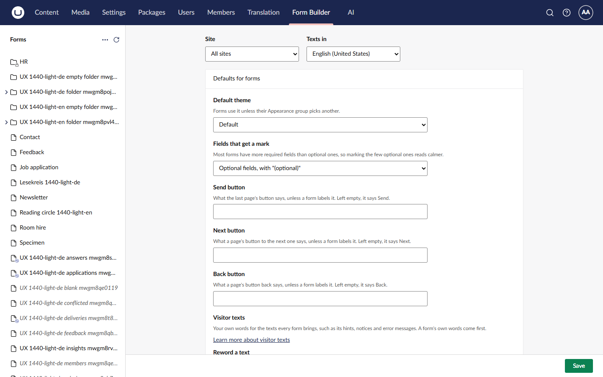
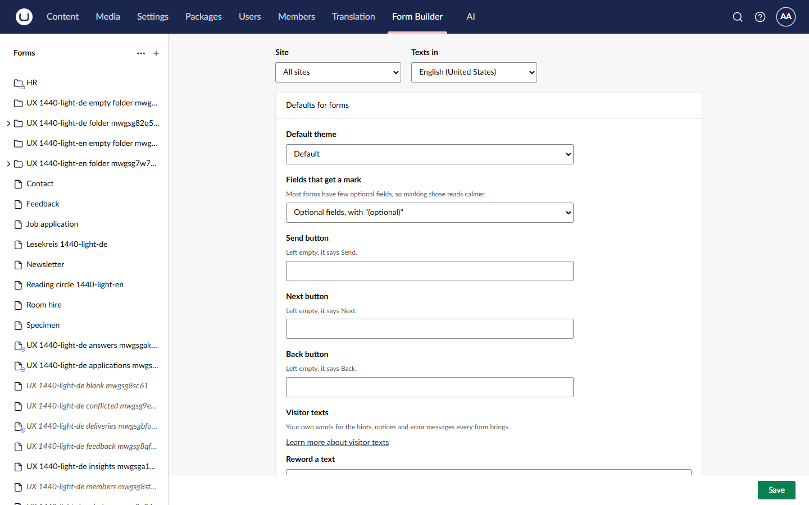
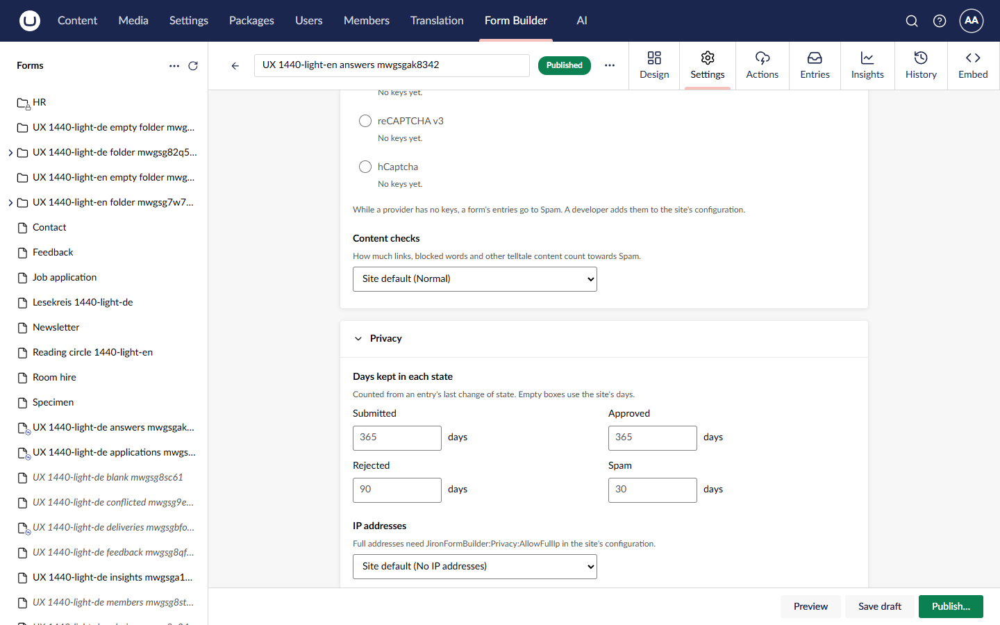

# Review 21.1: the last pass

The owner asked for one last pass (2026-11-14): go through every function roughly again, clear what is found, and
keep the screens plain and simple, without a feature less. This is what was looked at, what was found and what became
of each finding. The decisions that change an earlier record are in
[ADR-0252](../decisions/0252-the-last-pass.md).

## How it ran

1. **A walk of the build 20.1 verified:** all twelve looks (375, 768 and 1440 px, light and dark, English and
   German), 1,784 shots, every screen reached, and the visitor's side in seven languages.
2. **Eight readers of the code and the guides,** each with one area and the task of finding what is wrong, not what is
   right: saving for later (R1), the submission pipeline (R2), actions and delivery (R3), entries, privacy and access
   (R4), forms and their storage (R5), the website runtime and views (R6), the backoffice's state (R7) and the guides
   against the product (R8).
3. **Eight readers of the screens,** each with the shots and the dictionaries of one area: Overview and Library (U1),
   the designer (U2), a form's Settings, publishing and History (U3), actions and Deliveries (U4), entries and Insights
   (U5), Settings, Privacy and Access (U6), the library's editors (U7), the visitor's side in seven languages (U8).
4. Every fix was written with a test that fails without it. The readers only read.

## What the code readers found

| | Finding | What became of it |
| --- | --- | --- |
| R1.1 | A resumed tab applied its draft again whenever the page woke, so a form with a summary page could not be sent | fixed: a form written from a post or put in another's place restores nothing |
| R1.2 | "Other" texts and options that follow a parent never came back | fixed |
| R1.3 | A save the mail limit held back deleted the draft it replaced | fixed: the old draft goes once the new mail is queued |
| R1.4, R2.1 | Saving spent what the same page's Send needed; files attached before a save were refused | fixed: a draft's challenge is a mark of its own |
| R1.5 | An entry sent by post left its draft, link and tab token | fixed: the post names the draft |
| R1.6 | An answer the visitor cleared came back as the default | fixed |
| R1.7, R2.4 | Saving an untouched form asked for an email address | fixed |
| R1.8 | The focus left "Welcome back" for a repeater's row | fixed |
| R2.2 | A post without JavaScript to a form that stores no entries showed no outcome | fixed: the message is answered on the post |
| R2.3 | The same post repeated on a members' form with a file is answered "not sent" | kept: needs a digest by content; named in STATUS.md |
| R3.1 | Every mail over SMTP carried an `Expires` header 45 seconds ahead | fixed: none is written |
| R3.2 | A designer could import an action that sends a site's secret | fixed: only who manages settings imports such a file |
| R3.3 | One hanging webhook host could stop all mail | kept: a time budget for each queue stalled the browser suite's SQLite site in every long run and was taken out again (ADR-0252); mail is delayed, not lost |
| R3.4 | Failing to read a run spent its attempts | fixed |
| R4.1 | Privacy > People could not find a draft once its mail was 30 days old | fixed: the mail's row stays while the draft does |
| R4.2 | A field marked sensitive later stayed readable in older entries' panel, forward and edit | fixed for all three; kept: the search text stored with an older entry holds the answer until the entry is edited, so a search for it finds the entry and shows no answer |
| R4.3 | The timeline shows a mail's subject that holds a sensitive answer | kept: the subject is what the form's author chose to mail |
| R4.4 | Editing the confirmed address kept "confirmed" | fixed: that answer is not edited |
| R4.5 | An edit brought back an answer kept only until the actions ran | fixed |
| R4.6 | The guide asked for Edit entries to add a note | fixed in the guide: View entries |
| R5.1 | The mirror wrote over a form's own file it could not read | fixed |
| R5.2 | A form naming an option list the site lacks went live | fixed: the form check's error `option_list_missing` |
| R5.3 | One refused file ended every mirror pass | fixed |
| R5.4 | A theme or email layout that was only one site's default could be deleted | fixed |
| R5.5 | A form whose first mirror publish was refused stays unpublished until its file changes | kept: the log names the file and the reason |
| R5.6 | One visitor's aborted request failed others' theme read | fixed |
| R6.1 | A decimal comma was refused, and so was the message's own example | fixed in the page and in the post without JavaScript |
| R6.2 | Rewording two texts without their value took forms off the site | fixed |
| R6.3 | A half-typed date or number was sent as empty | fixed |
| R6.4 | A runtime or chunk that failed to load left Send dead and silent | fixed, in the views and in the element |
| R6.5 | Any 200 counted as a stored entry | fixed |
| R6.6 | Notices said "your answers" three times | fixed with the visitor's words below |
| R6.7 | The page slide never played | fixed: pages say which way they turn |
| R7.1 | Undo of a panel's move went to the wrong form; a late answer showed the entry before | fixed |
| R7.2 | Access and Settings dropped unsaved changes | fixed: both keep them and ask before they are left, as Retention does now |
| R7.3 | Deleting every loaded row said "No entries yet" while more remained | fixed |
| R7.4 | On narrow views the panel lost the focus, and an entry that failed to read had no way out | fixed |
| R7.5 | The tree kept a form "not published" after Publish | fixed |
| R7.6 | Under a one-state filter a moved row showed no change | fixed |
| R7.7 | Ctrl+S skipped the box being typed in | fixed |
| R8.1 to R8.13 | Thirteen places where a guide said less or other than the product | fixed in the guides |
| U1 | Emptying the Recycle Bin did not name the folders that go with the forms | fixed |

## What the screen readers found

About 170 texts and 40 small matters of structure, per area in English and German. The rules they were decided by are
in ADR-0252. In numbers: the backoffice's dictionaries went from 20,693 to 19,363 words in English and from 21,064 to
19,674 in German; 62 help lines are gone, 289 texts are shorter.

**Kept as they were, with the reason:**

- a line under every choice of a list (three the readers would have cut): a list reads evenly;
- the help under the Send, Next and Back labels, now one short sentence ("Left empty, it says Send."), as the box
  shows no placeholder;
- what an empty box means under Opens and Closes and under the entry limit;
- the numbers in the export dialog's choices, which help to choose;
- "No German text yet" on the canvas, which names the language;
- every trigger's section in a form's Actions view, and the third-party captcha box on Spam protection;
- the sample answers that name their fields in previews (16.6 decided it; two readers took it for a fault);
- the message tables and the mails in seven languages (ADR-0252);
- the entry panel, History and the audit log at 375 px, below the widths the backoffice supports.

**Structure, done:** the Access screen says once that forms can differ; the outcome list's note shows from two
outcomes on; "Who may fill it in" explains members only once members are chosen; the erase dialog's button says what
the choice does; the state tag in Deliveries never breaks; the colour scheme switch of the email layout editor hugs
its two buttons; the workspace's state in German is one short phrase.

**Structure, left for a later pass** (none is a fault; each changes a screen's build more than a last pass should):
the fixed Administrators column of Access; "Run order" and "Stop the rest" under More options; the digest dialog's
test button in the footer; the Spam list without its Actions column; one Light/Dark switch for the email layout
editor's colours and preview; "Change type" out of the inspector's header; the audit entry's sidebar without its Who
row; folding sections in the email layout editor.

## The words each screen shows

The walk now counts the words the section's own elements show on each screen, and the sheets compare two walks
(`JFB_UX_BEFORE`). The comparison is like for like: the build before the pass (`00e1494c`) and the final build, each on
a fresh site, in the two looks 1440 px light in English and in German, 147 screens each.

- **English:** 33,836 words before, 31,666 after. **German:** 32,160 before, 30,165 after.
- Of the 294 shots, 184 show fewer words, 91 the same, and 19 more.
- **The 19 that show more grew by a row of data, not by a text.** Two looks share one site while they are walked, so a
  list holds what the other look has done by then: the Overview behind six dialogs and journey steps shows a second
  health line ("1 action failed in the last 24 hours") once the walk's own failing webhook has given up; the Recycle
  Bin holds one more row in German and two fewer in English; the audit log holds one more row in German. They are
  named to the comparison (`JFB_UX_GROWN`) after being looked at, and no text on them changed but for the shorter ones.

The screens that changed most, in words:

| Screen | English, before | after | German, before | after |
| --- | ---: | ---: | ---: | ---: |
| general-settings | 354 | 215 | 334 | 201 |
| settings-privacy | 557 | 427 | 543 | 420 |
| translate-settings | 476 | 372 | 466 | 366 |
| settings-appearance | 405 | 303 | 389 | 294 |
| settings-developer | 473 | 371 | 456 | 361 |
| settings-after | 503 | 419 | 486 | 409 |
| settings-outcome | 503 | 419 | 486 | 409 |
| settings-outcome-redirect | 503 | 419 | 486 | 409 |
| settings-problem | 503 | 419 | 486 | 409 |
| settings-site | 194 | 121 | 179 | 110 |
| settings-protection | 334 | 266 | 322 | 265 |
| settings-spam | 329 | 271 | 329 | 262 |
| settings-more | 277 | 221 | 270 | 216 |
| data-collection | 247 | 196 | 243 | 194 |
| settings-availability | 226 | 185 | 221 | 182 |
| email-layouts-editor | 117 | 80 | 112 | 73 |
| translate-dictionary | 354 | 323 | 346 | 309 |
| translate-inspector | 336 | 305 | 327 | 290 |
| translate-picker | 336 | 305 | 327 | 290 |
| settings-email | 95 | 65 | 94 | 62 |
| rule-builder | 535 | 506 | 521 | 489 |
| undo-toast | 545 | 515 | 534 | 503 |
| settings | 155 | 124 | 153 | 124 |
| templates | 174 | 144 | 146 | 121 |
| themes-editor | 106 | 80 | 109 | 83 |
| settings-integrations | 131 | 108 | 120 | 100 |
| j3-4-retention | 150 | 133 | 147 | 127 |
| change-type | 522 | 505 | 507 | 491 |
| folder-name | 250 | 206 | 201 | 212 |
| inspector-sections | 515 | 499 | 497 | 480 |

## The walk on the final build

All twelve looks and the five journeys reached every screen: 1,784 shots, none with an error, and the visitor's side
in seven languages. A stall of the test site's SQLite database, which the suite reports as Umbraco's limit, stopped
seven looks half-way; those were walked again.

Axe inside the section's own elements found what it found on the build 20.1 verified, and nothing of the section's
own:

- Umbraco's and its UI library's own components: a tree item's label that differs from its visible name, the colours
  of an open tree row in the dark theme, a checkbox's `indeterminate` state, the entity actions' target in the Recycle
  Bin, and the label colour of one of its buttons in the dark theme, in one shot at 768 px.
- Two controls of an action's sidebar that the sidebar's own footer half covered at the moment of the shot (the fourth
  trigger at 375 px in German, a toolbar button of the mail's body at 768 px): scrolled into view, the first is an
  18 px radio in a row 44 px high that selects it, the second a 32 px button.

## The visitor's side in seven languages

- **Shorter:** the save panel's intro, the "welcome back" notice, the signature's hint, the "not sent" notice, the
  upload's stop, and the confirm page's two lines.
- **Translation faults:** Danish said "saved" where it meant "kept" in nine notices and doubled a word before a date;
  Spanish named the post where it meant email, and "complete" where a form is filled in; French paired "Suivant" with
  "Retour"; Italian opened a form "from the" weekday; Dutch counted submissions where it meant answers; four
  languages could break a line between a number and KB or MB; English said "agreement" for a consent.
- **One heading** for a link that no longer works, on the form and on the confirm page.

## The three design skills

Each skill looked at the screens the pass changed, on the shots of the walk before and the walk after
(ADR-0019, ADR-0020). None asked for a new component, a new colour or motion: the pass removes, it does not add.

### design-taste-frontend

- **Design read:** an operating tool for editors inside Umbraco's backoffice, with a calm, plain language, leaning on
  Umbraco's own UI library and tokens. The skill's dials for such a surface are low variance, low motion and a middle
  density; the pass leaves variance and motion alone and lowers density by words, not by layout.
- **What it checked:** no decoration came in to fill the room the words left (no icon rows, no cards, no gradients);
  one accent, Umbraco's; one radius and one type scale, both the backoffice's; every button text on one line, also in
  German; empty, loading and error states still say what to do (the entry panel's failed state gained "Try again").
- **What it asked for, and got:** the state tag in Deliveries on one line ("Trying again" broke inside its pill); the
  colour scheme switch of the email layout editor no wider than its two buttons; the link row above the Access table
  with its own space, where it touched the table's border.
- **Kept:** the settings boxes keep their full-width inputs; a form of labelled boxes reads faster than a denser grid.

### impeccable

The surface's mode is Operate: the editor completes a task, so scanability and sameness outrank expression. The skill's
distill and clarify lenses, in its bounded two rounds (the walk before, the walk after).

| Heuristic | Before | After |
| --- | --- | --- |
| Say it once | a box's lead, a field's help and a choice's line often said the same thing three times (Settings: General, Privacy; a form's Privacy group) | each fact once, at the control it belongs to |
| A help line earns its place | 62 help lines repeated their label or named the screen | gone; a field without a help line draws none, and the rhythm of label, help, control stays where a help says something |
| Messages name the thing | "This form can't be published yet: 1 error needs fixing." | "1 error blocks publishing." |
| One word per thing | German mixed Header and Kopfzeile, Log and Protokoll, sensibel and vertraulich, anlegen and erstellen | one each, as the copy guide has them |
| Buttons say what they do | the erase dialog's button said "Erase 6 entries" for both choices | "Anonymise 6 entries" once that is chosen |
| Nothing is lost silently | Access and Settings dropped unsaved changes on a reread or when left | both keep them and ask first |

Left as found, on purpose: the three "Left empty, it says ..." lines under the button labels read alike; a placeholder
in the empty box would say it without a line, and belongs with the larger ideas the review lists for later.

### emil-design-eng

| Before | After | Why |
| --- | --- | --- |
| Help under every setting, whatever it said | Help only where it says what the label cannot | Unseen details compound: a screen is read faster when every line on it is worth reading |
| A state tag that could wrap inside its pill | `white-space: nowrap` on the tag | A pill that breaks reads as two things |
| The scheme switch stretched across its column | `justify-self: start` | A control is as wide as what it holds |
| The links above the Access table touched its border | the note's space below them | Things that are not one thing do not touch |
| A late answer could paint the entry before in the panel | only its own entry takes it, and the panel takes the focus once it has read | What the screen shows is what was asked for, at the moment it is asked |
| The tree said "not published" after Publish | it follows at once | Feedback at the place the eye is |
| Ctrl+S saved without the box being typed in | the typing is taken first | A shortcut does what the button does |

No animation was added or changed: every screen the pass touched is one an editor uses many times a day, where the
skill's own rule is to animate nothing new. The page slide on the website, which never played because nothing set its
direction, plays now, with the duration and the easing of the theme's own tokens, which reduced motion sets to none.
